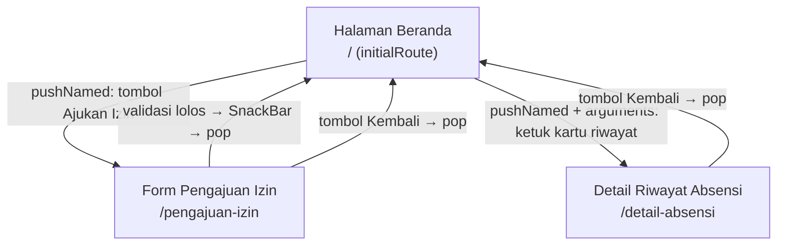

# Navigation Flow — PresentGo

**Nama:** <isi nama>
**NIM:** 230660221004

## Daftar Route

| Layar pada IA | Nama route | Dibuka dari | Data yang dikirim | Kebutuhan yang dipenuhi |
|---|---|---|---|---|
| Halaman Beranda (layar utama) | `/` | Awal (`initialRoute`) | — | F-02, F-03 |
| Halaman Pengajuan Izin | `/pengajuan-izin` | Tombol "Ajukan Izin" (`pushNamed`) | — (form diisi pengguna) | F-05 |
| Detail Riwayat Absensi | `/detail-absensi` | Ketukan kartu riwayat pada Beranda (`pushNamed` + `arguments`) | Objek `AttendanceRecord` (read-only) | F-04 |

## Diagram Navigation Flow

## Alasan Pemilihan `initialRoute`

Halaman Beranda dipilih sebagai `initialRoute` karena memenuhi dua kebutuhan Must have sekaligus (F-02 absen masuk, F-03 absen pulang) dan merupakan layar yang paling sering dibuka oleh persona Karyawan Lapangan di sela waktu kerja (5–10 menit), sehingga harus menjadi titik masuk aplikasi tanpa langkah tambahan.
