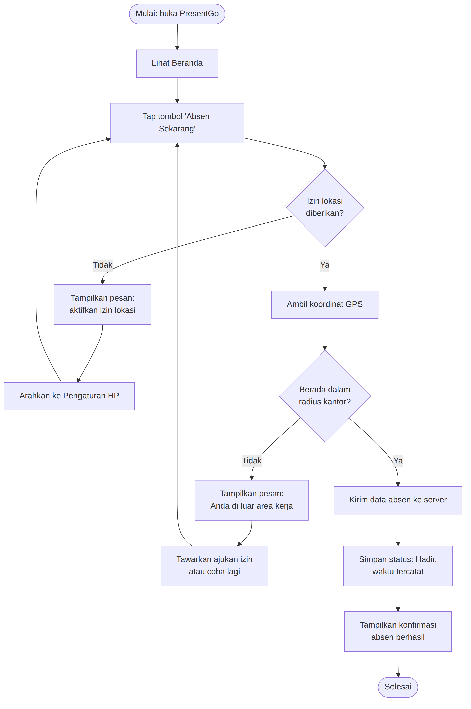
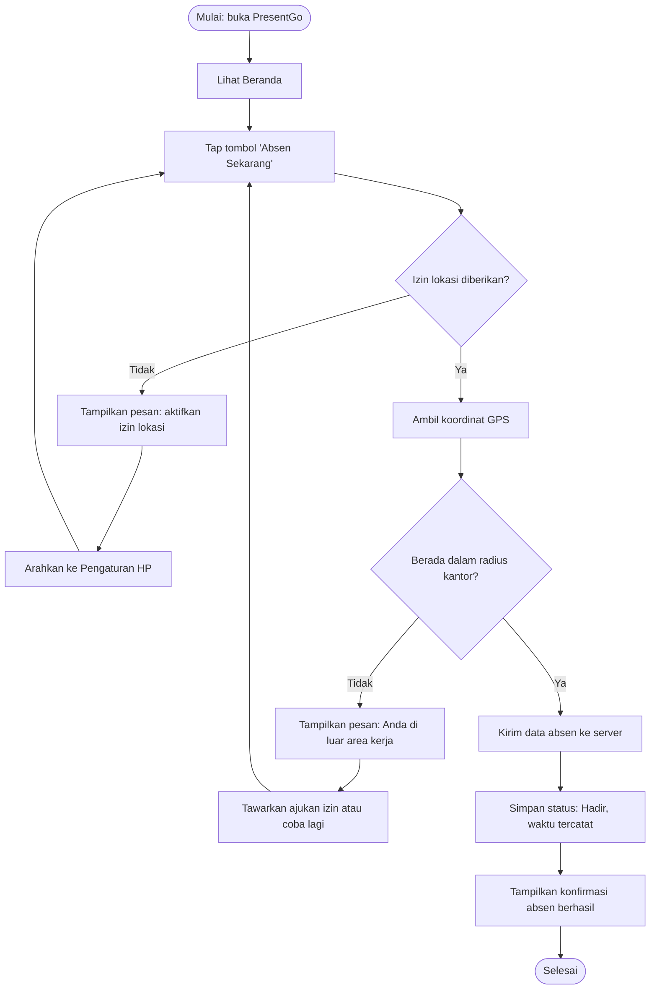

# Dokumen Kebutuhan dan User Flow — PresentGo

**Nama:** Rian Rianto
**NIM:** 230660221004
**Domain SI:** Absensi organisasi (PT Kencana Makmur Lestari)

## 1.1 Deskripsi Aplikasi

PresentGo adalah aplikasi absensi mobile untuk PT Kencana Makmur Lestari. Karyawan yang bekerja di luar kantor atau berpindah lokasi kesulitan melakukan absensi lewat mesin fisik di satu titik, sehingga pencatatan kehadiran sering terlambat diketahui dan rentan terhadap titip absen. PresentGo dibangun sebagai aplikasi mobile karena memanfaatkan GPS perangkat untuk memvalidasi lokasi karyawan secara langsung saat absen, dan karena absensi adalah aktivitas dengan sesi penggunaan singkat yang dilakukan berulang kali setiap hari sehingga cocok diakses lewat genggaman tanpa harus login ke sistem desktop.

## 1.2 User Persona

### Persona 1 — Karyawan Lapangan

| Komponen | Deskripsi |
|---|---|
| Nama dan peran | Karyawan Lapangan (merepresentasikan staf operasional yang berpindah lokasi kerja) |
| Tujuan | Mencatat kehadiran secara akurat tanpa harus kembali ke kantor pusat |
| Kendala | Sinyal internet tidak stabil di lokasi kerja; waktu terbatas karena sedang bertugas |
| Perangkat dan konteks | Ponsel Android pribadi, dipakai sambil berdiri di lapangan atau di dalam kendaraan |
| Frekuensi penggunaan | 2 kali sehari (absen masuk dan pulang), setiap hari kerja |

### Persona 2 — Staf HRD

| Komponen | Deskripsi |
|---|---|
| Nama dan peran | Staf HRD (merepresentasikan petugas yang mengelola data kehadiran) |
| Tujuan | Memantau kehadiran karyawan secara real-time dan menyetujui pengajuan izin |
| Kendala | Jumlah karyawan yang banyak membuat rekap manual memakan waktu; perlu memverifikasi keabsahan bukti izin |
| Perangkat dan konteks | Laptop dan ponsel kantor, dipakai di meja kerja pada jam kerja |
| Frekuensi penggunaan | Beberapa kali sehari untuk memeriksa laporan dan menanggapi pengajuan izin |

## 1.3 Kebutuhan Fungsional

- **F-01** Karyawan dapat login menggunakan akun perusahaan untuk mengakses aplikasi.
- **F-02** Karyawan dapat melakukan absen masuk melalui tombol absen ketika berada dalam radius lokasi kerja yang ditentukan.
- **F-03** Karyawan dapat melakukan absen pulang melalui tombol absen yang sama pada akhir jam kerja.
- **F-04** Karyawan dapat melihat riwayat kehadirannya sendiri dalam satu bulan terakhir.
- **F-05** Karyawan dapat mengajukan izin atau sakit disertai unggahan foto bukti pendukung.
- **F-06** Karyawan menerima notifikasi pengingat apabila belum melakukan absen masuk setelah jam kerja dimulai.
- **F-07** Staf HRD dapat melihat rekap kehadiran seluruh karyawan pada rentang tanggal tertentu.
- **F-08** Staf HRD dapat menyetujui atau menolak pengajuan izin yang masuk dari karyawan.

Uji keterukuran: setiap kebutuhan di atas dapat diverifikasi dengan mencoba aksinya secara langsung dan mengamati hasilnya di aplikasi (misalnya F-02 diverifikasi dengan mencoba tombol absen di dalam dan di luar radius, lalu memeriksa apakah status kehadiran tercatat sesuai kondisi tersebut).

## 1.4 Kebutuhan Nonfungsional

- **NF-01 (Kinerja)** Proses pengiriman data absen ke server selesai dalam waktu kurang dari 3 detik pada kondisi jaringan 4G normal.
- **NF-02 (Keamanan)** Koordinat lokasi karyawan hanya disimpan pada saat proses absen berlangsung dan tidak dapat diakses oleh karyawan lain selain dirinya sendiri dan staf HRD.
- **NF-03 (Kegunaan)** Tombol absen dapat dijangkau dan ditekan dengan satu tangan pada layar ponsel berukuran 5 sampai 6.5 inci.

## 1.5 Prioritas MoSCoW

| Kebutuhan | Prioritas | Alasan |
|---|---|---|
| F-01 Login | Must have | Tanpa login, identitas karyawan pada data absen tidak dapat dipastikan |
| F-02 Absen masuk | Must have | Fungsi inti aplikasi sesuai tujuan utama Karyawan Lapangan |
| F-03 Absen pulang | Must have | Melengkapi pasangan data jam kerja yang dibutuhkan HRD untuk rekap |
| F-04 Riwayat kehadiran | Must have | Dibutuhkan Karyawan Lapangan untuk memastikan absennya tercatat benar |
| F-07 Rekap kehadiran HRD | Must have | Fungsi inti bagi Staf HRD untuk memantau kehadiran |
| F-05 Pengajuan izin | Should have | Penting bagi Karyawan Lapangan, tetapi aplikasi tetap berfungsi tanpanya di rilis awal |
| F-08 Persetujuan izin HRD | Should have | Mengikuti F-05; dibutuhkan agar alur izin lengkap, tetapi belum menjadi fungsi inti absen harian |
| F-06 Notifikasi pengingat | Could have | Meningkatkan kepatuhan absen Karyawan Lapangan, tetapi bukan penghalang jika belum tersedia |
| Integrasi slip gaji otomatis | Won't have (iterasi ini) | Melibatkan sistem penggajian terpisah; ditunda sampai modul HRD inti selesai dan stabil |

Jumlah fitur Must have: 5 (sesuai batas maksimal).

## 1.6 User Flow — Alur Absen Masuk Karyawan Lapangan

Alur ini menggambarkan tujuan utama Karyawan Lapangan: berhasil mencatat kehadiran lewat absen masuk.

Alur ini memiliki 12 langkah dan 2 titik keputusan (izin lokasi, dan radius kantor), masing-masing dengan cabang gagal yang mengarahkan pengguna kembali mencoba, bukan jalan buntu.

## 1.7 Pemetaan Kebutuhan ke Antarmuka

| Kebutuhan | Halaman | Widget yang direncanakan |
|---|---|---|
| F-01 Login | Halaman Login | `TextField` (email/kata sandi), `ElevatedButton` |
| F-02 Absen masuk | Halaman Beranda | `FloatingActionButton` ("Absen Sekarang"), `AlertDialog` konfirmasi |
| F-03 Absen pulang | Halaman Beranda | `FloatingActionButton` (sama dengan F-02, berubah label sesuai status) |
| F-04 Riwayat kehadiran | Halaman Riwayat Absensi | `ListView.builder`, `Card`/`Row` per entri |
| F-05 Pengajuan izin | Halaman Pengajuan Izin | `TextField` (alasan), `ImagePicker` + `Image.file`, `ElevatedButton` kirim |
| F-06 Notifikasi pengingat | Sistem (notifikasi lokal) | `flutter_local_notifications` (di luar tampilan halaman) |
| F-07 Rekap kehadiran HRD | Halaman Rekap HRD | `DataTable` atau `ListView.builder`, `DropdownButton` filter tanggal |
| F-08 Persetujuan izin HRD | Halaman Daftar Pengajuan Izin | `ListView.builder`, `IconButton` (setuju/tolak) |

Catatan: kolom widget belum final dan akan diperhalus pada materi Pertemuan 5.
