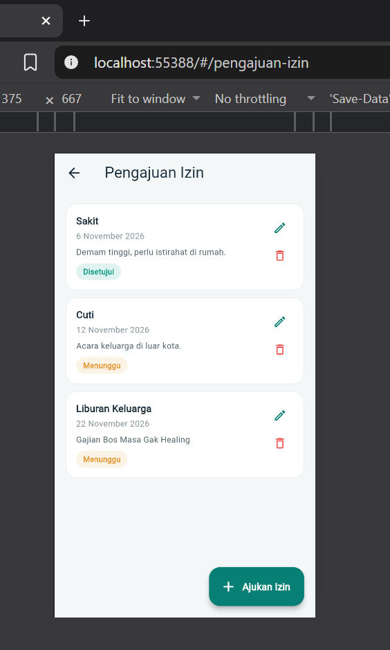
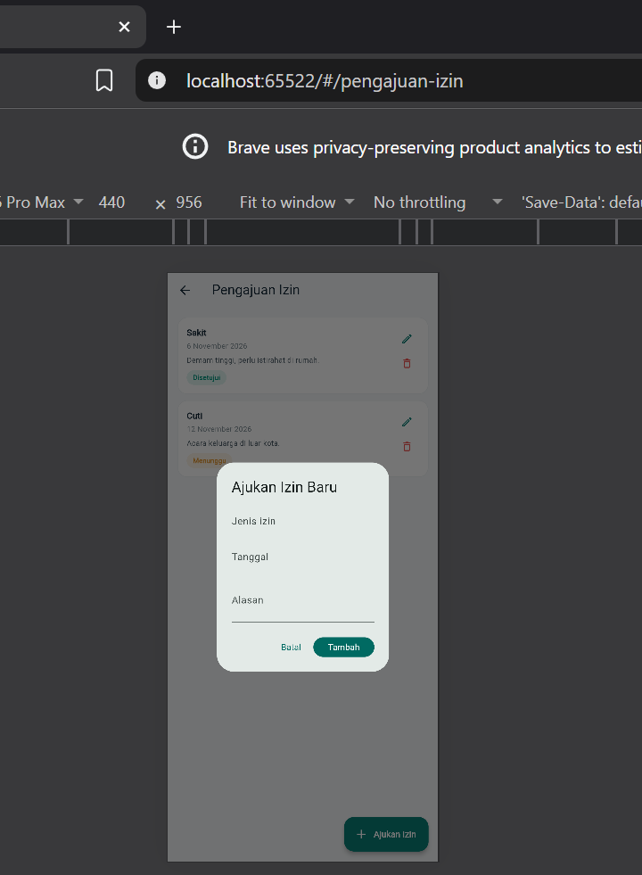
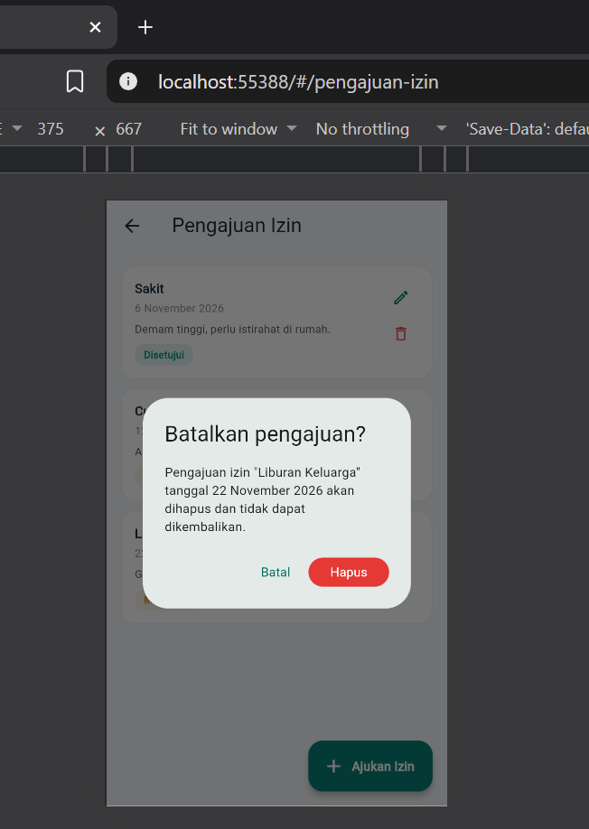

# Laporan Progress Project UTS (Milestone M4)

| | |
|:--|:--|
| **Nama** | Rian Rianto |
| **NIM** | 230660221004 |
| **Kelas** | SI-VIIB |
| **Domain SI** | Absensi organisasi (PT Kencana Makmur Lestari) |
| **Judul Aplikasi** | PresentGo |
| **Tautan Repository** | https://github.com/230660221004/SI-VIIB-Mobile/tree/230660221004/tugas-8 |

---

## 1. Ringkasan Eksekutif Project

PresentGo adalah aplikasi absensi mobile untuk PT Kencana Makmur Lestari. Karyawan yang bekerja di luar kantor atau berpindah lokasi kesulitan absen lewat mesin fisik di satu titik, sehingga kehadiran sering terlambat diketahui dan rentan titip absen. Pengguna aplikasi adalah Karyawan Lapangan, yang mencatat absen masuk dan pulang serta mengajukan izin, dan Staf HRD, yang memantau rekap kehadiran dan menyetujui izin.

Solusi mobile dipilih karena absensi adalah aktivitas dengan sesi penggunaan singkat yang dilakukan berulang kali setiap hari, dan karena ponsel dapat memanfaatkan GPS untuk memvalidasi lokasi karyawan saat absen. Pada tahap UTS, aplikasi sudah memiliki beranda dengan riwayat absensi, navigasi ke halaman detail dan halaman pengajuan izin, serta CRUD lokal untuk pengajuan izin.

## 2. Ketercapaian Milestone (M1 s.d. M3)

| Milestone | Deliverable | Status (Selesai / Sebagian) | Catatan / Bukti |
|:----------|:------------|:----------------------------|:----------------|
| M1: Kebutuhan | Dokumen kebutuhan + User Flow | Selesai | `kebutuhan.md` dan `user-flow.png` (Tugas 4): 2 persona, F-01 s.d. F-08, NF-01 s.d. NF-03, MoSCoW, user flow absen masuk |
| M2: UI/UX | Wireframe + Navigasi | Selesai | `prototype-ui-ux/` (Tugas 5: IA 6 layar, wireframe 2 layar, tema terpusat) dan `navigation-flow.md` (Tugas 6: 3 route bernama). Dari 6 layar pada IA, baru 3 yang diimplementasikan |
| M3: MVP Awal | Model data + CRUD lokal | Selesai | `crud-lokal.dart` (Tugas 7) dan `main-gabungan.dart` (beranda + navigasi + CRUD dalam satu aplikasi). Data masih in-memory (hilang saat aplikasi ditutup) |

## 3. Matriks Kebutuhan ke Implementasi

| ID Kebutuhan | Deskripsi Kebutuhan | Prioritas MoSCoW | Halaman Pemenuh | Operasi Data Terkait |
|:-------------|:-------------------|:----------------:|:----------------|:---------------------|
| F-01 | Karyawan dapat login dengan akun perusahaan | Must | Belum diimplementasikan (Halaman Login) | Read (autentikasi) — rencana M5 |
| F-02 | Karyawan dapat absen masuk melalui tombol absen | Must | Halaman Beranda (tombol "Absen Sekarang"; masih simulasi tanpa GPS) | Create — simulasi, belum disimpan |
| F-03 | Karyawan dapat absen pulang melalui tombol yang sama | Must | Halaman Beranda (label tombol berubah menjadi "Absen Pulang"; simulasi) | Create — simulasi, belum disimpan |
| F-04 | Karyawan dapat melihat riwayat kehadiran sendiri | Must | Halaman Beranda (Aktivitas terbaru) dan Halaman Detail Riwayat Absensi | Read (data statis) |
| F-05 | Karyawan dapat mengajukan izin atau sakit | Should | Halaman Pengajuan Izin (tanpa unggah foto bukti) | Create, Read, Update, Delete |
| F-06 | Karyawan menerima notifikasi pengingat absen | Could | Belum diimplementasikan | — |
| F-07 | Staf HRD dapat melihat rekap kehadiran | Must | Belum diimplementasikan (Halaman Rekap HRD) | Read — rencana M5 |
| F-08 | Staf HRD dapat menyetujui atau menolak izin | Should | Belum diimplementasikan (Halaman Persetujuan Izin HRD) | Update (status) — rencana M5 |

Keterbatasan yang diketahui: F-01, F-06, F-07, dan F-08 belum dibangun; F-02 dan F-03 hanya mengubah tampilan dan menampilkan `SnackBar`; F-05 belum mendukung foto bukti; seluruh data hilang ketika aplikasi ditutup.

## 4. Tangkapan Layar Aplikasi Berjalan

| No. | File | Bukti |
|:---:|:-----|:------|
| 1 | `
` | Halaman utama / daftar data (daftar pengajuan izin setelah data ditambah) |
| 2 | `
` | Form pengisian data dengan pesan validasi |
| 3 | `
` | Dialog konfirmasi hapus |

## 5. Kendala dan Solusi Teknis

| No. | Kendala | Cara Mengatasinya |
|:---:|:--------|:------------------|
| 1 | Unduhan Flutter SDK berbentuk zip diblokir Windows sebagai file berbahaya dari internet sehingga tidak bisa diekstrak | Mengambil Flutter lewat `git clone` repositori resminya, lalu menambahkan folder `bin` ke PATH dan memeriksanya dengan `flutter doctor` |
| 2 | `flutter run -d chrome` tidak menemukan browser karena browser yang terpasang adalah Brave | Mengatur variabel lingkungan `CHROME_EXECUTABLE` ke lokasi Brave |
| 3 | `flutter run` gagal dengan error `Undefined name 'main'` karena `lib/main.dart` masih berisi template counter bawaan, bukan kode PresentGo | Mengganti isi `lib/main.dart` dengan kode PresentGo yang benar, lalu menjalankan ulang dari root project |

## 6. Rencana Pengembangan Milestone M5 (REST API)

Data yang akan diambil dan dikirim lewat REST API (package `http`, `async`/`await`, dengan penanganan loading state dan error):

- **Login (F-01):** `POST /login` mengembalikan token untuk dipakai pada permintaan berikutnya.
- **Absen masuk/pulang (F-02, F-03):** `POST /absensi` mengirim waktu dan koordinat; server memvalidasi radius lokasi kantor.
- **Riwayat kehadiran (F-04):** `GET /absensi` untuk satu bulan terakhir, menggantikan data statis di beranda.
- **Pengajuan izin (F-05):** `GET`, `POST`, `PUT`, dan `DELETE /izin`, menggantikan `List` in-memory pada `crud-lokal.dart`.
- **Rekap dan persetujuan HRD (F-07, F-08):** `GET /rekap?dari=&sampai=` dan `PATCH /izin/{id}/status`.

Layanan backend yang dibutuhkan: server REST API dengan database untuk akun, absensi, dan izin; autentikasi berbasis token; validasi radius lokasi di sisi server; serta pembatasan akses data agar koordinat hanya dapat dilihat karyawan yang bersangkutan dan Staf HRD (NF-02).

## 7. Refleksi Pembelajaran Tengah Semester

Dari Minggu 1–7 saya memahami bahwa Flutter menyusun tampilan sebagai pohon widget, sehingga satu layar dibangun dari widget kecil yang bertumpuk seperti `Scaffold`, `Column`, `ListView.builder`, dan `Card`. Pengelolaan state dengan `setState` pada `StatefulWidget` menentukan apakah tampilan ikut berubah ketika data berubah, dan `id` unik pada model data membuat operasi ubah dan hapus lebih aman daripada memakai index. Tantangan terbesar adalah menjaga konsistensi antara dokumen kebutuhan, desain, dan kode, serta menyiapkan lingkungan pengembangan di Windows. Karena data masih in-memory dan hilang saat aplikasi ditutup, bagian itu yang ingin saya selesaikan melalui integrasi REST API pada M5.

## 8. Penggunaan AI

Deklarasi penggunaan AI: Claude (Anthropic) — membantu menyusun draf dokumen, desain, kode project Minggu 1–7, dan laporan ini berdasarkan domain yang ditentukan penulis; perbaikan kode, pengujian, dan penjelasan dilakukan serta diverifikasi oleh penulis.
