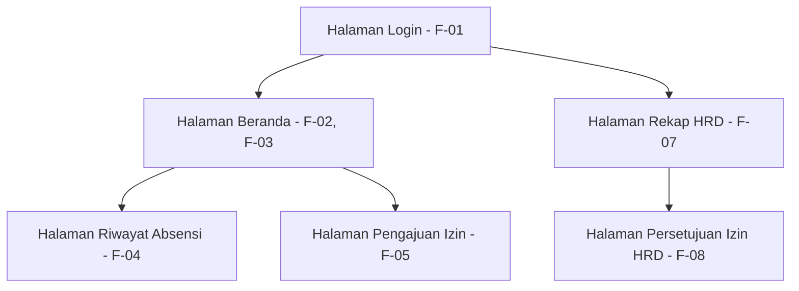

# Information Architecture — PresentGo

**Nama:** Rian Rianto
**NIM:** 230660221004

## Inventaris Layar

| Layar | Kebutuhan yang dipenuhi |
|---|---|
| Halaman Login | F-01 |
| Halaman Beranda | F-02, F-03 |
| Halaman Riwayat Absensi | F-04 |
| Halaman Pengajuan Izin | F-05 |
| Halaman Rekap HRD | F-07 |
| Halaman Persetujuan Izin HRD | F-08 |

Catatan: F-06 (notifikasi pengingat) tidak memiliki layar sendiri karena berbentuk notifikasi sistem, bukan halaman yang dikunjungi pengguna.

## Diagram IA

Halaman Beranda dan Halaman Rekap HRD sama-sama menggantung langsung di bawah Halaman Login, karena keduanya adalah titik masuk sesuai peran pengguna yang login (Karyawan Lapangan atau Staf HRD).

## Alasan Layar Utama

Halaman Beranda ditetapkan sebagai layar utama untuk peran Karyawan Lapangan karena memenuhi dua kebutuhan Must have sekaligus (F-02 absen masuk dan F-03 absen pulang), dan merupakan tugas yang paling sering dilakukan (2 kali sehari) sesuai persona Karyawan Lapangan pada Tugas 4. Layar ini harus terlihat tanpa menggulir agar aksi absen dapat dilakukan dengan cepat di sela waktu kerja di lapangan.
