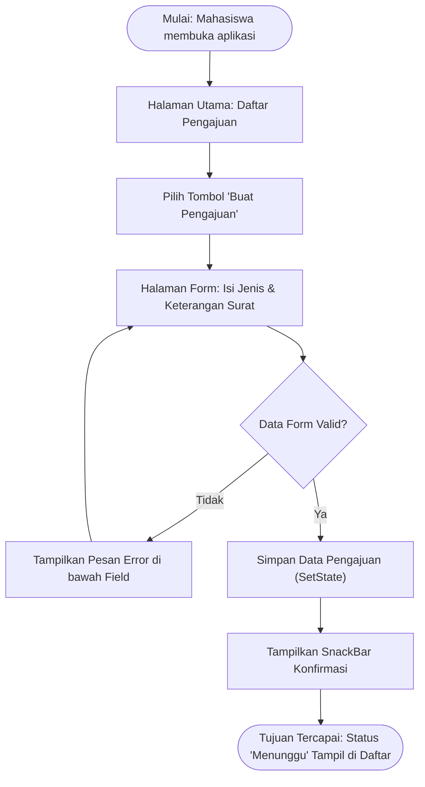

# Jawaban Tes Konsep UTS (Evaluasi Tengah Semester)

**Mata Kuliah:** Pemrograman Aplikasi Bergerak

**Berkas:** `tugas-8/tes-konsep-uts.md`

---

## Soal 1 (CPMK-1): Karakteristik Aplikasi Bergerak

### 1. 3 Karakteristik Utama Aplikasi Bergerak

1. **Portabilitas & Sesi Penggunaan Singkat (*Short Interaction Sessions*):** Aplikasi digunakan di mana saja dalam waktu relatif singkat (1–3 menit) di sela-sela aktivitas pengguna.


2. **Konektivitas Terbatas & Dinamis (*Variable Connectivity*):** Perangkat mobile berpindah antar-jaringan (Wi-Fi ke seluler) atau bahkan tanpa koneksi internet (*offline*).


3. **Ukuran Layar & Interaksi Sentuh (*Screen Size & Touch Interface*):** Ruang tampilan terbatas menuntut desain antarmuka yang ringkas, berhierarki jelas, serta ramah terhadap sentuhan jari pengguna.


### 2. Penerapan pada Kasus Pengajuan Surat Kampus

* **Sesi Singkat:** Mahasiswa dapat mengajukan surat keterangan aktif kuliah secara cepat di sela jam kuliah tanpa mengisi form yang panjang atau rumit.


* **Konektivitas:** Aplikasi menyediakan mekanisme penyimpanan draf lokal saat koneksi terputus dan mengunggahnya secara otomatis ketika terhubung kembali ke jaringan kampus.


* **Interaksi Sentuh:** Formulir pengajuan dirancang dengan tombol pilihan (*dropdown/radio button*) berukuran minimal $48 \times 48\text{ dp}$ agar mudah ditekan pada layar ponsel.


---

## Soal 2 (CPMK-1): Sintaks Kode Dart dan Validasi Data

### 1. Fungsi Komponen Kode Dart

* `List<String>`: Koleksi data bertipe `String` yang tersusun secara berurutan untuk menampung riwayat atau daftar surat.


* `String jenis`: Variabel penampung teks yang menyimpan jenis surat yang dipilih pengguna.


* `isEmpty`: Properti boolean yang memeriksa apakah suatu `String` atau `List` tidak memiliki karakter/elemen (bernilai `true` jika kosong).


* `return`: Kata kunci untuk menghentikan eksekusi fungsi dan mengembalikan nilai atau kontrol kembali ke pemanggil fungsi.


* `add`: *Method* bawaan pada `List` untuk menambahkan elemen baru ke bagian akhir koleksi.


* `for`: Struktur perulangan (*looping*) untuk melakukan iterasi pada elemen-elemen di dalam koleksi `List`.


### 2. Akibat Menghapus Validasi `isEmpty`

Jika validasi `isEmpty` dihapus, aplikasi akan mengizinkan pengiriman data formulir dalam keadaan kosong.

* **Konsekuensi Teknis:** Data yang tidak valid akan tersimpan ke dalam *state* atau basis data, memicu *runtime error* (seperti `FormatException` atau `NullPointerException`) saat data tersebut diolah lebih lanjut oleh fungsi visualisasi atau backend.


---

## Soal 3 (CPMK-1): Struktur Widget Flutter dan Penanganan Overflow

### 1. Fungsi Komponen Widget

* `MaterialApp`: Widget utama (*root*) yang mengonfigurasi tema aplikasi, gaya Material Design, dan sistem rute/navigasi.


* `Scaffold`: Kerangka dasar halaman yang menyediakan struktur visual utama seperti `AppBar`, `body`, dan `FloatingActionButton`.


* `AppBar`: Komponen bilah navigasi di bagian atas halaman.


* `Column`: Widget tata letak (*layout*) yang menyusun widget anak-anaknya secara vertikal.


* `Text`: Widget untuk menampilkan string teks di layar.


* `ListView.builder`: Widget *scrollable* yang membuat elemen daftar secara efisien (*lazy rendering*) hanya untuk item yang terlihat di layar.


### 2. Analisis Masalah Overflow & Solusi Kode

Memasukkan `ListView.builder` langsung ke dalam `Column` menyebabkan *error* **RenderFlex overflowed / Unbounded height assertion**.

* **Alasan Teknis:** `Column` memberikan tinggi tak terbatas (*unbounded vertical space*) kepada anak-anaknya, sedangkan `ListView.builder` membutuhkan batasan tinggi (*constrained height*) untuk menghitung area gulir.


* **Solusi Kode:** Membungkus `ListView.builder` dengan widget `Expanded`.


```dart
Column(
  children: [
    const Text('Daftar Surat Pengajuan'),
    Expanded(
      child: ListView.builder(
        itemCount: daftarSurat.length,
        itemBuilder: (context, index) {
          return ListTile(title: Text(daftarSurat[index]));
        },
      ),
    ),
  ],
)

```

---

## Soal 4 (CPMK-2): Analisis Kebutuhan, Prioritas MoSCoW, dan User Flow

### 1. Klasifikasi Kebutuhan

* **Kebutuhan Fungsional:**
* **F-01:** Mahasiswa dapat mengisi formulir pengajuan surat.


* **F-02:** Mahasiswa dapat melihat daftar dan status pengajuan surat.


* **F-03:** Admin dapat mengubah status persetujuan surat.


* **Kebutuhan Non-Fungsional:**
* **NF-01:** Waktu pemrosesan pengajuan dari *form* hingga tersimpan kurang dari 2 detik pada koneksi standar.


* **NF-02:** Antarmuka aplikasi harus menyesuaikan ukuran layar ponsel pintar dengan resolusi minimal 360px.


### 2. Matriks Prioritas MoSCoW

| Kategori | ID Kebutuhan | Alasan Teknis & Bisnis |
| --- | --- | --- |
| **Must have** | F-01, F-02 | Fitur inti MVP; tanpa fungsi pengajuan dan pemantauan, alur proses bisnis aplikasi tidak berjalan.

 |
| **Should have** | F-03 | Penting untuk pengolahan data oleh admin kampus, namun untuk MVP awal dapat disimulasikan secara lokal.

 |
| **Could have** | Filter Jenis Surat | Fitur pendukung pencarian untuk mempermudah navigasi tetapi tidak membatalkan alur utama.

 |
| **Won't have** | Tanda Tangan Digital Bersertifikat | Diabaikan pada rilis awal karena membutuhkan integrasi *third-party* yang kompleks.

 |

### 3. Diagram User Flow (Kebutuhan Must Have: F-01)



---

## Soal 5 (CPMK-2): Prinsip UI/UX Mobile pada Daftar 20 Jenis Surat

### 1. 3 Prinsip UI/UX Mobile

1. **Hierarki Visual & Pengelompokan (*Chunking*):** Mengelompokkan item berukuran besar agar pengguna tidak mengalami kelelahan kognitif saat membaca 20 baris data.


2. **Ketergapaian & Kecepatan Akses (*Searchability & Filter*):** Menyediakan kontrol pencarian langsung agar pengguna tidak perlu menggulir antarmuka terlalu panjang.


3. **Umpan Balik Visual (*Visual Feedback & Touch Affordance*):** Memberikan penanda status visual yang jelas (warna *badge/chip*) serta respons saat item diketuk.


### 2. Keputusan Desain & Alasan

* **Pencarian & Pengelompokan:** Menambahkan `TextField` pencarian di atas daftar dan membungkus item ke dalam widget `Card` berserta `Chip` warna status (Hijau = Disetujui, Kuning = Menunggu, Merah = Ditolak).


* **Alasan:** Pengguna dapat menemukan jenis surat spesifik dalam waktu singkat tanpa harus membaca seluruh 20 item secara manual.


---

## Soal 6 (CPMK-2): Penerapan Navigasi, Form, dan Feedback

### 1. Konsep `Navigator`

* `push`: Menambahkan rute layar baru ke atas tumpukan (*stack*) navigasi.


* `pushNamed`: Menambahkan rute baru berdasarkan nama rute (*named route*) yang telah didefinisikan secara terpusat pada `MaterialApp`.


* `pop`: Menghapus rute paling atas dari *stack* navigasi untuk kembali ke layar sebelumnya.


### 2. Alur Pengiriman Data & Feedback

```dart
// 1. Mengirim data ke Halaman Form menggunakan pushNamed + arguments
Navigator.pushNamed(
  context,
  '/form-pengajuan',
  arguments: 'Surat Keterangan Aktif',
);

// 2. Pada Halaman Form: Validasi dan SnackBar Feedback
void _simpanForm() {
  if (_formKey.currentState!.validate()) {
    // Memberikan feedback visual
    ScaffoldMessenger.of(context).showSnackBar(
      const SnackBar(content: Text('Pengajuan berhasil dikirim!')),
    );
    // Kembali ke layar sebelumnya
    Navigator.pop(context);
  }
}

```

---

## Soal 7 (CPMK-3): Model Data dan Pengelolaan State

### 1. Alasan Field bersifat `final`

Menjaga prinsip *immutability* (kekekalan data). Objek model data tidak boleh diubah secara langsung dari luar untuk mencegah perubahan state yang tak terduga (*side effects*).

### 2. Keharusan Properti `id` Unik

Properti `id` berfungsi sebagai identitas unik (*primary key*) dari setiap entitas data. Tanpa `id` unik, operasi pembaruan (*update*) atau penghapusan (*delete*) pada data yang memiliki konten sama dapat salah sasaran.

### 3. `StatelessWidget` vs `StatefulWidget` & Fungsi `setState`

* **`StatelessWidget`:** Widget yang tampilan antarmukanya bersifat statis dan tidak berubah setelah dibuat.


* **`StatefulWidget`:** Widget yang memiliki objek `State` yang menyimpan data dinamis yang dapat berubah selama *lifecycle* widget.


* **`setState`:** *Method* yang memberitahu *framework* Flutter bahwa *state* internal telah berubah, memicu eksekusi ulang fungsi `build()` untuk memperbarui tampilan UI.


---

## Soal 8 (CPMK-3): Operasi CRUD Lokal dan Konsekuensi Kunci Index

### 1. 4 Operasi CRUD & *Method List*

1. **Create:** Menambahkan data pengajuan baru ke dalam daftar $\rightarrow$ `daftar.add(objekBaru)`.


2. **Read:** Membaca dan menampilkan elemen dari daftar $\rightarrow$ `ListView.builder` membaca `daftar[index]`.


3. **Update:** Memperbarui data objek $\rightarrow$ `daftar[indexWhere] = objekBaru`.


4. **Delete:** Menghapus data dari daftar $\rightarrow$ `daftar.removeWhere((item) => item.id == targetId)`.


### 2. Akibat Menggunakan Indeks Daftar sebagai Kunci

Menggunakan indeks `List` (bukan `id`) sebagai kunci pembaruan/penghapusan data berisiko tinggi menyebabkan bug.

* **Dampak:** Ketika daftar diurutkan ulang atau disaring (*filtering*), posisi indeks elemen akan berubah. Akibatnya, operasi *update* atau *delete* akan menghapus atau mengubah data pada baris yang salah.


---

## Soal 9 (CPMK-3): Persistensi Data dan Operasi Asinkron

### 1. Penyimpanan *In-Memory* vs `shared_preferences`

* **Penyimpanan *In-Memory*:** Data disimpan pada RAM komputer/ponsel (variabel `List` dalam *state*). Data hilang saat aplikasi ditutup.


* **`shared_preferences`:** Data disimpan secara permanen pada disk fisik perangkat dalam format *key-value pair*. Data tetap tersimpan walaupun aplikasi ditutup atau ponsel dimuat ulang (*reboot*).


### 2. Operasi Asinkron (`Future`) & Dampak Mengabaikan `await`

* **Alasan Asinkron:** Proses pembacaan/penulisan ke media penyimpanan fisik membutuhkan waktu I/O. Operasi dibuat bersifat asinkron (`Future`) agar proses tersebut tidak membekukan (*block*) *main thread* UI.


* **Dampak Mengabaikan `await`:** Kode eksekusi baris berikutnya akan berjalan sebelum proses I/O selesai. Hal ini mengakibatkan data yang dibaca bernilai `null` atau data gagal tersimpan karena koneksi penyimpanan terputus di pertengahan jalan.


---

## Soal 10 (CPMK-1 s.d. CPMK-3): Rancangan Aplikasi Perpustakaan Kampus

### 1. Arsitektur Sistem

Aplikasi menggunakan arsitektur *Client-Server*:

```
[Flutter Mobile App] <---> [Local Storage (shared_preferences)]
         ^
         | (HTTP / REST API)
         v
[Backend SI Perpustakaan] <---> [Database Perpustakaan]

```

### 2. Kebutuhan & Alur Pengguna

* **Kebutuhan Utama (Must Have):**
* F-01: Mahasiswa dapat mencari dan melihat katalog buku.


* F-02: Mahasiswa dapat mengajukan peminjaman buku.


* F-03: Mahasiswa dapat melihat status peminjaman buku.


* **Alur Pengguna:** Buka Aplikasi $\rightarrow$ Cari Buku di Katalog $\rightarrow$ Tekan Tombol "Pinjam" $\rightarrow$ Isi Form Durasi $\rightarrow$ Konfirmasi Peminjaman $\rightarrow$ Data Masuk ke Daftar Transaksi Peminjaman.

### 3. Struktur Komponen Widget (`main.dart`)

```
MaterialApp
 └── Scaffold
      ├── AppBar (Judul: 'Perpustakaan Kampus')
      └── Column
           ├── Padding (TextField Pencarian)
           └── Expanded
                └── ListView.builder
                     └── Card
                          └── ListTile (Judul Buku, Penulis, Chip Status)

```

### 4. Data & Pengelolaan State

* **Model Data (`Buku`):**
```dart
class Buku {
  final String id;
  final String judul;
  final String penulis;
  final bool isDipinjam;

  const Buku({
    required this.id,
    required this.judul,
    required this.penulis,
    required this.isDipinjam,
  });
}

```


* **State Management:** Menggunakan `StatefulWidget` pada halaman utama dengan `List<Buku>` di dalam objek `State`. Operasi peminjaman diubah melalui eksekusi `setState()` yang memperbarui status `isDipinjam` berdasarkan kriteria `id` buku.


---