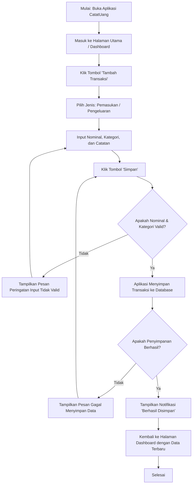

# Dokumen Kebutuhan dan User Flow — CatatUang

## 1.1 Deskripsi Aplikasi

**CatatUang** adalah aplikasi pencatatan keuangan pribadi berbasis mobile yang dirancang untuk mengatasi masalah kebiasaan pengeluaran impulsif dan kurangnya kesadaran finansial pada kalangan mahasiswa serta _first-jobber_. Melalui dukungan fitur pencatatan transaksi yang cepat, pengkategorian otomatis, serta grafik ringkasan alokasi anggaran, aplikasi mobile ini memungkinkan pengguna mencatat transaksi secara praktis kapan saja dan di mana saja langsung dari smartphone mereka.

---

## 1.2 User Persona

### Persona 1

- **Nama dan peran:** Rian (Mahasiswa / Pengguna Utama)
- **Tujuan:** Mencatat pengeluaran harian dengan cepat agar dapat mengontrol sisa uang saku bulanan.
- **Kendala:** Sering lupa mencatat pengeluaran kecil dan malas menggunakan aplikasi yang alurnya rumit.
- **Perangkat dan konteks:** Perangkat Android entry-level, digunakan sesaat setelah melakukan transaksi tunai atau e-wallet di kasir/merchant.
- **Frekuensi penggunaan:** 3–5 kali sehari.

### Persona 2

- **Nama dan peran:** Amanda (First-Jobber / Pengelola Anggaran)
- **Tujuan:** Evaluasi alokasi pengeluaran bulanan berdasarkan kategori (makanan, transportasi, hiburan) serta menetapkan batas anggaran (_budget limit_).
- **Kendala:** Kesulitan melihat tren pengeluaran bulanan secara visual dan sering terlanjur _overbudget_.
- **Perangkat dan konteks:** Perangkat iOS/Android mid-range, digunakan di rumah pada malam hari atau di akhir pekan saat mengevaluasi keuangan.
- **Frekuensi penggunaan:** 2–3 kali seminggu.

---

## 1.3 Kebutuhan Fungsional

- **F-01:** Pengguna dapat melakukan pendaftaran akun baru menggunakan alamat email dan kata sandi.
- **F-02:** Pengguna dapat menambahkan data transaksi pengeluaran atau pemasukan baru beserta nominal, kategori, dan tanggal.
- **F-03:** Pengguna dapat melihat daftar riwayat transaksi keuangan yang dikelompokkan berdasarkan rentang waktu.
- **F-04:** Pengguna dapat mengedit atau menghapus data catatan transaksi yang telah dibuat.
- **F-05:** Pengguna dapat melihat grafik statistik dan persentase alokasi pengeluaran bulanan.
- **F-06:** Pengguna dapat menetapkan batas anggaran (_budget limit_) untuk kategori pengeluaran tertentu.

---

## 1.4 Kebutuhan Nonfungsional

- **NF-01 (Kinerja):** Aplikasi harus dapat menyimpan dan memperbarui data transaksi ke penyimpanan lokal/database dalam waktu kurang dari 1,5 detik setelah tombol simpan ditekan.
- **NF-02 (Keamanan):** Aplikasi harus memverifikasi kata sandi atau autentikasi biometrik (sidik jari/PIN) setiap kali aplikasi dibuka dari latar belakang (_background_).

---

## 1.5 Prioritas MoSCoW

### Must have (Maksimal 5)

- **F-01 (Pendaftaran Akun):** Memastikan keamanan dan sinkronisasi data keuangan antar-perangkat.
- **F-02 (Tambah Transaksi):** Fitur utama aplikasi pencatatan keuangan.
- **F-03 (Lihat Riwayat):** Akses informasi dasar untuk melihat rekapitulasi data keuangan.
- **F-04 (Edit/Hapus Transaksi):** Akses krusial untuk mengoreksi kesalahan pencatatan transaksi pengguna.
- **Alasan:** Empat fitur ini merupakan fungsi _CRUD_ inti pencatatan keuangan. Tanpa fitur-fitur ini, aplikasi tidak dapat berfungsi sebagai alat pencatat keuangan.

### Should have

- **F-05 (Grafik Statistik):** Membantu pengguna memvisualisasikan alokasi keuangan secara lebih intuitif.
- **Alasan:** Penting untuk membantu analisis keuangan pengguna, tetapi fungsi dasar pencatatan transaksi tetap berjalan tanpanya.

### Could have

- **F-06 (Batas Anggaran / Budget Limit):** Memberikan peringatan (_alert_) saat pengeluaran mendekati ambang batas tertentu.
- **Alasan:** Sebagai fitur nilai tambah untuk kontrol finansial yang lebih canggih bagi pengguna menengah.

### Won't have (Saat Ini)

- **Fitur Hubung Rekening Bank Otomatis (Open API Bank):** Ditunda ke iterasi berikutnya karena membutuhkan lisensi regulasi perbankan dan integrasi API Pihak Ketiga yang kompleks.

---

## 1.6 User Flow

