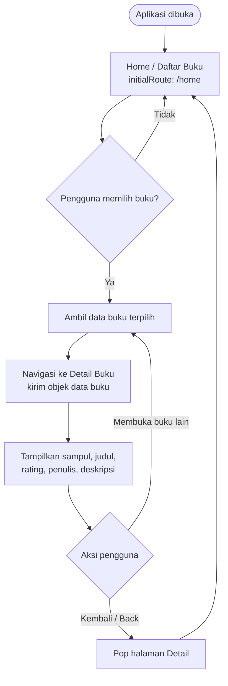

# Navigation Flow — Aplikasi E-Book

> **Catatan:** Dokumen ini disusun berdasarkan UI aplikasi E-Book yang dilampirkan. Daftar route bersifat rancangan awal karena dokumen _IA Tugas 5_ belum disertakan. Sesuaikan nama layar dan kebutuhan dengan IA Tugas 5 yang sudah disepakati di kelas.

## 1. Daftar Route

| Nama route     | Layar                    | Kebutuhan yang dipenuhi                                                                                                                                                                  | `initialRoute` |
| -------------- | ------------------------ | ---------------------------------------------------------------------------------------------------------------------------------------------------------------------------------------- | -------------- |
| `/home`        | Home / Daftar Buku       | Menjadi titik awal pengguna untuk melihat buku populer, daftar buku lain, kategori, dan kolom pencarian.                                                                                 | **Ya**         |
| `/book-detail` | Detail Buku              | Menampilkan informasi buku yang dipilih, seperti sampul, judul, rating, penulis, dan deskripsi. Menerima data buku dari halaman Home.                                                    | Tidak          |
| `/search`      | Hasil Pencarian          | Menampilkan daftar buku yang sesuai dengan kata kunci yang dimasukkan pengguna.                                                                                                          | Tidak          |
| `/category`    | Daftar Buku per Kategori | Menampilkan buku berdasarkan kategori yang dipilih, misalnya Adventure, Action, atau Romance.                                                                                            | Tidak          |
| `/library`     | Koleksi / Perpustakaan   | Menjadi tempat pengguna melihat buku yang disimpan atau ditandai untuk dibaca nanti. Route ini merupakan usulan berdasarkan ikon navigasi bawah dan perlu disesuaikan dengan IA Tugas 5. | Tidak          |
| `/activity`    | Aktivitas / Pesan        | Menyediakan halaman untuk aktivitas atau pesan pengguna. Makna ikon ini perlu dipastikan kembali berdasarkan IA Tugas 5.                                                                 | Tidak          |

### Contoh konfigurasi route di Flutter

Nama route di atas merupakan rancangan dokumentasi. Jika digunakan dalam aplikasi Flutter, route perlu didaftarkan pada konfigurasi navigasi aplikasi, misalnya melalui `MaterialApp.routes` atau mekanisme navigasi yang digunakan proyek.

```dart
MaterialApp(
  initialRoute: '/home',
  routes: {
    '/home': (context) => const HomePage(),
    // Daftarkan route lain sesuai halaman yang tersedia.
  },
);
```

> Contoh kode tersebut hanya menunjukkan pemilihan `initialRoute`. Pastikan nama kelas halaman sesuai dengan nama kelas yang benar-benar ada di proyek.

## 2. Diagram Navigation Flow

Skenario _Must have_: pengguna membuka daftar buku, memilih salah satu buku, membaca detailnya, lalu kembali ke daftar buku. Data buku dikirim saat navigasi menuju halaman detail.



### Pengiriman data

Ketika pengguna mengetuk kartu buku pada halaman Home, aplikasi mengirimkan data buku yang dipilih ke halaman Detail Buku. Data yang dapat dikirim, misalnya:

- `id`: identitas buku
- `title`: judul buku
- `author`: nama penulis
- `cover`: lokasi aset atau URL sampul
- `rating`: nilai rating
- `description`: deskripsi buku

Secara konseptual, alurnya adalah:

1. Pengguna mengetuk salah satu buku di halaman Home.
2. Home mengambil objek data untuk buku tersebut.
3. Aplikasi membuka halaman Detail Buku dan meneruskan objek buku sebagai argumen.
4. Detail Buku membaca objek tersebut untuk menampilkan informasi yang sesuai.
5. Saat pengguna menekan tombol kembali, halaman Detail Buku ditutup dan pengguna kembali ke Home.

Contoh pola navigasi Flutter menggunakan `Navigator`:

```dart
// Dari halaman Home, saat sebuah buku dipilih:
Navigator.push(
  context,
  MaterialPageRoute(
    builder: (context) => BookDetailPage(book: selectedBook),
  ),
);

// Pada BookDetailPage, data diterima melalui konstruktor:
// BookDetailPage({super.key, required this.book});
```

Kode di atas merupakan contoh pola pengiriman data. Sesuaikan `selectedBook`, model `Book`, dan konstruktor `BookDetailPage` dengan struktur kode aplikasi yang sebenarnya.

## 3. Alasan Pemilihan `initialRoute`

Route `/home` dipilih sebagai `initialRoute` karena halaman Home merupakan titik masuk paling sesuai untuk aplikasi E-Book. Pada layar ini, pengguna langsung dapat menjelajahi daftar buku, melihat buku populer, memilih kategori, dan menggunakan pencarian. Dengan demikian, pengguna tidak perlu melewati halaman lain sebelum menemukan konten utama aplikasi.

Halaman Detail Buku tidak dijadikan `initialRoute` karena detail bergantung pada buku tertentu yang dipilih pengguna. Halaman tersebut memerlukan data buku dari halaman sebelumnya. Oleh sebab itu, alur yang dirancang dimulai dari Home, berlanjut ke Detail Buku setelah pengguna memilih buku, dan memungkinkan pengguna kembali ke Home melalui navigasi _back_.
