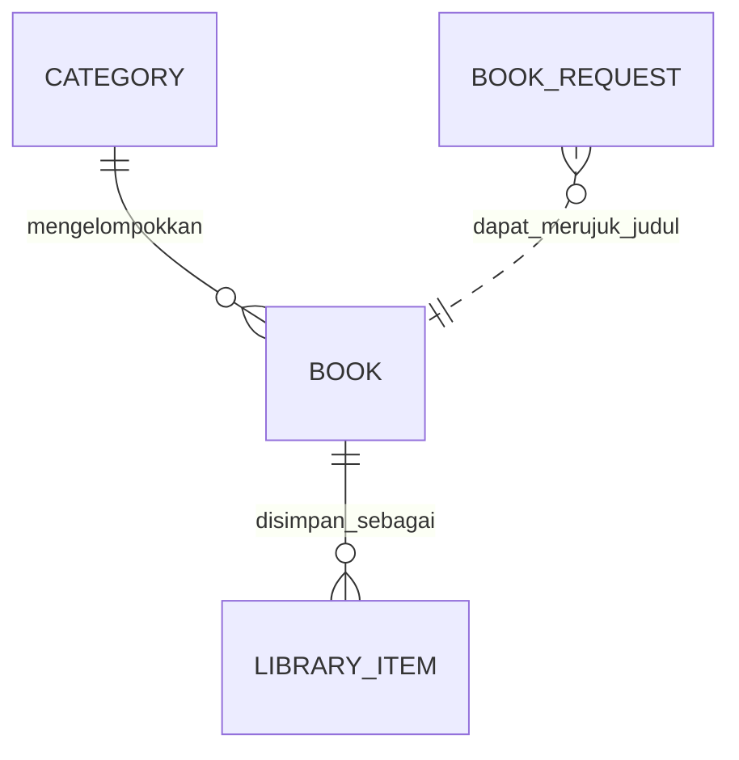

# Model Data — Aplikasi E-Book

> **Catatan:** Dokumen ini disusun berdasarkan UI E-Book yang dilampirkan dan rancangan `form-interaksi.dart`. Dokumen kebutuhan lengkap/IA Tugas 5 belum disertakan, sehingga field yang diusulkan perlu dicocokkan dengan kebutuhan resmi.

## 1. Entitas `Book` (Buku)

Mewakili buku yang tampil di Home dan Detail Buku.

| Field | Tipe | Kebutuhan yang dipenuhi | Mengapa diperlukan | Asal nilai |
|---|---|---|---|---|
| `id` | `String` | Identifikasi buku | Membedakan buku secara unik, termasuk buku dengan judul serupa. | Sistem/katalog |
| `title` | `String` | Menampilkan judul buku | Pengguna perlu mengetahui buku yang dipilih. | Data katalog |
| `author` | `String` | Menampilkan penulis | Membantu pengguna mengenali penulis buku. | Data katalog |
| `coverImage` | `String` | Menampilkan sampul | Referensi gambar untuk kartu dan halaman detail; dapat berupa path aset atau URL. | Katalog/aset |
| `rating` | `double` | Menampilkan rating bintang | Memberi gambaran penilaian buku. | Perhitungan dari rating atau data katalog |
| `description` | `String` | Menampilkan deskripsi buku | Membantu pengguna memahami isi buku sebelum memilihnya. | Data katalog |
| `category` | `String` | Menyaring buku berdasarkan kategori | Mendukung kategori seperti Adventure, Action, dan Romance pada UI. | Data katalog |
| `isPopular` | `bool` | Menentukan buku di bagian “Top books” | Memisahkan buku populer dari daftar lainnya. | Sistem/aturan kurasi |

## 2. Entitas `BookRequest` (Form Minat Baca)

Mewakili data yang dikirim melalui Form Interaksi pada `form-interaksi.dart`.

| Field | Tipe | Kebutuhan yang dipenuhi | Mengapa diperlukan | Asal nilai |
|---|---|---|---|---|
| `name` | `String` | Menerima nama pengirim | Mengenali pengirim dan menampilkan nama pada pesan konfirmasi. | Form |
| `email` | `String` | Menerima alamat email | Menyediakan kontak jika permintaan perlu ditindaklanjuti. | Form |
| `requestedBookTitle` | `String` | Mencatat judul buku yang diminati | Menjelaskan buku yang ingin dibaca/diminta. | Form |
| `message` | `String` | Mencatat alasan atau pesan | Memberi konteks mengenai minat pengguna. | Form |
| `submittedAt` | `DateTime` | Mencatat waktu pengiriman | Berguna untuk mengurutkan dan menelusuri permintaan. | Sistem |
| `status` | `String` atau enum | Menandai status permintaan | Contoh: `new`, `reviewed`, `completed`, jika pengelolaan permintaan diterapkan. | Sistem/pengelola |

**Validasi field form:** `name` wajib dan minimal 3 karakter; `email` wajib dan harus memiliki format email yang valid; `requestedBookTitle` wajib dan minimal 2 karakter; `message` wajib dan minimal 10 karakter.

`submittedAt` dan `status` adalah field usulan, belum ada pada form saat ini. Kode yang dibuat sejauh ini memvalidasi input dan menampilkan `SnackBar`, tetapi belum menyimpan data ke database.

## 3. Entitas opsional `Category` (Kategori)

Dapat dibuat terpisah jika kategori perlu dikelola sebagai data, bukan hanya teks pada `Book`.

| Field | Tipe | Kebutuhan yang dipenuhi | Mengapa diperlukan | Asal nilai |
|---|---|---|---|---|
| `id` | `String` | Identitas kategori | Membedakan kategori secara konsisten. | Sistem |
| `name` | `String` | Label kategori | Menampilkan nama kategori pada menu. | Data katalog |
| `sortOrder` | `int` | Urutan kategori | Menjaga susunan kategori pada UI. | Konfigurasi sistem |

Untuk prototipe sederhana, kategori bisa disimpan langsung sebagai field `category` di `Book`; entitas terpisah ini tidak wajib.

## 4. Entitas opsional `LibraryItem` (Buku dalam Koleksi)

Digunakan jika ikon/halaman koleksi pada navigasi bawah memang merupakan fitur yang disyaratkan.

| Field | Tipe | Kebutuhan yang dipenuhi | Mengapa diperlukan | Asal nilai |
|---|---|---|---|---|
| `id` | `String` | Identifikasi item koleksi | Membedakan setiap catatan koleksi. | Sistem |
| `bookId` | `String` | Menghubungkan item dengan buku | Mengacu ke `Book.id` tanpa menyalin seluruh data buku. | Sistem, dari buku yang dipilih |
| `savedAt` | `DateTime` | Mencatat waktu menyimpan | Mendukung pengurutan berdasarkan waktu simpan. | Sistem |
| `isRead` | `bool` | Menandai status baca | Pengguna dapat menandai buku sudah/belum dibaca jika fitur tersedia. | Interaksi pengguna |

## 5. Ringkasan asal nilai

| Asal nilai | Contoh field | Penjelasan |
|---|---|---|
| Form | `BookRequest.name`, `email`, `requestedBookTitle`, `message` | Diisi pengguna dan diperiksa validator. |
| Sistem | `Book.id`, `BookRequest.submittedAt`, `BookRequest.status`, `LibraryItem.savedAt` | Dibuat atau diberi nilai awal oleh aplikasi. |
| Data katalog/aset | `Book.title`, `author`, `coverImage`, `description`, `category` | Disediakan oleh katalog; untuk prototipe dapat berupa data statis di kode. |
| Perhitungan/aturan | `Book.rating`, `Book.isPopular`, `Category.sortOrder` | Rating dapat dihitung dari penilaian, popularitas mengikuti aturan yang ditetapkan, dan urutan kategori diatur sistem. |
| Interaksi pengguna | `LibraryItem.isRead` | Berubah saat pengguna menandai status baca. |

## 6. Hubungan antarentitas

- Satu kategori dapat memiliki banyak buku.
- Satu buku dapat disimpan sebagai item koleksi.
- Pada form saat ini, `requestedBookTitle` berupa teks bebas dan belum terhubung langsung dengan `Book.id`.

## 7. Prioritas implementasi

Untuk versi aplikasi yang terlihat pada UI dan kode sebelumnya, entitas minimum yang paling relevan adalah:

1. **`Book`** — diperlukan untuk daftar buku, halaman detail, dan pengiriman data melalui named route.
2. **`BookRequest`** — mewakili input form, validasi, dan feedback setelah pengiriman.

`Category` dan `LibraryItem` adalah rancangan opsional sampai kebutuhan resmi memastikan fitur tersebut harus dibuat. Jika penyimpanan permanen diwajibkan, tambahkan penyimpanan lokal atau backend.
