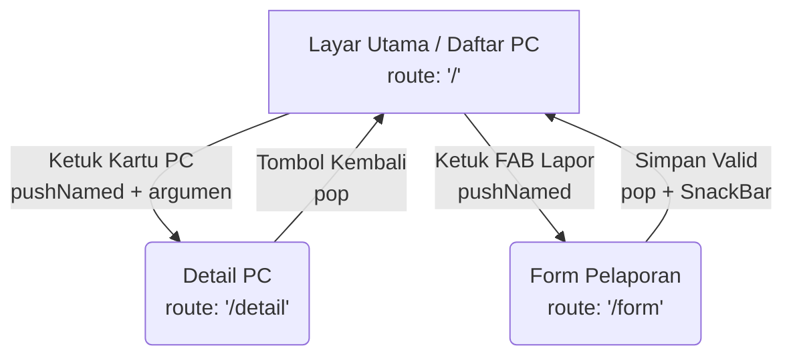

# Navigation Flow: Lab PC Monitor

**Daftar Route**
- `/` (Layar Utama / Daftar PC)
  - Kebutuhan: F-01 (Melihat daftar PC dan statusnya)
  - Initial Route: Ya, karena ini adalah titik awal utama teknisi memantau seluruh perangkat lab (Must have).
- `/detail` (Detail PC)
  - Kebutuhan: F-01 (Melihat detail spesifikasi dari PC yang dipilih)
- `/form` (Form Pelaporan)
  - Kebutuhan: F-02 (Melaporkan kendala atau kerusakan PC)

**Diagram Navigation Flow**

