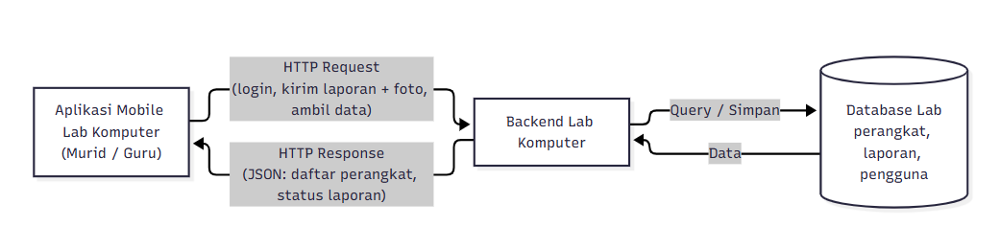

# Tugas 1 — Identifikasi Kebutuhan Aplikasi Bergerak

**Nama:** Dian Erwin
**NIM:** 230660221022
**Kelas:** (isi: SI-VIIA / SI-VIIB)
**Domain:** Laboratorium Komputer — Pelaporan Kerusakan Perangkat

---

## 1. Deskripsi Sistem

Pengguna utama sistem ini adalah murid sebagai pelapor dan guru sebagai pihak yang menerima serta menindaklanjuti laporan. Masalah yang terjadi saat ini adalah PC atau perangkat lab yang rusak tidak terlapor dengan cepat, sehingga perangkat rusak tetap dipakai atau baru diketahui ketika praktikum sudah berjalan dan mengganggu kegiatan belajar. Solusinya berbentuk aplikasi mobile karena pelaporan terjadi di lokasi saat pengguna berada di depan perangkat (konteks bergerak), alurnya harus selesai dalam hitungan detik (sesi penggunaan singkat), dan pengguna dapat langsung memotret kerusakan serta memindai kode QR perangkat lewat layar sentuh (interaksi sentuh), sesuatu yang tidak praktis dilakukan dari komputer desktop.

## 2. Diagram Arsitektur

Sumber diagram: `diagram.mmd`

Aplikasi mobile mengirim HTTP request (misalnya laporan kerusakan beserta foto) ke backend lab komputer. Backend memproses dan menyimpan data ke database, lalu mengirim HTTP response kembali ke aplikasi.

## 3. Tabel Kebutuhan

| No. | Permintaan | Pengguna | Karakteristik Mobile yang Terkait | Fitur Aplikasi | Materi Pemenuh |
|-----|------------|----------|-----------------------------------|----------------|----------------|
| 1 | Melihat daftar PC/perangkat lab beserta statusnya | Murid, Guru | Layar kecil, sesi penggunaan singkat | Halaman daftar perangkat dan halaman detail | Minggu 3, 5 |
| 2 | Melaporkan kerusakan perangkat dengan foto | Murid | Konteks bergerak, interaksi sentuh | Form laporan kerusakan + pengambilan foto kamera | Minggu 6, 11 |
| 3 | Mengisi identitas perangkat otomatis dengan memindai QR pada PC | Murid | Sesi penggunaan singkat, interaksi sentuh | Pemindai QR | Minggu 11 |
| 4 | Laporan tidak hilang saat jaringan lab tidak stabil | Murid | Konektivitas terbatas | Draf laporan tersimpan lokal | Minggu 7 |
| 5 | Memantau status laporan (diterima, diperbaiki, selesai) | Murid | Sesi penggunaan singkat | Halaman riwayat dan status laporan | Minggu 9-10 |
| 6 | Menerima laporan baru dan memperbarui statusnya | Guru | Konteks bergerak, notifikasi seketika | Daftar laporan, ubah status, notifikasi | Minggu 9-10, 11 |
| 7 | Mengelola data master perangkat, hak akses, dan rekap laporan | Guru/pengelola lab | - | Di luar lingkup (backend SI) | Mata kuliah Prak-backend |

## 4. Bukti Environment Siap

- `flutter doctor -v` sebelum perbaikan: `flutter-doctor/sebelum.png`
- `flutter doctor -v` sesudah perbaikan: `flutter-doctor/sesudah.png`
- Aplikasi counter berjalan (web/emulator/perangkat fisik): `aplikasi.png`

## 5. Refleksi

Fitur kamera paling relevan untuk lab komputer karena foto kerusakan membuat laporan jelas tanpa perlu deskripsi panjang. Pemindaian QR pada setiap PC mengisi identitas perangkat secara otomatis sehingga laporan tidak salah perangkat. Dengan begitu guru dapat menilai tingkat kerusakan lebih cepat tanpa harus memeriksa langsung ke lokasi.

---

Bantuan AI: Claude, digunakan untuk menyusun draf dari pilihan penulis (pengguna, masalah, dan fitur kamera) yang kemudian ditinjau dan disesuaikan oleh penulis.
