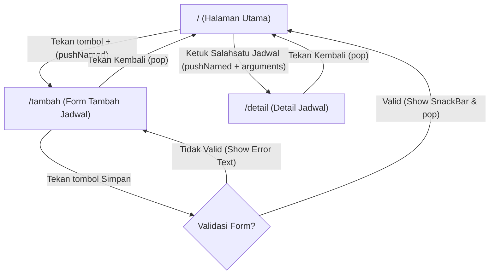

# Navigation Flow — RadiAct (UNSAP Radio)

Dokumen ini memetakan alur navigasi aplikasi RadiAct berbasis *Information Architecture* (IA) dan dokumen kebutuhan.

## 1. Daftar Route

| Nama Route | Layar Terkait | Kebutuhan yang Dipenuhi | Peran Route |
| :--- | :--- | :--- | :--- |
| `/` | `HalamanUtama` | F-03 (Melihat daftar status jadwal konten) | `initialRoute` |
| `/tambah` | `FormTambahJadwal` | F-01 (Mengajukan/menambahkan jadwal konten baru) | Layar Input Form |
| `/detail` | `DetailJadwal` | F-03 (Melihat rincian/catatan lengkap jadwal konten) | Layar Detail (*Read-only*) |

## 2. Diagram Navigation Flow (Mermaid)

## 3. Alasan Pemilihan initialRoute
Rute / (HalamanUtama) dipilih sebagai initialRoute karena memenuhi kebutuhan utama (Must Have) pengguna, yaitu memantau ringkasan statistik konten dan melihat daftar seluruh jadwal konten secara langsung saat aplikasi dibuka.