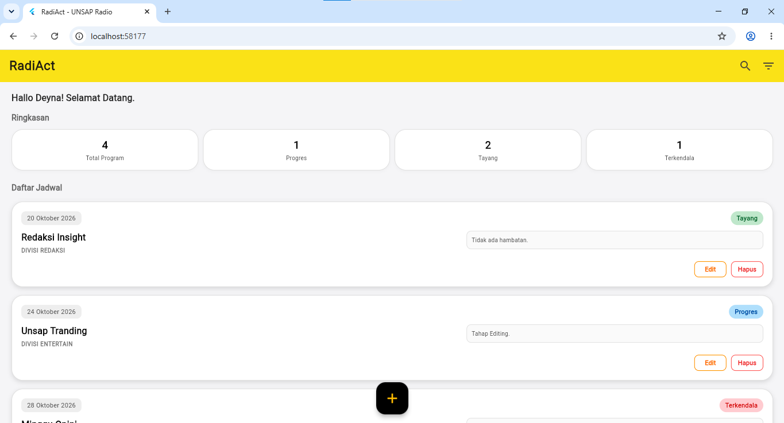
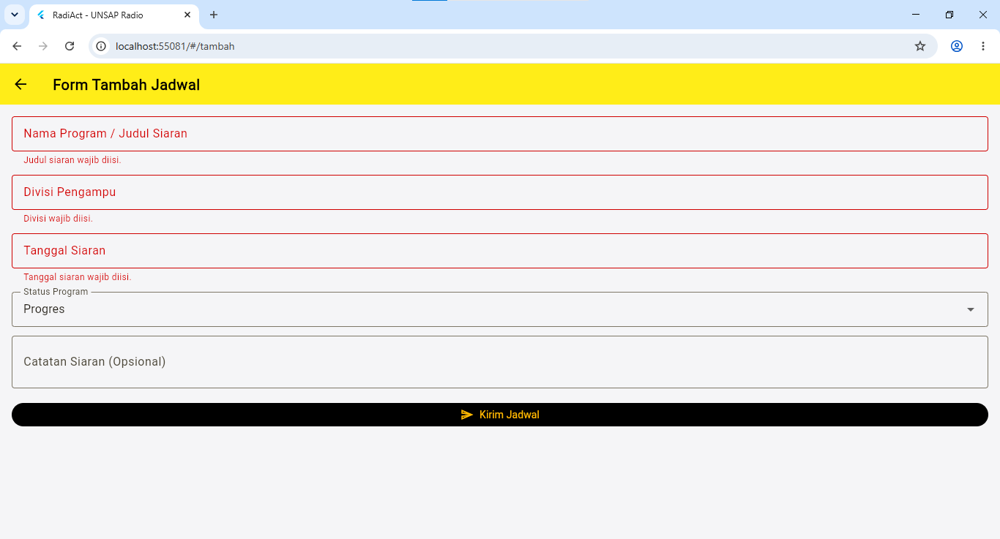
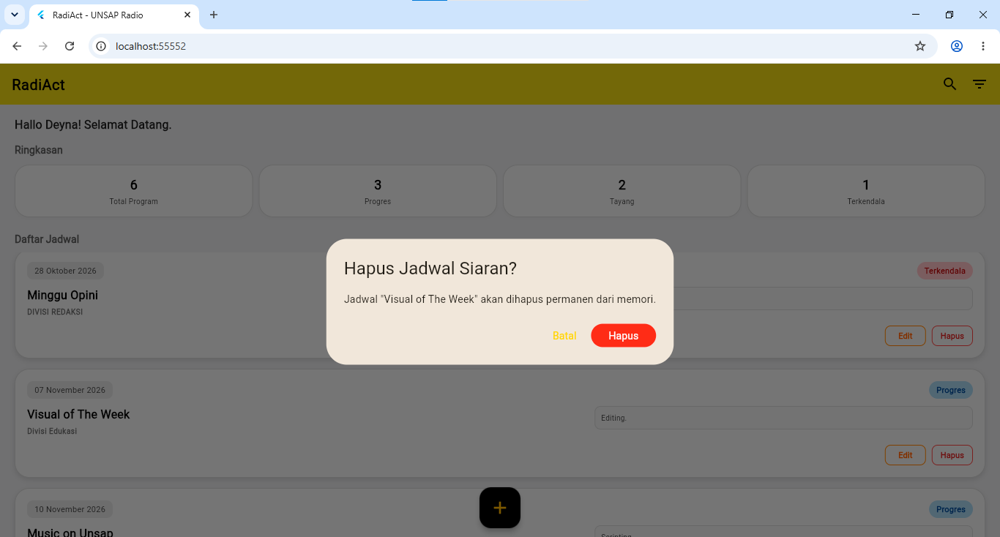

# Laporan Progress Project UTS (Milestone M4)

| | |
|:--|:--|
| **Nama** | Deyna Angeliawati Zahara |
| **NIM** | 230660221032 |
| **Kelas** | SI-VIIB |
| **Domain SI** | Manajemen Program Kerja Harian (Media/Konten) UKM Unsap Radio - RADIACT |
| **Judul Aplikasi** | RadiAct (UNSAP Radio) |

## 1. Ringkasan Eksekutif Project
Aplikasi **RadiAct (Radio Activity)** dirancang untuk digunakan oleh seluruh anggota UKM Unsap Radio sebagai pengguna dengan hak akses pemantauan (*view-only*), serta Ketua Divisi dan Badan Pengurus Harian sebagai pengelola yang memiliki wewenang untuk memperbarui data serta status operasional konten. Permasalahan utama yang dihadapi saat ini adalah jadwal publikasi konten yang terpusat di grup WhatsApp atau penyimpanan awan sering kali tertimbun mengakibatkan tingginya tingkat kelalaian tenggat waktu, alur koordinasi konfirmasi publikasi yang bersifat personal tanpa transparansi kepada pengurus, serta tingginya intensitas revisi jadwal harian yang memicu keterlambatan dan ketidakpastian eksekusi program kerja.

Solusi berbasis aplikasi mobile diimplementasikan untuk mengakomodasi konteks bergerak, di mana seluruh anggota dapat memantau keterbukaan informasi jadwal secara praktis dari handphone, serta mendukung sesi penggunaan singkat melalui antarmuka yang efisien agar pengelola dapat memperbarui status kesiapan konten secara cepat di sela-sela aktivitas akademik.

## 2. Ketercapaian Milestone (M1 s.d. M3)

| Milestone | Deliverable | Status (Selesai / Sebagian) | Catatan / Bukti |
|:----------|:------------|:----------------------------|:----------------|
| M1: Kebutuhan | Dokumen kebutuhan + User Flow | Selesai | File `kebutuhan.md` di Tugas 4 |
| M2: UI/UX | Wireframe + Navigasi | Selesai | File prototype & navigasi di Tugas 5 & 6 |
| M3: MVP Awal | Model data + CRUD lokal | Selesai | File `crud-lokal.dart` di Tugas 7 |

## 3. Matriks Kebutuhan ke Implementasi

| ID Kebutuhan | Deskripsi Kebutuhan | Prioritas MoSCoW | Halaman Pemenuh | Operasi Data Terkait |
|:-------------|:-------------------|:----------------:|:----------------|:---------------------|
| F-01 | Menginput jadwal dan draf program kerja/konten harian baru | Must | Halaman Form Pengajuan/Tambah | Create |
| F-02 | Melihat daftar jadwal siaran/konten harian beserta statusnya | Must | Halaman Utama (Daftar Konten) | Read |
| F-03 | Mengubah detail jadwal atau memperbarui status eksekusi konten | Should | Halaman Form / Detail Status | Update |
| F-04 | Menghapus jadwal/konten harian dari daftar riwayat lokal | Could | Halaman Utama (Dialog Hapus) | Delete |

## 4. Tangkapan Layar Aplikasi Berjalan

1. **Halaman utama / daftar data**: Menampilkan daftar jadwal program kerja harian konten radio yang tersimpan beserta kartu indikator statusnya.
   

2. **Halaman form pengisian data dengan validasi**: Menampilkan formulir penambahan/pengajuan jadwal konten baru yang dilengkapi validasi *input* (divisi, tanggal, judul konten).
   

3. **Dialog konfirmasi aksi (ubah/hapus)**: Menampilkan modal dialog konfirmasi sebelum pengurus memperbarui status publikasi atau menghapus jadwal dari daftar.
   

## 5. Kendala dan Solusi Teknis
1. **Daftar Jadwal Tidak Langsung Perbarui Tampilan**:  
   Saat menambah data jadwal baru dari form, tampilan di layar utama sempat tidak langsung berubah.  
   **Solusi**: Menggunakan fungsi `setState` untuk memberitahu aplikasi agar memperbarui tampilan layar secara otomatis tepat setelah form ditutup (`pop`).

2. **Kesulitan Mengirim Data Antarlayar**:  
   Sempat kesulitan mengirimkan detail data jadwal konten yang dipilih dari halaman utama ke halaman detail/edit.  
   **Solusi**: Memanfaatkan fitur pengiriman data (`arguments`) pada fungsi navigasi Flutter untuk membawa data ke halaman tujuan dengan aman.

## 6. Rencana Pengembangan Milestone M5 (REST API)
Pada Minggu 9–10 nanti, aplikasi RadiAct akan dihubungkan ke server database online supaya data jadwal konten tidak lagi cuma tersimpan di HP sendiri, tapi bisa diakses bersama oleh semua pengurus. Data yang akan diambil dari server meliputi daftar jadwal konten harian dan data akun anggota UKM. Di tahap ini, aplikasi akan diatur agar bisa menampilkan status saat data sedang diunduh (loading), menampilkan daftar jadwal jika koneksi berhasil, serta memunculkan pesan peringatan sederhana kalau internet terputus atau terjadi gangguan pada server.

## 7. Refleksi Pembelajaran Tengah Semester
Selama setengah semester ini, saya belajar bagaimana Flutter menyusun tampilan aplikasi secara deklaratif melalui struktur *widget* yang rapi. Saya juga memahami pentingnya pengelolaan *state* lokal menggunakan `setState` agar antarmuka aplikasi bisa langsung memperbarui data jadwal secara *real-time*. Tantangan terbesar yang saya hadapi adalah menjaga konsistensi ui dan menyesuaikan alur navigasi antarlayar dan memastikan data yang diinput lewat form bisa berpindah dengan aman tanpa ada yang terlewat.

### Deklarasi Penggunaan AI
Deklarasi penggunaan AI: **Gemini** — membantu menyusun ide alur aplikasi, asistensi penulisan dokumentasi laporan, serta perancangan diagram Mermaid, membantu memahami fungsi kode dan error. Seluruh aspek tugas dilakukan serta diverifikasi penuh oleh penulis.