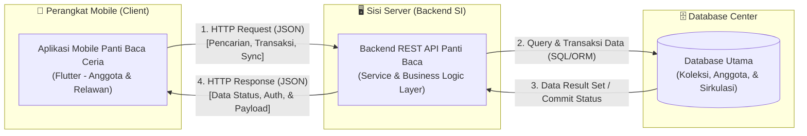

# Tugas 1: Identifikasi Kebutuhan Aplikasi Bergerak — CeriaReads
**Mata Kuliah:** Pemrograman Aplikasi Bergerak (PAB)  
**Program Studi:** Sistem Informasi — Semester 7 (Gasal 2026/2027)  

| Informasi Mahasiswa | |
|:---|:---|
| **Nama Mahasiswa** | Yelly Ambarwaty |
| **NIM** | 230660221033 |
| **Kelas** | SI-VIIB |
| **Domain Aplikasi** | Aplikasi Katalog & Sirkulasi Peminjaman Buku Komunitas Panti Baca Ceria |

---

## 1. Deskripsi Sistem

Aplikasi CeriaReads (Katalog dan Peminjaman Buku Komunitas Panti Baca Ceria) ditujukan bagi anggota komunitas guna menyelesaikan kendala pencatatan transaksi secara manual yang menyebabkan lambatnya verifikasi ketersediaan stok buku, kerap terjadinya kehilangan koleksi fisik, serta keterlambatan pengembalian buku. Solusi ini wajib diimplementasikan dalam bentuk aplikasi *mobile* karena sangat erat kaitannya dengan karakteristik **konteks bergerak**, di mana kegiatan lapak baca berpindah-pindah lokasi secara dinamis mengikuti tempat aktivitas komunitas sehingga relawan memerlukan akses sistem yang ramah portabilitas tanpa bergantung pada perangkat komputer meja. Selain itu, aplikasi ini dirancang khusus untuk memenuhi karakteristik **sesi penggunaan singkat** dan **konektivitas terbatas**, yang memungkinkan peminjaman buku diproses secara presisi hanya dalam hitungan detik di area *outdoor* yang kerap kali mengalami fluktuasi sinyal internet melalui mekanisme penyimpanan data lokal sementara.

---

## 2. Diagram Arsitektur

Diagram berikut menggambarkan alur komunikasi dua arah (*bidirectional flow*) antara Aplikasi Mobile berbasis Flutter, Server Backend Sistem Informasi (REST API), dan Database Utama.

### Keterangan Diagram:
1. **HTTP Request (JSON):** Aplikasi *mobile* mengirimkan permintaan data (misalnya: pencarian buku, pengajuan peminjaman, autentikasi pengguna) ke Backend REST API.
2. **Query & Transaksi Data:** Backend memvalidasi hak akses dan aturan bisnis, kemudian melakukan operasi *Read/Write* ke Database.
3. **Data Result Set:** Database mengembalikan hasil pemrosesan data ke Backend.
4. **HTTP Response (JSON):** Backend menyusun respon format JSON dan mengembalikannya ke aplikasi *mobile* untuk ditampilkan pada layar pengguna.

---

## 3. Tabel Kebutuhan Sistem

Tabel berikut mengidentifikasi kebutuhan aplikasi *mobile* serta membatasi ruang lingkup sistem yang menjadi ranah *Backend SI*.

| No. | Permintaan Pengguna | Pengguna | Karakteristik Mobile yang Terkait | Fitur Aplikasi Mobile | Materi Pemenuh |
|:---:|:---|:---|:---|:---|:---|
| 1 | Melihat katalog buku lengkap beserta detail status ketersediaan stok buku secara *real-time*. | Anggota & Relawan | **Layar kecil & bervariasi, Sesi penggunaan singkat** — Informasi disajikan ringkas dan adaptif untuk layar ponsel. | Halaman Katalog Adaptif dengan Filter Kategori & Pencarian Buku | Minggu 3, 5 |
| 2 | Melakukan pengajuan peminjaman buku fisik yang tersedia hanya dengan beberapa langkah mudah di lokasi. | Anggota | **Interaksi sentuh, Daya & data terbatas** | Form Peminjaman Ringkas 1-Klik dengan Konfirmasi Dialog | Minggu 7, 9–10 |
| 3 | Mengakses data katalog buku yang pernah dibuka sebelumnya saat berada di area lapak baca tanpa koneksi internet. | Anggota & Relawan | **Konektivitas terbatas** — Membutuhkan mekanisme pencatatan data sementara di perangkat. | *Local Storage Caching* & Indikator Status *Offline* | Minggu 7 |
| 4 | Menerima pengingat otomatis sebelum batas waktu pengembalian buku peminjaman habis. | Anggota | **Notifikasi perangkat, Konteks bergerak** | *Local Notification Engine* (Pengingat H-2 & H-1 Jatuh Tempo) | Minggu 11 |
| 5 | Melakukan pemindaian kode ISBN/Barcode pada buku fisik untuk mempercepat pencarian data katalog. | Relawan | **Pemanfaatan kapabilitas perangkat, Konteks bergerak** | Integrasi *Camera QR/Barcode Scanner* | Minggu 11 |
| 6 | Pengelolaan *master data* relawan, manajemen akun anggota, dan hak akses pengguna secara menyeluruh. | Relawan / Pengurus | *Di luar lingkup (backend SI)* | *Di luar lingkup (web dashboard admin backend SI)* | - (Backend SI) |
| 7 | Rekapitulasi laporan sirkulasi bulanan, statistik peminjaman, dan analisis minat baca komunitas. | Pengelola Panti Baca | *Di luar lingkup (backend SI)* | *Di luar lingkup (web dashboard admin backend SI)* | - (Backend SI) |

---

## 4. Bukti Environment Siap

Seluruh *toolchain* pengembangan Flutter dan Dart telah dikonfigurasi dan diverifikasi pada perangkat kerja lokal:

1. **`flutter-doctor/sebelum.png`**: Tangkapan layar awal saat `flutter doctor -v` dijalankan dan masih memuat indikator *warning/error* (misal: lisensi Android/Dart SDK path).
2. **`flutter-doctor/sesudah.png`**: Tangkapan layar `flutter doctor -v` setelah perbaikan jalur PATH, menunjukkan komponen utama Flutter siap digunakan.
3. **`aplikasi.png`**: Tangkapan layar bukti aplikasi bawaan *counter* Flutter berhasil dijalankan pada target web (Google Chrome/Edge).

---

## 5. Refleksi Pemanfaatan Fitur Perangkat

Fitur perangkat keras yang paling relevan untuk domain Panti Baca Ceria adalah kamera ponsel pintar yang difungsikan sebagai pemindai kode QR (*QR code*) dan kode batang (*barcode*) ISBN pada sampul buku fisik. Integrasi kamera ini secara drastis mempercepat proses pendataan dan pencatatan sirkulasi peminjaman di lapangan tanpa memerlukan pengketikan judul buku secara manual oleh relawan. Dengan pemanfaatan kamera tersebut, tingkat akurasi pencatatan inventaris meningkat secara signifikan dan potensi kesalahan manusia (*human error*) saat proses transaksi buku di area lapak baca dapat diminimalkan.