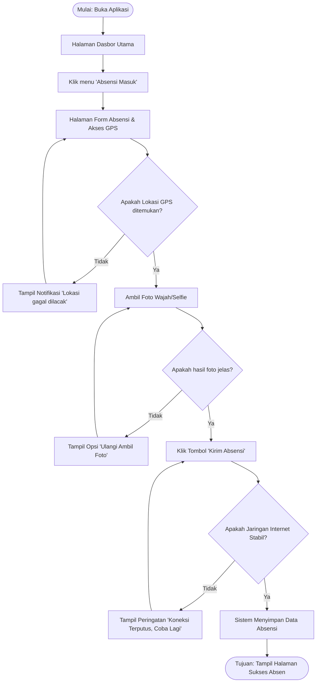

# Dokumen Kebutuhan dan User Flow
**Sistem Informasi Kepegawaian Puskesmas Berbasis Mobile**

## 1. Deskripsi Aplikasi
Sistem Informasi Kepegawaian Puskesmas Berbasis Mobile adalah aplikasi yang dirancang untuk mengatasi masalah pencatatan kehadiran dan pemantauan aktivitas pegawai yang sering berdinas di luar (seperti puskesmas keliling atau kunjungan pasien) menggunakan sistem manual. Solusi berbentuk aplikasi mobile dipilih karena selaras dengan karakteristik konteks bergerak (mobilitas tinggi) para tenaga kesehatan, sehingga memungkinkan pelaporan lokasi via GPS dan pengambilan foto secara *real-time* langsung dari ponsel masing-masing pegawai di lapangan.

## 2. User Persona

**Persona 1 — Budi — Perawat Lapangan**
| Komponen | Isi |
| :--- | :--- |
| **Nama dan peran** | Budi — Perawat Lapangan (Dinas Luar) |
| **Tujuan** | Melakukan absensi masuk/pulang dan melaporkan status dinas luar dengan cepat tanpa harus kembali ke puskesmas induk. |
| **Kendala** | Sering berada di wilayah desa atau rumah pasien dengan sinyal internet yang tidak stabil dan waktu operasional yang terbatas. |
| **Perangkat dan konteks** | Ponsel pintar Android kelas menengah; sering digunakan di luar ruangan dengan pencahayaan terang matahari. |
| **Frekuensi penggunaan** | 2–4 kali per hari (saat jam masuk, istirahat, dan pulang kerja). |

**Persona 2 — Dr. Ratna — Kepala Tata Usaha**
| Komponen | Isi |
| :--- | :--- |
| **Nama dan peran** | Dr. Ratna — Kepala Tata Usaha (Admin Kepegawaian) |
| **Tujuan** | Memantau status kehadiran harian seluruh pegawai secara seketika dan memvalidasi pengajuan izin dengan mudah. |
| **Kendala** | Kesulitan melacak pegawai dinas luar karena rekap manual baru diserahkan di akhir minggu sehingga data tidak *real-time*. |
| **Perangkat dan konteks** | Tablet atau Ponsel pintar layar besar; umumnya digunakan dalam ruangan (kantor Puskesmas). |
| **Frekuensi penggunaan** | Terus-menerus memantau *dashboard* pada awal jam kerja dan akhir jam operasional. |

## 3. Kebutuhan Fungsional

| ID | Rumusan Kebutuhan | Terkait Persona |
| :--- | :--- | :--- |
| **F-01** | Pegawai dapat mengirimkan data absensi masuk menggunakan koordinat GPS sehingga status kehadiran tercatat di sistem. | Persona 1 |
| **F-02** | Pegawai dapat mengunggah foto wajah (*selfie*) pada form absensi sehingga sistem menyimpan bukti kehadiran visual yang sah. | Persona 1 |
| **F-03** | Pegawai dapat melihat daftar riwayat kehadiran bulanan sehingga mengetahui rekapitulasi kehadiran pribadi secara mandiri. | Persona 1 |
| **F-04** | Kepala TU dapat memantau daftar status kehadiran harian seluruh pegawai sehingga mengetahui posisi dan siapa yang hadir. | Persona 2 |
| **F-05** | Pegawai dapat mengirimkan formulir pengajuan izin tidak masuk sehingga pengajuan langsung masuk ke daftar validasi sistem. | Persona 1 & 2 |
| **F-06** | Pegawai dapat mengunduh rekap absensi bulanan dalam bentuk dokumen PDF sehingga memiliki salinan cetak secara luring. | Persona 1 |

## 4. Kebutuhan Nonfungsional

| ID | Kategori | Rumusan | Kriteria Terukur |
| :--- | :--- | :--- | :--- |
| **NF-01** | Kinerja | Aplikasi memuat halaman daftar riwayat kehadiran secara cepat | Daftar tampil kurang dari 3 detik pada kondisi jaringan 4G. |
| **NF-02** | Kegunaan | Proses absensi masuk dari halaman utama hingga pengiriman selesai tidak memakan waktu | Tugas utama (absensi) selesai maksimal dalam 4 langkah/ketukan layar. |

## 5. Prioritas Fitur (MoSCoW)

| Prioritas | ID Kebutuhan | Alasan |
| :--- | :--- | :--- |
| **Must have** | F-01, F-02, F-03, F-04 | Fitur dasar operasional aplikasi absensi (Mencatat kehadiran, bukti otentikasi, melihat riwayat mandiri, dan pengawasan). |
| **Should have** | F-05 | Pengajuan izin penting untuk manajemen SDM, namun sementara masih bisa dilakukan via pesan singkat jika tertunda. |
| **Could have** | - | - |
| **Won't have (saat ini)** | F-06 | Konversi dan unduh rekap PDF di perangkat *mobile* membebani target rilis minimum, akan dikerjakan di versi mendatang. |

## 6. Pemetaan Kebutuhan ke Antarmuka

| ID Kebutuhan | Rumusan (ringkas) | Prioritas | Halaman yang Memenuhi | Widget yang Direncanakan (P3) |
| :--- | :--- | :--- | :--- | :--- |
| **F-01** | Kirim lokasi absensi (GPS) | Must | Halaman Form Absensi | `Scaffold` + `Column` + Tombol |
| **F-02** | Unggah foto bukti kehadiran | Must | Halaman Form Absensi | `Container` + Kotak Kamera |
| **F-03** | Lihat riwayat absensi pribadi | Must | Halaman Riwayat Pegawai | `ListView.builder` + `ListTile` |
| **F-04** | Pantau daftar kehadiran semua | Must | Halaman Dasbor (Tugas 3) | `ListView.builder` + `Card` |
| **F-05** | Form pengajuan izin kerja | Should | Halaman Pengajuan | `Scaffold` + `Column` + `TextField` |
| **F-06** | Unduh laporan format PDF | Won't | Halaman Riwayat Pegawai | `Row` + `Icon` (Nonaktif sementara) |

## 7. Diagram User Flow
*(Diagram ini menggambarkan alur absensi masuk oleh pegawai lapangan)*

