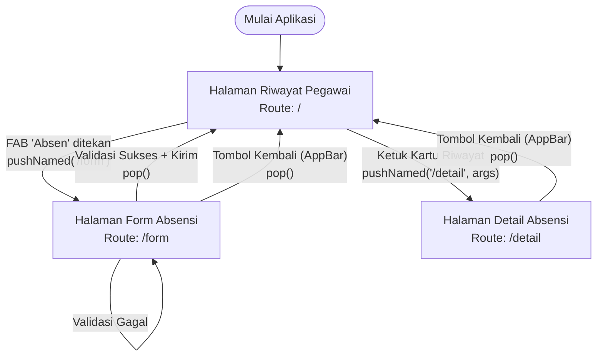

# Navigation Flow

## 1. Daftar Route
| Nama Route | Layar IA | Kebutuhan yang Dipenuhi | Tipe Route |
| :--- | :--- | :--- | :--- |
| `/` | Halaman Riwayat Pegawai | F-03 (Melihat riwayat) | `initialRoute` |
| `/form` | Halaman Form Absensi | F-01 (Kirim GPS), F-02 (Foto) | Route Pendukung |
| `/detail` | Halaman Detail Absensi | F-03 (Rincian riwayat) | Route Pendukung |

## 2. Diagram Navigation Flow

## 3. Alasan Pemilihan initialRoute
Route `/` diarahkan ke Halaman Riwayat Pegawai sebagai `initialRoute` karena langsung menjawab kebutuhan *Must have* (F-03). Pengguna lapangan (Perawat) selalu membutuhkan kepastian apakah absensinya hari ini sudah tercatat atau belum segera setelah aplikasi dibuka, sebelum memutuskan untuk membuat pengajuan absen baru.
