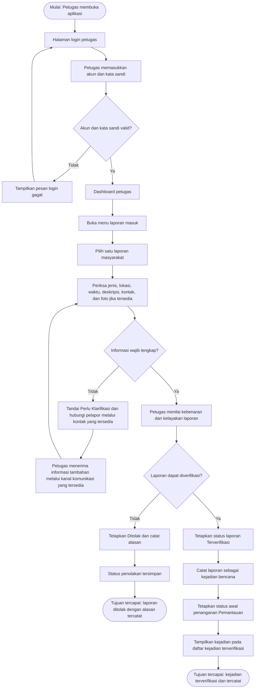

**Tugas 4: Dokumen Kebutuhan dan User Flow**  
**NIM:** 230660221088  
**Nama:** Muhammad Panji Adhitya  
**Kelas:** SI-VIIB   
**Domain Sistem Informasi:** Pendataan Bencana BPBD  
**Tugas:** Pertemuan 4 — Analisis Kebutuhan dan User Flow

## 1. Deskripsi Aplikasi

Pendataan Bencana BPBD merupakan rancangan aplikasi bergerak untuk membantu masyarakat menyampaikan laporan kejadian bencana dan membantu petugas internal BPBD menerima, memeriksa, mencatat, serta memantau perkembangan penanganan kejadian. Sistem ini dirancang untuk mengakomodasi dua sumber informasi, yaitu laporan langsung dari masyarakat melalui aplikasi dan pencatatan mandiri oleh petugas berdasarkan informasi yang diterima melalui jalur lain. Aplikasi berbasis mobile dipilih agar masyarakat dapat menyampaikan informasi menggunakan ponsel ketika sudah berada di tempat yang aman, sedangkan petugas dapat memeriksa data dan memperbarui status kejadian saat menjalankan tugas.

**Kondisi implementasi saat ini (Pertemuan 3):** Prototipe pada `main.dart` baru menampilkan dashboard daftar empat contoh kejadian bencana dengan informasi jenis bencana, lokasi kecamatan, tanggal, dan status penanganan. Data tersebut masih ditulis secara statis di dalam kode.

## 2. User Persona

Kedua persona berikut merupakan persona awal berbasis peran dan konteks Pendataan Bencana BPBD. Nama yang digunakan bersifat ilustratif, bukan identitas narasumber atau hasil wawancara. Tujuan, kendala, perangkat, dan frekuensi perlu dikonfirmasi kembali melalui peninjauan dengan pengguna atau peer review.

### Persona 1 — Rina (ilustratif) — Warga/Pelapor

| Komponen | Isi |
|:---------|:----|
| Nama dan peran | Rina — warga yang melaporkan kejadian bencana. |
| Tujuan | Menyampaikan informasi awal tentang kejadian bencana kepada BPBD dan mengetahui perkembangan status laporan yang telah dikirim. |
| Kendala | Informasi yang diketahui mungkin belum lengkap; koneksi internet di sekitar lokasi kejadian dapat tidak stabil; warga belum tentu dapat mengambil foto atau mengisi seluruh informasi ketika situasi belum aman. |
| Perangkat dan konteks | Ponsel Android. Aplikasi digunakan setelah warga berada di tempat yang aman, ketika melihat atau mengalami kejadian bencana, atau saat ingin memeriksa status laporan. |
| Frekuensi penggunaan | Tidak rutin; digunakan ketika menemukan atau mengalami kejadian bencana dan ketika perlu memeriksa laporan yang pernah dikirim. |

### Persona 2 — Andi (ilustratif) — Petugas Pendataan BPBD

| Komponen | Isi |
|:---------|:----|
| Nama dan peran | Andi — petugas internal BPBD yang menerima dan mengelola informasi kejadian bencana. |
| Tujuan | Memeriksa laporan masyarakat, mencatat kejadian yang diterima melalui jalur lain, serta memperbarui status penanganan agar informasi kejadian dapat dipantau. |
| Kendala | Laporan dapat memiliki informasi yang belum lengkap atau memerlukan klarifikasi; informasi kejadian dapat diterima dari lebih dari satu jalur; petugas perlu membedakan status pemeriksaan laporan dan status penanganan bencana. |
| Perangkat dan konteks | Ponsel Android saat bertugas di lapangan maupun saat melakukan pemantauan atau pencatatan di lingkungan kerja BPBD. |
| Frekuensi penggunaan | Rutin sesuai jadwal tugas, volume laporan, dan perkembangan kejadian bencana. |

## 3. Kebutuhan Fungsional

Kebutuhan fungsional ditulis dengan pola aktor–aksi–hasil. Status laporan dan status penanganan dibedakan: status laporan menunjukkan hasil pemeriksaan petugas, sedangkan status penanganan menunjukkan perkembangan tindak lanjut kejadian.

| ID | Rumusan Kebutuhan | Terkait Persona |
|:---|:------------------|:----------------|
| F-01 | Masyarakat dapat mengirim laporan bencana dengan mengisi jenis bencana, lokasi, tanggal/waktu kejadian, dan deskripsi singkat; sistem memvalidasi data wajib, menyimpan laporan, memberikan status awal “Menunggu Verifikasi”, dan menampilkan kode pelacakan kepada pelapor. Kontak dan foto menjadi informasi pendukung yang bersifat opsional. | Persona 1 — Warga/Pelapor |
| F-02 | Masyarakat dapat memeriksa status laporan menggunakan kode pelacakan; sistem menampilkan status terbaru berupa “Menunggu Verifikasi”, “Perlu Klarifikasi”, “Terverifikasi”, atau “Ditolak”. | Persona 1 — Warga/Pelapor |
| F-03 | Petugas BPBD dapat melihat daftar laporan yang dikirim masyarakat; sistem menampilkan jenis bencana, lokasi, tanggal/waktu, dan status pemeriksaan setiap laporan. | Persona 2 — Petugas BPBD |
| F-04 | Petugas BPBD dapat mencatat kejadian bencana yang informasinya diterima melalui jalur selain aplikasi; data kejadian yang disimpan muncul pada daftar kejadian bencana. | Persona 2 — Petugas BPBD |
| F-05 | Petugas BPBD dapat menetapkan hasil pemeriksaan laporan menjadi “Terverifikasi”, “Perlu Klarifikasi”, atau “Ditolak”; sistem menyimpan status pemeriksaan dan alasan ketika laporan memerlukan klarifikasi atau ditolak. | Persona 2 — Petugas BPBD |
| F-06 | Petugas BPBD dapat memperbarui status penanganan kejadian yang telah terverifikasi menjadi “Pemantauan”, “Penanganan”, atau “Selesai”; sistem menampilkan status terbaru pada daftar kejadian. | Persona 2 — Petugas BPBD |
| F-07 | Masyarakat dapat melihat daftar kejadian bencana yang telah terverifikasi; sistem menampilkan jenis bencana, lokasi, tanggal kejadian, dan status penanganan tanpa menampilkan data pribadi pelapor. | Persona 1 — Warga/Pelapor |
| F-08 | Petugas BPBD dapat menyaring daftar kejadian berdasarkan jenis bencana, kecamatan, atau status penanganan; sistem menampilkan data yang sesuai dengan kriteria yang dipilih. | Persona 2 — Petugas BPBD |
| F-09 | Petugas BPBD dapat masuk menggunakan akun yang terdaftar; sistem memvalidasi akun dan hanya memberikan akses pengelolaan kepada petugas yang berhasil diautentikasi. | Persona 2 — Petugas BPBD |
| F-10 | Sistem dapat mengirim notifikasi otomatis kepada pelapor ketika status pemeriksaan laporan atau status penanganan kejadian berubah. | Persona 1 — Warga/Pelapor |

## 4. Kebutuhan Nonfungsional

Angka pada kebutuhan nonfungsional berikut merupakan target rancangan yang perlu diuji pada tahap implementasi, bukan hasil pengujian prototipe saat ini.

| ID | Kategori | Rumusan | Kriteria Terukur |
|:---|:---------|:--------|:-----------------|
| NF-01 | Kegunaan | Alur pengiriman laporan masyarakat harus ringkas dan dapat dipahami tanpa bantuan petugas. | Dari halaman utama sampai konfirmasi laporan terkirim, alur diselesaikan maksimal 5 langkah/layar utama. Pengisian setiap kolom dalam satu halaman dihitung sebagai satu langkah; lampiran foto dan kontak opsional tidak menambah langkah wajib. |
| NF-02 | Kinerja | Daftar kejadian bencana harus ditampilkan dalam waktu yang dapat diterima saat digunakan petugas atau masyarakat. | Daftar berisi hingga 50 kejadian tampil dalam waktu kurang dari 3 detik pada perangkat Android uji dengan koneksi internet stabil, pada minimal 9 dari 10 kali pengujian. |
| NF-03 | Keamanan | Fitur verifikasi laporan dan perubahan status penanganan hanya boleh digunakan oleh petugas yang memiliki akses. | Dalam 10 dari 10 percobaan pengujian, akun masyarakat atau pengguna yang belum login tidak dapat membuka aksi verifikasi maupun mengubah status penanganan. |

## 5. Prioritas Fitur (MoSCoW)

Setiap kebutuhan fungsional diberi satu prioritas. Jumlah **Must have** dibatasi maksimal lima fitur sesuai ketentuan Pertemuan 4.

| Prioritas | ID Kebutuhan | Alasan |
|:----------|:-------------|:-------|
| Must have | F-01 — Pelaporan masyarakat | Pelaporan langsung merupakan salah satu tujuan utama aplikasi bagi masyarakat. Tanpa fungsi ini, masyarakat tidak dapat mengirim informasi kejadian melalui aplikasi. |
| Must have | F-03 — Daftar laporan untuk petugas | Petugas perlu melihat laporan yang masuk agar dapat melakukan pemeriksaan. Fungsi ini mendukung tugas utama Persona 2. |
| Must have | F-05 — Verifikasi laporan | Petugas perlu membedakan laporan yang terverifikasi, memerlukan klarifikasi, atau ditolak sebelum laporan diperlakukan sebagai kejadian terverifikasi. |
| Must have | F-06 — Pembaruan status penanganan | Pemantauan perkembangan kejadian merupakan tujuan utama dashboard BPBD dan sesuai dengan informasi status yang sudah ditampilkan pada prototipe Pertemuan 3. |
| Must have | F-09 — Login petugas | Verifikasi dan perubahan status merupakan tindakan internal. Autentikasi diperlukan untuk membatasi akses pengelolaan kepada petugas. |
| Should have | F-02 — Pemeriksaan status dengan kode pelacakan | Penting agar pelapor dapat mengetahui perkembangan laporannya, tetapi sementara dapat digantikan dengan konfirmasi melalui petugas atau kanal komunikasi yang tersedia. |
| Should have | F-04 — Pencatatan kejadian oleh petugas | Mendukung masukan data dari jalur selain aplikasi. Pada MVP awal, pencatatan melalui prosedur kerja yang sudah berjalan dapat menjadi cara sementara jika fungsi ini belum selesai. |
| Should have | F-07 — Daftar kejadian terverifikasi untuk masyarakat | Memberi akses informasi kejadian kepada masyarakat, tetapi alur penerimaan dan pemeriksaan laporan perlu diselesaikan lebih dahulu. |
| Could have | F-08 — Penyaringan daftar kejadian | Mempermudah pencarian ketika jumlah data bertambah, tetapi daftar dasar tetap dapat digunakan sebelum fitur penyaringan tersedia. |
| Won't have (saat ini) | F-10 — Notifikasi otomatis | Notifikasi otomatis tidak menjadi cakupan MVP semester ini karena menambah pekerjaan implementasi. Untuk tahap awal, pelapor dapat memeriksa status melalui kode pelacakan atau informasi yang ditampilkan aplikasi. |

## 6. Pemetaan Kebutuhan ke Antarmuka

Widget pada tabel berikut merupakan rancangan struktur antarmuka dengan mengacu pada materi Pertemuan 3, seperti `Scaffold`, `AppBar`, `Column`, `Row`, `Padding`, `Center`, `ListView.builder`, `Card`, `ListTile`, `Text`, dan `Icon`. Pemetaan widget bukan desain final. Kontrol input, tombol, navigasi, dan perilaku interaktif akan diperinci pada pertemuan berikutnya.

| ID Kebutuhan | Rumusan (ringkas) | Prioritas | Halaman yang Memenuhi | Widget yang Direncanakan (P3) |
|:-------------|:------------------|:----------|:----------------------------|:------------------------------|
| F-01 | Masyarakat mengirim laporan bencana | Must have | Form Laporan Bencana | `Scaffold` + `AppBar` + `Padding` + `Column` + `Text` |
| F-02 | Masyarakat memeriksa status dengan kode pelacakan | Should have | Halaman Cek Status Laporan | `Scaffold` + `AppBar` + `Padding` + `Column` + `Card` + `Text` |
| F-03 | Petugas melihat daftar laporan masuk | Must have | Halaman Laporan Masuk Petugas | `Scaffold` + `AppBar` + `ListView.builder` + `Card` + `Row` + `Column` + `Text` + `Icon` |
| F-04 | Petugas mencatat kejadian dari jalur lain | Should have | Form Pencatatan Kejadian | `Scaffold` + `AppBar` + `Padding` + `Column` + `Text` |
| F-05 | Petugas memverifikasi atau menolak laporan | Must have | Detail dan Verifikasi Laporan | `Scaffold` + `AppBar` + `Padding` + `Column` + `Row` + `Card` + `Text` |
| F-06 | Petugas memperbarui status penanganan | Must have | Detail Kejadian Bencana | `Scaffold` + `AppBar` + `Padding` + `Column` + `Row` + `Card` + `Text` |
| F-07 | Masyarakat melihat daftar kejadian terverifikasi | Should have | Dashboard Masyarakat | `Scaffold` + `AppBar` + `ListView.builder` + `Card` + `Padding` + `Row` + `Column` + `Text` + `Icon` |
| F-08 | Petugas menyaring daftar kejadian | Could have | Daftar Kejadian Petugas | `Scaffold` + `AppBar` + `Column` + `Row` + `ListView.builder` + `Card` + `Text` |
| F-09 | Petugas login | Must have | Halaman Login Petugas | `Scaffold` + `AppBar` + `Center` + `Padding` + `Column` + `Text` |
| F-10 | Sistem mengirim notifikasi otomatis | Won't have (saat ini) | Halaman Notifikasi (rencana pengembangan berikutnya) | `Scaffold` + `AppBar` + `ListView.builder` + `ListTile` + `Text` |

## 7. User Flow

### 7.1 Identitas Alur

| Aspek | Isi |
|:------|:----|
| Nama alur | Petugas memeriksa dan memverifikasi laporan bencana masyarakat |
| Aktor | Petugas Pendataan BPBD (Persona 2) |
| Tujuan alur | Petugas menyelesaikan pemeriksaan laporan; laporan yang diterima tercatat sebagai kejadian terverifikasi dan memiliki status awal penanganan, sedangkan laporan yang tidak dapat diterima memiliki status penolakan dan alasan. |

### 7.2 Diagram User Flow

### 7.3 Daftar Langkah dan Cabang

| No. | Jenis | Langkah/Halaman | Bila gagal |
|:---:|:------|:----------------|:-----------|
| 1 | Mulai | Petugas membuka aplikasi. | — |
| 2 | Halaman | Sistem menampilkan halaman login petugas. | — |
| 3 | Proses | Petugas memasukkan akun dan kata sandi. | — |
| 4 | Keputusan | Apakah akun dan kata sandi valid? | Jika tidak, sistem menampilkan pesan login gagal dan petugas kembali ke halaman login. |
| 5 | Halaman | Petugas masuk ke dashboard dan membuka menu laporan masuk. | — |
| 6 | Proses | Petugas memilih satu laporan masyarakat dari daftar. | — |
| 7 | Proses | Petugas memeriksa jenis bencana, lokasi, tanggal/waktu, deskripsi, serta kontak dan foto jika tersedia. | — |
| 8 | Keputusan | Apakah empat informasi wajib sudah lengkap? | Jika tidak, petugas menetapkan “Perlu Klarifikasi”, menghubungi pelapor melalui kontak yang tersedia, lalu memeriksa kembali setelah informasi tambahan diterima. |
| 9 | Proses | Petugas menilai kebenaran dan kelayakan laporan. | — |
| 10 | Keputusan | Apakah laporan dapat diverifikasi? | Jika tidak, petugas menetapkan “Ditolak”, mencatat alasan, dan proses berakhir dengan status penolakan tersimpan. |
| 11 | Proses | Petugas menetapkan status laporan “Terverifikasi”. | — |
| 12 | Proses | Laporan dicatat sebagai kejadian bencana. | — |
| 13 | Proses | Petugas menetapkan status awal penanganan “Pemantauan”. | — |
| 14 | Tujuan | Kejadian terverifikasi tampil pada daftar kejadian. | — |
