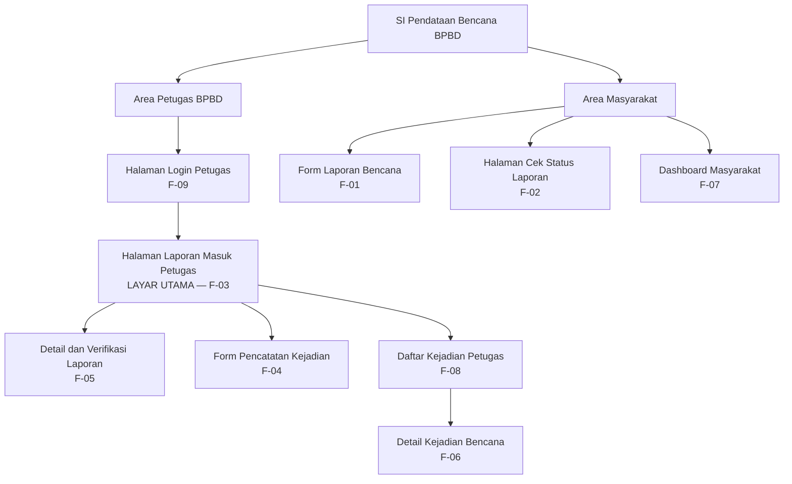

**Tugas:** Pertemuan 5 — Prototype UI/UX

**Mata Kuliah:** Pengembangan Aplikasi Bergerak (PAB)  
**NIM:** 2306602210888  
**Nama:** Muhammad Panji Adhitya  
**Kelas:** SI-VIIB     

## 1. Deskripsi Singkat

SI Pendataan Bencana BPBD dirancang untuk membantu masyarakat menyampaikan laporan kejadian bencana dan membantu petugas BPBD memeriksa laporan, mencatat kejadian, serta memantau perkembangan penanganan. Struktur layar berikut diturunkan dari tabel pemetaan kebutuhan pada Tugas 4.

## 2. Inventaris Layar

| No. | Nama layar | Pengguna | ID kebutuhan | Fungsi utama |
|---:|---|---|---|---|
| 1 | Halaman Login Petugas | Petugas BPBD | F-09 | Memvalidasi akun petugas sebelum akses pengelolaan. |
| 2 | Halaman Laporan Masuk Petugas | Petugas BPBD | F-03 | Menampilkan daftar laporan masyarakat beserta jenis bencana, lokasi, tanggal/waktu, dan status pemeriksaan. |
| 3 | Detail dan Verifikasi Laporan | Petugas BPBD | F-05 | Menampilkan isi laporan dan menyediakan keputusan Terverifikasi, Perlu Klarifikasi, atau Ditolak. |
| 4 | Form Pencatatan Kejadian | Petugas BPBD | F-04 | Memasukkan kejadian yang informasinya diterima melalui jalur selain aplikasi. |
| 5 | Daftar Kejadian Petugas | Petugas BPBD | F-08 | Menyaring daftar kejadian berdasarkan jenis bencana, kecamatan, atau status penanganan. |
| 6 | Detail Kejadian Bencana | Petugas BPBD | F-06 | Memperbarui status penanganan menjadi Pemantauan, Penanganan, atau Selesai. |
| 7 | Form Laporan Bencana | Masyarakat | F-01 | Mengirim laporan dengan jenis, lokasi, tanggal/waktu, dan deskripsi; kontak dan foto bersifat opsional. |
| 8 | Halaman Cek Status Laporan | Masyarakat | F-02 | Memeriksa status laporan menggunakan kode pelacakan. |
| 9 | Dashboard Masyarakat | Masyarakat | F-07 | Melihat daftar kejadian bencana yang telah terverifikasi. |

## 3. Diagram Information Architecture

## 4. Penetapan Layar Utama

Layar utama yang dipilih adalah **Halaman Laporan Masuk Petugas** karena memenuhi kebutuhan F-03 yang berprioritas *Must have*. Layar ini menjadi titik kerja utama petugas untuk memantau laporan masyarakat dan memilih laporan yang perlu diperiksa lebih lanjut.

## 5. Batasan Prototype

Wireframe terdiri dari layar utama Halaman Laporan Masuk Petugas dan layar pendukung Detail dan Verifikasi Laporan. Implementasi Flutter pada Tugas 5 difokuskan pada layar utama; layar lain masih berupa bagian dari rancangan arsitektur dan belum dihubungkan melalui navigasi aplikasi.
