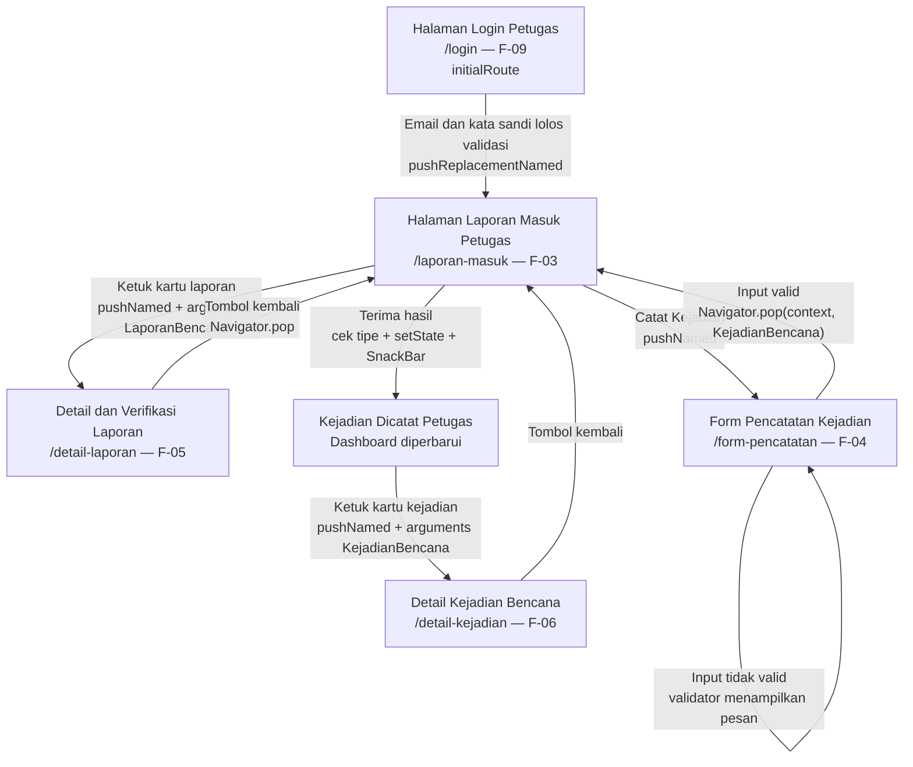

# Navigation Flow — SI Pendataan Bencana BPBD

**Mata Kuliah:** Pengembangan Aplikasi Bergerak (PAB)  
**NIM:** 230660221088  
**Nama:** Muhammad Panji Adhitya  
**Kelas:** SI-VIIB  
**Tugas:** Pertemuan 6 — Navigation Flow dan Interaksi

## 1. Ringkasan

Navigation flow ini menerjemahkan sembilan layar pada Information Architecture Tugas 5 menjadi named route Flutter. Alur utama yang telah diuji adalah petugas masuk ke aplikasi, melihat daftar laporan masyarakat, membuka detail laporan yang dipilih, dan kembali ke daftar. Petugas juga dapat membuka form pencatatan kejadian, mengisi data, menerima validasi ketika input tidak sesuai, lalu mengirim objek kejadian kembali ke dashboard. Setelah objek diterima, dashboard menambahkan data ke bagian **Kejadian Dicatat Petugas** dan menampilkan `SnackBar` konfirmasi.

## 2. Daftar Route

| Nama route | Layar pada IA Tugas 5 | Dibuka dari | Data yang dikirim / dikembalikan | Kebutuhan | Keterangan |
|---|---|---|---|---|---|
| `/login` | Halaman Login Petugas | `initialRoute` | Tidak ada | F-09 (Must have) | Form demo memvalidasi format email sederhana dan panjang kata sandi secara lokal; belum terhubung ke autentikasi server. |
| `/laporan-masuk` | Halaman Laporan Masuk Petugas | Tombol masuk pada `/login` melalui `pushReplacementNamed` | Tidak ada | F-03 (Must have) | Layar utama petugas untuk melihat laporan masyarakat dan hasil pencatatan manual. |
| `/detail-laporan` | Detail dan Verifikasi Laporan | Ketukan kartu laporan pada `/laporan-masuk` melalui `pushNamed` | Objek `LaporanBencana` melalui `arguments` | F-05 (Must have) | Data dibaca dengan pemeriksaan tipe dan cabang null; detail bersifat read-only pada tugas ini. |
| `/form-pencatatan` | Form Pencatatan Kejadian | Tombol **Catat Kejadian** pada `/laporan-masuk` melalui `pushNamed<dynamic>` | Mengembalikan objek `KejadianBencana` melalui `Navigator.pop(context, kejadianBaru)` | F-04 (Should have) | Input divalidasi. Jika valid, objek dikembalikan ke dashboard, dimasukkan ke daftar dengan `setState()`, kemudian `SnackBar` konfirmasi ditampilkan. |
| `/daftar-kejadian` | Daftar Kejadian Petugas | Menu navigasi pada `/laporan-masuk` melalui `pushNamed` | Tidak ada | F-08 (Could have) | Menampilkan satu contoh kejadian untuk membuka detail; belum terhubung dengan daftar pencatatan manual di dashboard. |
| `/detail-kejadian` | Detail Kejadian Bencana | Ketukan kartu pada `/daftar-kejadian` atau kartu hasil pencatatan di `/laporan-masuk` melalui `pushNamed` | Objek `KejadianBencana` melalui `arguments` | F-06 (Must have) | Menampilkan detail secara read-only; perubahan status penanganan belum diaktifkan. |
| `/form-laporan` | Form Laporan Bencana | Tombol **Laporkan Bencana** pada `/dashboard-masyarakat` melalui `pushNamed` | Data diisi masyarakat | F-01 (Must have) | Route terdaftar; layar masih berupa kerangka untuk alur masyarakat. |
| `/cek-status` | Halaman Cek Status Laporan | Tombol **Cek Status Laporan** pada `/dashboard-masyarakat` melalui `pushNamed` | Belum ada | F-02 (Should have) | Route terdaftar; pemeriksaan kode pelacakan belum terhubung ke data. |
| `/dashboard-masyarakat` | Dashboard Masyarakat | Menu navigasi pada `/laporan-masuk` melalui `pushNamed` | Tidak ada | F-07 (Should have) | Menampilkan contoh informasi kejadian terverifikasi dan pintasan ke fitur masyarakat. |

## 3. Initial Route

`initialRoute` ditetapkan ke `/login` karena autentikasi petugas merupakan kebutuhan F-09 yang berprioritas **Must have**. Setelah validasi lokal pada form demo berhasil, aplikasi menggunakan `pushReplacementNamed` untuk membuka `/laporan-masuk`, yaitu layar utama petugas yang memenuhi F-03 (Must have). Validasi login ini hanya simulasi antarmuka dan tidak membuktikan autentikasi akun ke server.

## 4. Diagram Navigation Flow

## 5. Pengiriman Data Antarlayar

### 5.1 Daftar laporan ke detail laporan

Saat petugas mengetuk kartu, aplikasi mengirim satu objek `LaporanBencana` melalui `arguments`. Objek memuat jenis bencana, lokasi, tanggal, deskripsi, status pemeriksaan, dan kontak apabila tersedia. Pada halaman tujuan, aplikasi memeriksa `args is LaporanBencana`; jika pemeriksaan gagal atau arguments bernilai null, halaman menampilkan pesan **Data laporan tidak tersedia** alih-alih mengalami error.

### 5.2 Form pencatatan kembali ke dashboard

Saat tombol **Catat Kejadian** ditekan, dashboard menunggu hasil dari `/form-pencatatan` melalui `Navigator.pushNamed<dynamic>`. Pemakaian tipe `dynamic` dipilih karena route yang didaftarkan melalui `MaterialApp.routes` menghasilkan `Route<dynamic>`; hasilnya kemudian diperiksa dengan `hasil is KejadianBencana` sebelum diproses. Setelah seluruh field wajib lolos validasi, form membentuk objek `KejadianBencana` dengan status awal **Pemantauan** dan mengembalikannya melalui `Navigator.pop(context, kejadianBaru)`. Dashboard menerima objek tersebut, menambahkannya pada urutan paling atas daftar `dataKejadianManual` menggunakan `setState()`, lalu menampilkan `SnackBar` konfirmasi.

Pola ini memperbaiki masalah runtime yang sebelumnya muncul ketika pemanggilan `pushNamed<KejadianBencana>` tidak cocok dengan tipe route yang didaftarkan. Setelah pemanggilan diubah menjadi `pushNamed<dynamic>` dan hasilnya diperiksa dengan type guard, alur form dapat dibuka dan hasil pencatatan dapat diterima dashboard.

### 5.3 Daftar kejadian ke detail kejadian

Setiap kartu pada bagian **Kejadian Dicatat Petugas** dapat diketuk untuk membuka `/detail-kejadian` dengan mengirim objek `KejadianBencana` melalui `arguments`. Halaman detail memeriksa tipe objek sebelum menampilkan informasi; jika data tidak tersedia, layar menampilkan pesan pengganti.

## 6. Validasi dan Feedback Form

- Jenis bencana, lokasi, tanggal/waktu, dan deskripsi wajib diisi; input kosong atau berisi spasi ditolak.
- Deskripsi harus berisi minimal 15 karakter setelah `trim()`.
- Kontak bersifat opsional; jika diisi, minimal 8 karakter.
- Pesan validasi ditampilkan di bawah field yang bermasalah melalui `TextFormField.validator`.
- Setelah input valid, form mengembalikan objek ke dashboard. `SnackBar` sukses ditampilkan di dashboard setelah data diterima dan daftar diperbarui.

## 7. Navigasi Kembali dan Batasan

- Layar detail dan layar pendukung menggunakan `pushNamed`; tombol kembali menggunakan `Navigator.pop`.
- Login menggunakan `pushReplacementNamed` agar tombol kembali dari dashboard tidak mengembalikan petugas ke halaman login demo.
- Data kejadian yang baru dicatat tersimpan sementara pada list `dataKejadianManual` di state dashboard. Data terlihat selama sesi aplikasi berjalan, tetapi akan hilang ketika aplikasi ditutup atau di-restart karena belum menggunakan database atau penyimpanan lokal permanen.
- Daftar laporan awal masih berupa data demonstrasi statis. Pencatatan manual tidak mengubah daftar laporan masuk maupun penghitung laporan menunggu verifikasi; hasilnya ditampilkan terpisah pada bagian **Kejadian Dicatat Petugas**.
- Route masyarakat disertakan agar seluruh layar IA terdaftar, tetapi form laporan masyarakat dan cek status masih berupa kerangka navigasi.
- Detail laporan dan detail kejadian masih read-only; perubahan status verifikasi maupun penanganan belum diaktifkan.
- Tidak ada package routing tambahan; implementasi menggunakan API bawaan Flutter.
