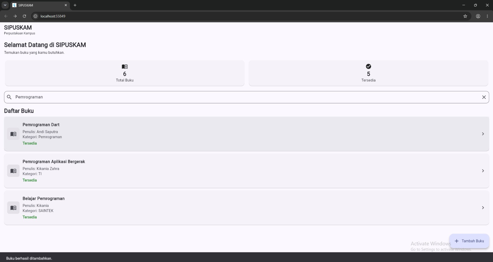
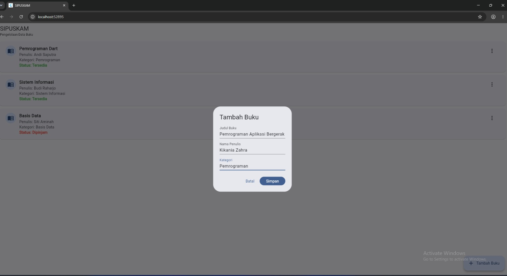
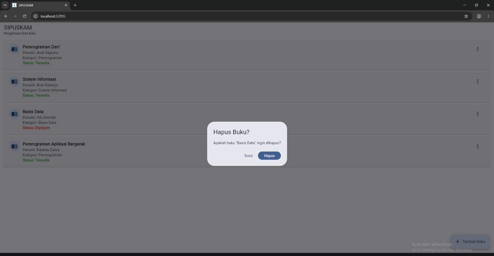

# LAPORAN PROGRESS PROJECT UTS (MILESTONE M4)

## 2.1 Identitas Project

| Identitas | Keterangan |
|---|---|
| Nama | Kikania Zahra |
| NIM | [230660221094] |
| Kelas | SI-VIIB |
| Domain Sistem Informasi | Perpustakaan Kampus |
| Judul Aplikasi | SIPUSKAM – Sistem Informasi Perpustakaan Kampus |
| Repository GitHub | https://github.com/PBWFEND/SI-VIIB-Mobile |

## 2.2 Ringkasan Eksekutif Project

SIPUSKAM (Sistem Informasi Perpustakaan Kampus) merupakan aplikasi mobile yang dikembangkan untuk mendukung penyampaian informasi dan pengelolaan data koleksi buku di lingkungan perpustakaan kampus. Pengembangan aplikasi ini dilatarbelakangi oleh kebutuhan mahasiswa dalam memperoleh informasi mengenai koleksi buku, seperti judul, penulis, kategori, dan status ketersediaan buku. Selain itu, petugas perpustakaan membutuhkan sarana yang dapat membantu proses pengelolaan data koleksi agar informasi buku dapat dicatat dan diperbarui dengan lebih mudah.

Aplikasi ini memiliki dua kelompok pengguna utama, yaitu mahasiswa sebagai pengguna yang membutuhkan informasi koleksi buku dan petugas perpustakaan sebagai pihak yang bertanggung jawab dalam pengelolaan data buku. Fitur yang dirancang meliputi melihat daftar buku, melihat detail informasi buku, mencari buku berdasarkan judul atau kata kunci, menambahkan data buku, mengubah informasi atau status buku, serta mengelola data koleksi. Pengembangan dilakukan menggunakan framework Flutter dan bahasa pemrograman Dart. Pemilihan platform mobile bertujuan agar aplikasi dapat digunakan melalui perangkat smartphone sehingga akses informasi dan pengelolaan data perpustakaan menjadi lebih praktis.

## 2.3 Ketercapaian Milestone M1 sampai M3

| Milestone | Deliverable | Status | Bukti Pengerjaan |
|---|---|---|---|
| M1 – Analisis Kebutuhan | Dokumen kebutuhan dan User Flow | Selesai | `dokumen-kebutuhan.md`, `user-flow.png` |
| M2 – UI/UX dan Navigasi | Prototype UI/UX dan implementasi navigasi | Selesai | Hasil prototype Tugas 5, `navigation-flow.md`, serta implementasi navigasi dan form pada Tugas 6 |
| M3 – MVP Awal | Model data dan CRUD lokal | Selesai | `crud-lokal.dart`, implementasi model `DataBuku`, serta fungsi Create, Read, Update, dan Delete |

### A. M1 – Analisis Kebutuhan

Pada milestone pertama, dilakukan analisis kebutuhan untuk menentukan tujuan pengembangan aplikasi SIPUSKAM serta mengidentifikasi kebutuhan pengguna. Tahap ini menghasilkan dokumen kebutuhan yang berisi deskripsi aplikasi, identifikasi pengguna, kebutuhan fungsional, kebutuhan nonfungsional, dan prioritas pengembangan fitur.

Identifikasi pengguna menghasilkan dua persona utama, yaitu Rani sebagai mahasiswa yang membutuhkan informasi mengenai koleksi buku dan Dimas sebagai petugas perpustakaan yang bertanggung jawab dalam pengelolaan data buku.

Kebutuhan fungsional aplikasi terdiri atas enam kebutuhan utama, yaitu:

1. F-01: Mahasiswa dapat melihat daftar buku.
2. F-02: Mahasiswa dapat melihat detail informasi buku.
3. F-03: Mahasiswa dapat mencari buku berdasarkan judul atau kata kunci.
4. F-04: Petugas dapat menambahkan data buku.
5. F-05: Petugas dapat mengubah informasi buku.
6. F-06: Petugas dapat memperbarui status ketersediaan buku.

Selain itu, ditetapkan kebutuhan nonfungsional yang berkaitan dengan kemudahan penggunaan dan kecepatan akses informasi. Prioritas kebutuhan ditentukan menggunakan metode MoSCoW. Tahap ini juga menghasilkan user flow yang menggambarkan alur mahasiswa ketika mencari buku hingga memperoleh informasi mengenai ketersediaannya.

Dengan demikian, dokumen analisis kebutuhan dan user flow telah disusun sebagai dasar pengembangan antarmuka dan implementasi aplikasi pada milestone berikutnya.

### B. M2 – Perancangan UI/UX dan Navigasi

Pada milestone kedua, dilakukan perancangan antarmuka aplikasi SIPUSKAM berdasarkan kebutuhan pengguna yang telah diidentifikasi sebelumnya. Perancangan UI/UX mencakup struktur halaman, komponen antarmuka, dan penyusunan tampilan yang mendukung proses pencarian serta pengelolaan informasi buku.

Prototype aplikasi mencakup halaman utama atau daftar buku dan halaman detail buku. Dalam implementasi antarmuka, digunakan komponen Flutter seperti Scaffold, AppBar, Column, Row, ListView.builder, ListTile, Card, FilledButton, dan Chip sesuai kebutuhan tampilan.

Selanjutnya, dilakukan pengembangan navigasi dan interaksi aplikasi. Implementasi mencakup penggunaan named routes pada MaterialApp, pengiriman argumen ant halaman, pemeriksaan argumen yang diterima, serta penggunaan Navigator untuk berpindah halaman dan mengembalikan data.

Pada bagian interaksi form, diterapkan Form, GlobalKey<FormState>, validator, dan TextEditingController untuk mengelola input pengguna. Pengelolaan controller juga dilakukan melalui metode dispose() agar sumber daya dapat dilepaskan ketika tidak lagi digunakan.

Dengan selesainya perancangan UI/UX dan implementasi navigasi, milestone kedua telah menghasilkan dasar antarmuka dan alur interaksi aplikasi SIPUSKAM.

### C. M3 – Implementasi MVP Awal dan CRUD Lokal

Pada milestone ketiga, pengembangan difokuskan pada implementasi pengelolaan data buku menggunakan Flutter dan bahasa pemrograman Dart. Tahap ini menghasilkan model data `DataBuku` yang digunakan untuk merepresentasikan informasi buku, meliputi ID, judul, penulis, kategori, dan status ketersediaan.

Implementasi pengelolaan data dilakukan dengan menggunakan StatefulWidget, setState(), serta struktur data List untuk menampung kumpulan data buku. Fitur pengelolaan data mencakup empat operasi utama CRUD, yaitu:

1. **Create:** Menambahkan data buku melalui form yang berisi judul, penulis, dan kategori. Input diperiksa menggunakan validasi form sebelum data ditambahkan.
2. **Read:** Menampilkan daftar buku menggunakan ListView.builder dengan informasi judul, penulis, kategori, dan status ketersediaan.
3. **Update:** Memperbarui status ketersediaan buku dari Tersedia menjadi Dipinjam atau sebaliknya.
4. **Delete:** Menghapus data buku melalui dialog konfirmasi sebelum data dihapus dari daftar.

Selain operasi CRUD, implementasi juga dilengkapi dengan pemberian umpan balik kepada pengguna menggunakan SnackBar setelah proses penambahan, perubahan status, maupun penghapusan data.

Dengan tersedianya model data dan fungsi pengelolaan data tersebut, milestone ketiga telah menghasilkan implementasi MVP awal aplikasi SIPUSKAM. Hasil pengerjaan M1, M2, dan M3 menjadi dasar untuk pengembangan aplikasi pada milestone berikutnya.

## 2.4 Matriks Kebutuhan ke Implementasi

Matriks berikut menunjukkan keterkaitan antara kebutuhan fungsional yang telah ditentukan pada tahap analisis kebutuhan dengan halaman dan operasi data dalam aplikasi SIPUSKAM.

| ID | Deskripsi Kebutuhan | Prioritas | Halaman Pemenuh | Operasi CRUD |
|---|---|---|---|---|
| F-01 | Mahasiswa dapat melihat daftar buku yang tersedia di perpustakaan. | Must | Halaman Utama / Daftar Buku | Read |
| F-02 | Mahasiswa dapat melihat detail informasi buku yang dipilih. | Must | Halaman Detail Buku | Read |
| F-03 | Mahasiswa dapat mencari buku berdasarkan judul atau kata kunci. | Must | Halaman Utama / Daftar Buku | Read |
| F-04 | Petugas dapat menambahkan data buku ke dalam sistem. | Must | Form Tambah Buku | Create |
| F-05 | Petugas dapat mengubah informasi buku. | Should | Form Edit Buku | Update |
| F-06 | Petugas dapat memperbarui status ketersediaan buku. | Should | Halaman Daftar Buku | Update |

### Penjelasan Implementasi

- F-01 berkaitan dengan fungsi penampilan daftar koleksi buku.
- F-02 berkaitan dengan rancangan halaman detail buku.
- F-03 berkaitan dengan kebutuhan pencarian koleksi berdasarkan judul atau kata kunci.
- F-04 berkaitan dengan proses penambahan data buku melalui form.
- F-05 berkaitan dengan kebutuhan pengubahan informasi koleksi buku.
- F-06 berkaitan dengan proses pembaruan status ketersediaan buku.

Pada implementasi CRUD lokal yang telah dibuat, operasi Create, Read, Update, dan Delete digunakan untuk mengelola data buku. Pengubahan yang terlihat pada kode `crud-lokal.dart` adalah perubahan status ketersediaan buku, sedangkan pengubahan judul, penulis, dan kategori merupakan kebutuhan pengembangan yang perlu dibedakan dari fungsi tersebut.

## 2.5 Tangkapan Layar Aplikasi Berjalan

Dokumentasi tangkapan layar berikut digunakan sebagai bukti implementasi fitur-fitur utama aplikasi SIPUSKAM yang telah dikembangkan.

| **No.** | **File** | **Mengisi Bukti** |
|---|---|---|
| 1 | `screenshot-daftar.png`  | **Halaman Utama / Daftar Buku** Menampilkan halaman utama aplikasi SIPUSKAM yang berisi daftar koleksi buku perpustakaan. Informasi yang ditampilkan meliputi judul buku, nama penulis, kategori, dan status ketersediaan buku. Screenshot ini menjadi bukti bahwa aplikasi telah menerapkan fungsi Read untuk menampilkan data buku kepada pengguna. |
| 2 | `screenshot-form.png`  | **Form Pengisian Data dan Validasi** Menampilkan formulir penambahan data buku yang terdiri atas kolom judul, penulis, dan kategori. Formulir dilengkapi validasi untuk memastikan seluruh kolom wajib telah diisi sebelum data disimpan. Screenshot ini menjadi bukti penerapan fungsi Create dan validasi input pada aplikasi. |
| 3 | `screenshot-hapus.png`  | **Dialog Konfirmasi Penghapusan Data** Menampilkan dialog konfirmasi sebelum data buku dihapus dari daftar. Dialog ini memberikan kesempatan kepada pengguna untuk memastikan tindakan yang dipilih sehingga dapat mengurangi risiko penghapusan data secara tidak sengaja. Screenshot ini menjadi bukti penerapan fungsi Delete pada aplikasi. |

## 2.6 Kendala dan Solusi Teknis

Selama proses pengembangan aplikasi SIPUSKAM, terdapat beberapa tantangan teknis yang berkaitan dengan penyusunan struktur program, navigasi ant halaman, serta pengelolaan data dan interaksi pengguna.

| No. | Kendala | Solusi |
|---|---|---|
| 1 | Pengaturan navigasi ant halaman membutuhkan konsistensi antara nama route, halaman tujuan, dan argumen yang dikirimkan. | Menggunakan named routes pada MaterialApp serta menyamakan nama route dengan dokumentasi alur navigasi. Argumen yang diterima juga diperiksa sebelum digunakan. |
| 2 | Pengelolaan input pada form membutuhkan validasi agar data yang dimasukkan tidak kosong dan dapat diproses dengan benar. | Menggunakan Form, GlobalKey<FormState>, validator, dan TextEditingController. Controller juga dikelola menggunakan dispose() setelah tidak digunakan. |
| 3 | Perubahan data pada aplikasi harus langsung tercermin pada tampilan agar pengguna mengetahui hasil setiap tindakan. | Menggunakan StatefulWidget dan setState() untuk memperbarui tampilan setelah proses penambahan, perubahan status, dan penghapusan data. |

Kendala tersebut menjadi bagian dari proses pembelajaran dan membantu meningkatkan pemahaman mengenai struktur aplikasi Flutter, pengelolaan state, serta hubungan antara antarmuka dan data.

## 2.7 Rencana Pengembangan Milestone M5 – REST API

Pada milestone M5, pengembangan aplikasi SIPUSKAM direncanakan berlanjut pada integrasi REST API. Pengembangan ini bertujuan menghubungkan aplikasi mobile dengan layanan backend sehingga proses pengelolaan data buku tidak hanya bergantung pada pengelolaan data lokal.

Beberapa rencana pengembangan pada milestone M5 meliputi:

1. Menyiapkan layanan backend dan basis data untuk menyimpan informasi koleksi buku.
2. Membuat endpoint REST API untuk mengambil daftar buku.
3. Mengintegrasikan proses penambahan data buku melalui API.
4. Mengintegrasikan proses pembaruan informasi dan status ketersediaan buku.
5. Mengintegrasikan proses penghapusan data buku melalui API.
6. Menggunakan HTTP request pada aplikasi Flutter untuk melakukan komunikasi dengan server.
7. Menampilkan respons dari server pada antarmuka aplikasi.

Data yang direncanakan untuk dikelola melalui REST API meliputi ID buku, judul, penulis, kategori, dan status ketersediaan. Melalui integrasi ini, aplikasi SIPUSKAM diharapkan dapat memiliki pengelolaan data yang lebih terstruktur dan terpusat serta mendukung pengembangan fitur pada tahap berikutnya.

## 2.8 Refleksi Pembelajaran

Selama proses pembelajaran hingga pertengahan semester, saya memperoleh pemahaman mengenai tahapan pengembangan aplikasi mobile menggunakan framework Flutter dan bahasa pemrograman Dart. Pembelajaran dimulai dari pemahaman dasar pemrograman, penggunaan widget untuk membangun antarmuka, perancangan UI/UX, implementasi navigasi, hingga pengelolaan data menggunakan operasi CRUD. Salah satu hal yang menjadi tantangan adalah menghubungkan komponen antarmuka dengan proses pengelolaan data agar setiap interaksi dapat berjalan sesuai kebutuhan pengguna. Melalui proyek SIPUSKAM, saya memahami bahwa pengembangan aplikasi tidak hanya berfokus pada tampilan, tetapi juga membutuhkan perencanaan kebutuhan, struktur kode, navigasi, validasi input, dan pengelolaan state yang tepat. Pengalaman ini menjadi dasar untuk mengembangkan aplikasi lebih lanjut melalui integrasi REST API pada milestone berikutnya.

## 2.9 Deklarasi Penggunaan AI

Dalam proses pengerjaan proyek SIPUSKAM, saya menggunakan bantuan AI, yaitu ChatGPT, sebagai pendukung pembelajaran dan pengembangan aplikasi. AI digunakan untuk membantu memahami konsep Flutter dan Dart, memberikan arahan mengenai struktur kode, membantu mengidentifikasi kesalahan program, memberikan masukan terhadap implementasi navigasi dan CRUD, serta membantu penyusunan dokumentasi proyek.

Seluruh hasil yang digunakan tetap diperiksa dan disesuaikan dengan kebutuhan proyek. Proses implementasi, pengujian, dan pemeriksaan hasil aplikasi dilakukan oleh penulis.