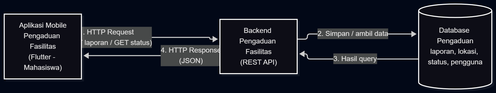

## 1. Deskripsi Sistem

Sistem ini digunakan oleh mahasiswa sebagai pelapor utama yang menemukan kerusakan fasilitas kampus (misalnya AC mati, lampu padam, keran bocor, atau proyektor rusak), serta petugas sarana prasarana yang menerima, memverifikasi, dan menindaklanjuti laporan tersebut. Masalah saat ini adalah laporan kerusakan disampaikan secara tidak terstruktur melalui grup chat, lisan, atau datang ke kantor, sehingga lokasi kerusakan sering tidak jelas, tidak ada bukti foto, laporan mudah tenggelam, dan pelapor tidak tahu apakah laporannya sudah ditangani. Solusi berbentuk aplikasi mobile karena kerusakan ditemukan saat mahasiswa bergerak di lingkungan kampus (konteks bergerak), sehingga laporan perlu dibuat langsung di tempat dalam sesi penggunaan singkat dengan memanfaatkan kamera ponsel, dan karena konektivitas terbatas di sebagian gedung, aplikasi perlu menyimpan draf laporan secara lokal sebelum dikirim ketika sinyal tersedia.

## 2. Diagram Arsitektur

Alur: Aplikasi Mobile → HTTP Request → Backend Pengaduan Fasilitas → Database Pengaduan → HTTP Response → Aplikasi Mobile.
File sumber: [`diagram.mmd`](diagram.mmd)
