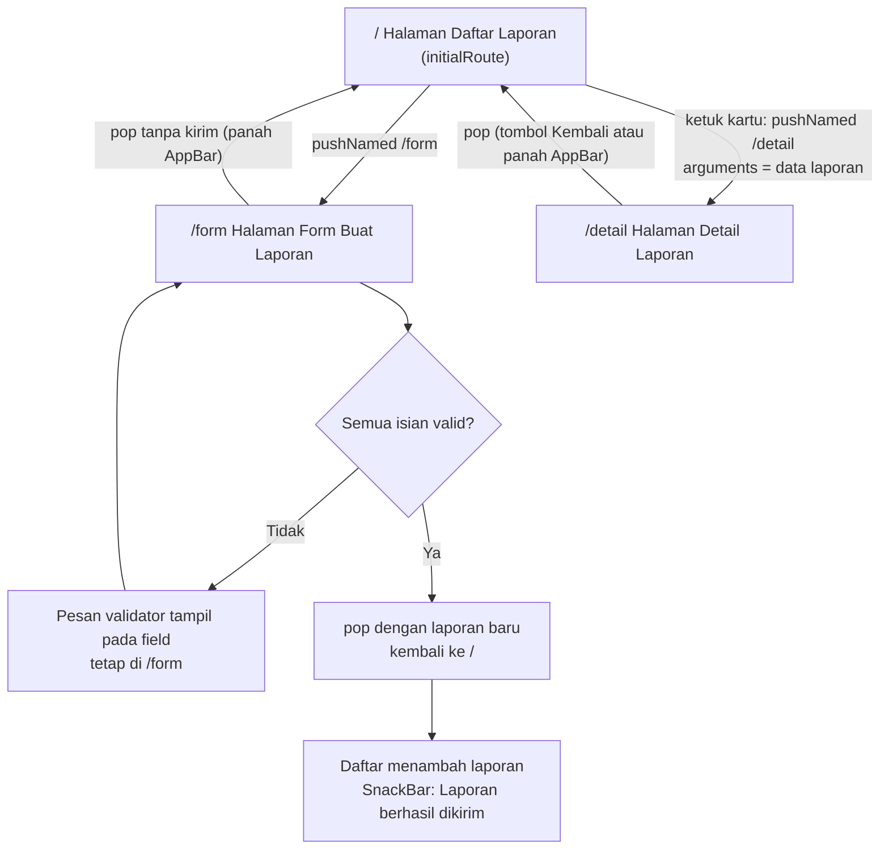

## 1. Daftar Route

`initialRoute`: **`/`**

| Nama Route | Layar (IA Tugas 5)        | Kebutuhan yang Dipenuhi | Keterangan                                       |
| :--------- | :------------------------ | :---------------------- | :----------------------------------------------- |
| `/`        | Halaman Daftar Laporan    | F-02, F-05              | `initialRoute`; layar utama                      |
| `/detail`  | Halaman Detail Laporan    | F-03                    | Menerima data laporan lewat `arguments`          |
| `/form`    | Halaman Form Buat Laporan | F-01                    | Mengembalikan laporan baru lewat `Navigator.pop` |

## 2. Diagram Alur

## 3. Alasan `initialRoute`

karena memenuhi kebutuhan Must have F-02 dan F-05, yaitu melihat daftar laporan dan status terbarunya yang paling sering dibuka pengguna. Dari layar ini pengguna dapat menuju pembuatan laporan (F-01) dan detail laporan (F-03) dengan satu ketukan.
