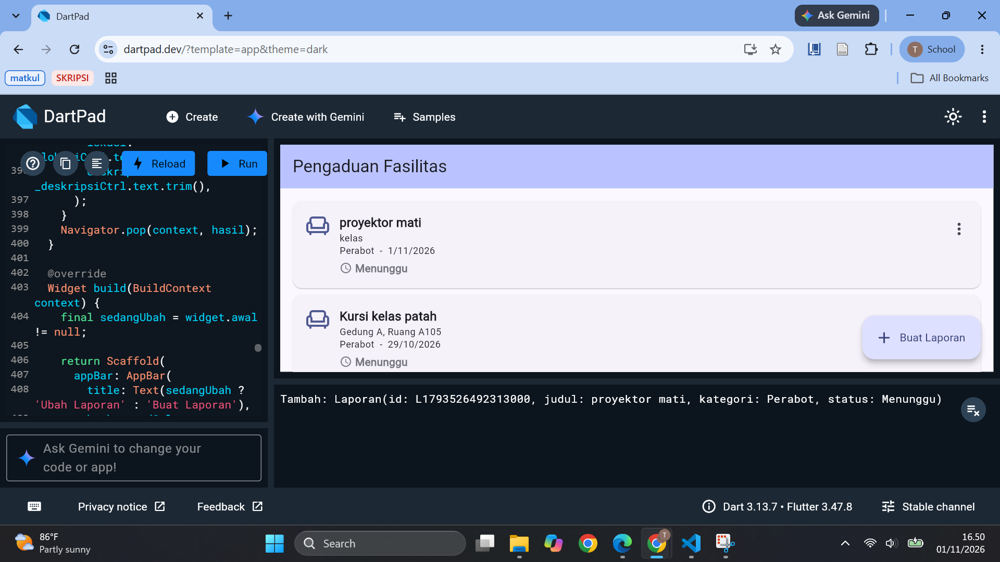
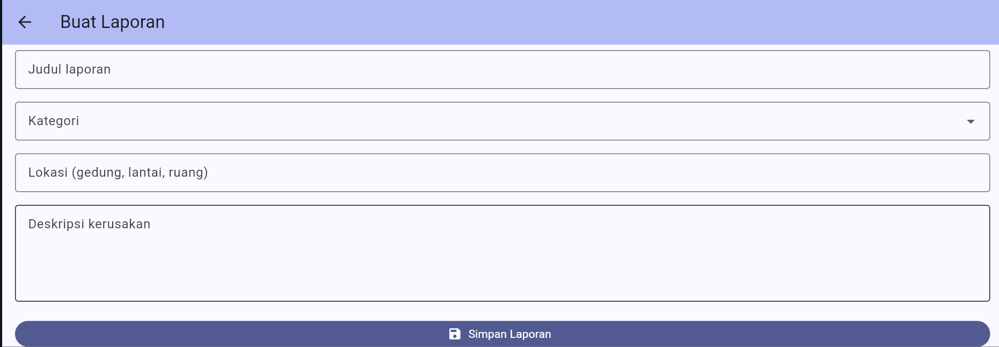
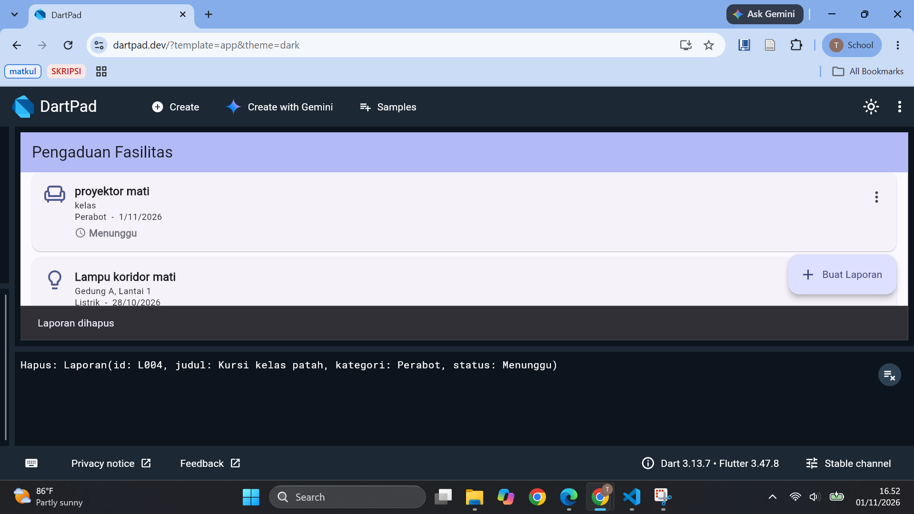

# Tabel Identitas

|                       |                                                         |
| :-------------------- | :------------------------------------------------------ |
| **Nama**              | Tika Anggraeni                                          |
| **NIM**               | 230660221098                                            |
| **Kelas**             | SI-VIIB                                                 |
| **Domain SI**         | Pengaduan Fasilitas Kampus                              |
| **Judul Aplikasi**    | Pengaduan Fasilitas Kampus                              |
| **Tautan Repository** | git clone https://github.com/PBWFEND/SI-VIIB-Mobile.git |

cd SI-VIIB-Mobile
git checkout <230660221098> |

## 1. Ringkasan Eksekutif Project

Pengaduan Fasilitas Kampus adalah aplikasi mobile untuk melaporkan kerusakan fasilitas kampus (misalnya AC mati, lampu padam, keran bocor, atau proyektor rusak) dan memantau perkembangan penanganannya. Masalah yang diselesaikan adalah laporan yang selama ini disampaikan lewat grup chat atau lisan sehingga mudah tenggelam, tidak disertai foto, lokasinya tidak jelas, dan pelapor tidak mengetahui statusnya. Pengguna utamanya adalah mahasiswa pelapor, sedangkan petugas sarana prasarana menjadi pengguna lain yang mengelola laporan melalui backend Sistem Informasi.

Solusi mobile dipilih karena kerusakan ditemukan saat mahasiswa bergerak di area kampus, sehingga laporan perlu dibuat langsung di lokasi dalam sesi singkat dengan bantuan kamera ponsel, dan aplikasi harus tetap berguna ketika sinyal lemah di dalam gedung. Sampai Minggu 7, kebutuhan, rancangan antarmuka, alur navigasi, dan CRUD lokal pada data laporan sudah selesai; fitur perangkat dan integrasi REST API masih dalam rencana.

## 2. Ketercapaian Milestone (M1 s.d. M3)

| Milestone     | Deliverable                   | Status (Selesai / Sebagian) | Catatan / Bukti                                                                                                                                 |
| :------------ | :---------------------------- | :-------------------------- | :---------------------------------------------------------------------------------------------------------------------------------------------- |
| M1: Kebutuhan | Dokumen kebutuhan + User Flow | Selesai                     | File `dokumen-kebutuhan.md` dan `user-flow.mmd` di Tugas 4 (2 persona, 10 kebutuhan fungsional, 4 nonfungsional, MoSCoW)                        |
| M2: UI/UX     | Wireframe + Navigasi          | Selesai                     | File `information-architecture.md`, `wireframe.png`, `halaman-utama.dart` di Tugas 5; `navigation-flow.md` dan `form-interaksi.dart` di Tugas 6 |
| M3: MVP Awal  | Model data + CRUD lokal       | Selesai                     | File `model-data.md` dan `crud-lokal.dart` di Tugas 7. Data tersimpan di memori dan belum persisten                                             |

## 3. Matriks Kebutuhan ke Implementasi

| ID Kebutuhan | Deskripsi Kebutuhan                                                                            | Prioritas MoSCoW | Halaman Pemenuh                                 | Operasi Data Terkait |
| :----------- | :--------------------------------------------------------------------------------------------- | :--------------: | :---------------------------------------------- | :------------------- |
| F-01         | Mahasiswa membuat laporan kerusakan dengan validasi isian wajib                                |       Must       | Halaman Form Buat Laporan                       | Create               |
| F-02         | Mahasiswa melihat daftar laporan miliknya beserta status                                       |       Must       | Halaman Daftar Laporan                          | Read                 |
| F-03         | Mahasiswa membuka detail satu laporan                                                          |       Must       | Halaman Detail Laporan                          | Read                 |
| F-04         | Mahasiswa melampirkan foto kerusakan dari kamera                                               |       Must       | Halaman Form Buat Laporan                       | Create               |
| F-05         | Mahasiswa melihat status terbaru laporannya                                                    |       Must       | Halaman Daftar Laporan                          | Read                 |
| F-06         | Mahasiswa menyimpan draf saat tanpa koneksi                                                    |      Should      | Halaman Draf Laporan                            | Create, Read         |
| F-07         | Mahasiswa menerima pemberitahuan perubahan status                                              |      Should      | Notifikasi perangkat dan Halaman Daftar Laporan | Read                 |
| F-08         | Mahasiswa mengisi lokasi otomatis dari posisi ponsel                                           |      Could       | Halaman Form Buat Laporan                       | Create               |
| F-09         | Petugas memverifikasi laporan dan mengubah status                                              |      Won't       | Di luar aplikasi mobile (backend SI)            | Update (di backend)  |
| F-10         | Petugas melihat rekap laporan                                                                  |      Won't       | Di luar aplikasi mobile (backend SI)            | Read (di backend)    |
| F-11         | Mahasiswa mengubah laporan yang masih Menunggu (kebutuhan tambahan Tugas 7)                    |      Should      | Halaman Form Buat Laporan (mode ubah)           | Update               |
| F-12         | Mahasiswa menghapus laporan yang masih Menunggu dengan konfirmasi (kebutuhan tambahan Tugas 7) |      Should      | Halaman Daftar Laporan dengan `AlertDialog`     | Delete               |

Catatan status implementasi sampai Minggu 7:

Sudah berjalan: F-01, F-02, F-11, F-12 (kode `crud-lokal.dart`); F-03 sudah berjalan di kode Tugas 6 dan belum digabung ke kode Tugas 7.
Sebagian: F-05, karena status tampil dari data lokal dan belum disinkronkan dengan server (rencana M5).
Belum: F-04, F-06, F-07, F-08 (fitur perangkat dan penyimpanan persisten pada minggu berikutnya).
Di luar aplikasi mobile: F-09 dan F-10 (backend SI).

## 4. Tangkapan Layar Aplikasi Berjalan

1. Halaman daftar laporan berisi data hasil tambah:

2. Halaman form dengan pesan validasi pada isian yang kosong:

3. Dialog konfirmasi hapus laporan:

## 5. Kendala dan Solusi Teknis

| No. | Kendala                                                                                                                                              | Cara Mengatasinya                                                                                                                                       |
| :-: | :--------------------------------------------------------------------------------------------------------------------------------------------------- | :------------------------------------------------------------------------------------------------------------------------------------------------------ |
|  1  | Berkas tugas tersebar di luar struktur folder pengumpulan (nama `diagram.png.png` dan `readme.md` berada di luar folder tugas)                       | Mengganti nama berkas sesuai ketentuan dan memindahkannya ke dalam folder tugas, lalu memeriksa ulang struktur folder sebelum push                      |
|  2  | Panel Problems di VS Code menampilkan peringatan pada `analysis_options.yaml` dan saran gaya pada `main.dart`, sehingga saya mengira kode bermasalah | Membaca jenis pesannya, menyadari bahwa itu peringatan dan saran gaya (bukan error), lalu merapikan kode yang disarankan dan tetap menjalankan aplikasi |
|  3  | Data baru yang ditambahkan ke daftar tidak muncul di layar                                                                                           | Membungkus perubahan data dengan `setState` pada `State` layar daftar sehingga tampilan dibangun ulang                                                  |

## 6. Rencana Pengembangan Milestone M5 (REST API)

Pada Minggu 9–10, daftar laporan yang sekarang berada di memori akan diambil dari layanan REST API. Data yang dipertukarkan sesuai model `Laporan`: `id`, `judul`, `kategori`, `lokasi`, `deskripsi`, `tanggal`, dan `status`.

| Kebutuhan  | Layanan backend yang dibutuhkan                                         | Cara di aplikasi                                                                                         |
| :--------- | :---------------------------------------------------------------------- | :------------------------------------------------------------------------------------------------------- |
| F-02, F-05 | Endpoint mengambil daftar laporan milik pengguna beserta status terbaru | Permintaan HTTP GET, hasil JSON diubah menjadi objek `Laporan`, dengan indikator loading dan pesan error |
| F-03       | Endpoint mengambil satu laporan berdasarkan `id`                        | Permintaan GET dari halaman detail                                                                       |
| F-01       | Endpoint menerima laporan baru dan mengembalikan `id` dari server       | Permintaan POST dari form setelah validasi lolos                                                         |
| F-11, F-12 | Endpoint mengubah dan menghapus laporan berstatus Menunggu              | Permintaan PUT dan DELETE memakai `id`                                                                   |

Backend SI juga menyediakan sisi petugas (F-09 dan F-10), yaitu mengubah status laporan dan merekap laporan, yang tidak dikerjakan di aplikasi mobile. Daftar laporan harus tampil kurang dari 3 detik (NF-02), dan hanya laporan milik pengguna yang masuk yang dikembalikan (NF-04).

## 7. Refleksi Pembelajaran Tengah Semester

Selama setengah semester ini, saya belajar bahwa membangun aplikasi Flutter pada dasarnya adalah merangkai pohon widget. Begitu memahami pola hubungan induk dan anak antarwidget, menyusun tata letak halaman terasa lebih intuitif. Pemahaman saya tentang pengelolaan state juga makin terbuka lewat StatefulWidget dan setState—saya jadi tahu bahwa antarmuka tidak akan berubah sebelum Flutter "diberi tahu" bahwa datanya sudah berganti. Selain itu, saya menyadari pentingnya memakai id unik dibanding index daftar agar proses edit dan hapus data tidak salah sasaran. Tantangan terseru sekaligus tersulit ada pada konsistensi antara kebutuhan, rancangan, dan kode nyata, terutama saat fitur ubah dan hapus baru ditambahkan di tengah jalan. Ke depannya, saya ingin melangkah lebih jauh dengan mempelajari integrasi REST API.

Deklarasi penggunaan AI: [Gemini] — [aktivitas spesifik yang dibantu];
membantu dalam pengujian, dan penyusunan laporan yang telah diverifikasi
