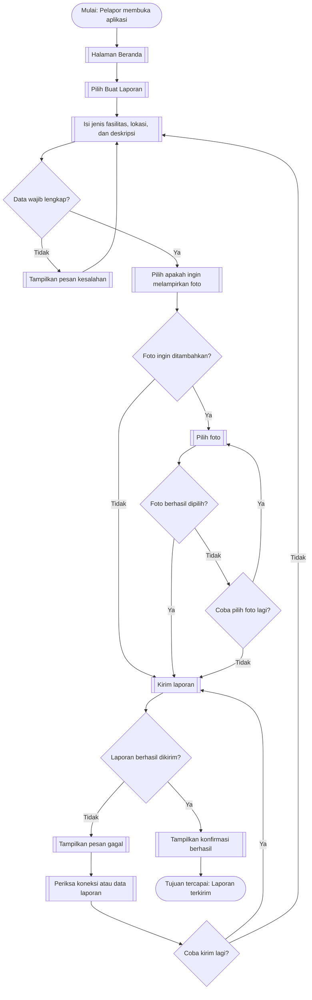

# Dokumen Kebutuhan — Lapor Fasilitas FTI

## 1. Deskripsi Aplikasi

Lapor Fasilitas FTI merupakan aplikasi mobile yang dirancang untuk membantu mahasiswa dan dosen melaporkan kerusakan fasilitas di lingkungan Fakultas Teknologi Informasi serta membantu Petugas Fasilitas Fakultas dari Bagian Peralatan memantau dan menindaklanjuti laporan. Saat ini, pelaporan kerusakan dilakukan melalui WhatsApp dan belum terpusat, sehingga pelapor dapat kesulitan menentukan pihak yang perlu dihubungi dan tidak selalu dapat memantau status perbaikan secara transparan. Melalui aplikasi ini, pelapor dapat mengisi jenis fasilitas, lokasi, dan deskripsi kerusakan serta melampirkan foto sebagai bukti tambahan dan video secara opsional, sedangkan petugas dapat melihat laporan dan memperbarui statusnya. Bentuk mobile dipilih karena pelapor dapat membuat laporan langsung ketika menemukan kerusakan di lingkungan fakultas, sementara proses pelaporan dirancang agar dapat dilakukan secara singkat melalui ponsel.

## 2. User Persona

### Persona 1 — Pelapor (Mahasiswa dan Dosen FTI)

| Komponen | Isi |
|:---------|:----|
| Nama dan peran | Pelapor — Mahasiswa dan Dosen FTI |
| Tujuan | Melaporkan kerusakan fasilitas dengan lokasi dan deskripsi yang jelas serta memantau status laporan. |
| Kendala | Tidak selalu mengetahui pihak yang harus dihubungi dan sulit memastikan apakah laporan sudah ditangani. |
| Perangkat dan konteks | Ponsel ketika berada di lingkungan fakultas dan menemukan fasilitas rusak. |
| Frekuensi penggunaan | Ketika menemukan kerusakan fasilitas. |

### Persona 2 — Petugas Fasilitas Fakultas — Bagian Peralatan

| Komponen | Isi |
|:---------|:----|
| Nama dan peran | Petugas Fasilitas Fakultas — Bagian Peralatan |
| Tujuan | Melihat laporan masuk, memeriksa informasi kerusakan, menangani kerusakan, dan memperbarui status laporan. |
| Kendala | Informasi lokasi atau kerusakan dapat kurang jelas, dan laporan yang belum ditangani perlu dipantau agar tidak terlewat. |
| Perangkat dan konteks | Ponsel ketika bekerja dan memeriksa fasilitas di lingkungan fakultas. |
| Frekuensi penggunaan | Saat terdapat laporan baru serta ketika memeriksa atau memperbarui laporan. |

## 3. Kebutuhan Fungsional

| ID | Rumusan Kebutuhan | Terkait Persona |
|:---|:------------------|:----------------|
| F-01 | Pelapor dapat mengirim laporan kerusakan fasilitas dengan mengisi jenis fasilitas, lokasi, dan deskripsi masalah, serta melampirkan foto sebagai bukti tambahan jika tersedia. | Persona 1 |
| F-02 | Pelapor dapat melampirkan video sebagai bukti tambahan pada laporan jika diperlukan. | Persona 1 |
| F-03 | Petugas Fasilitas Fakultas dapat melihat daftar laporan kerusakan yang masuk agar laporan yang perlu ditindaklanjuti dapat diketahui. | Persona 2 |
| F-04 | Petugas Fasilitas Fakultas dapat membuka detail laporan yang dipilih untuk melihat informasi fasilitas, lokasi, deskripsi, dan lampiran jika tersedia. | Persona 2 |
| F-05 | Petugas Fasilitas Fakultas dapat mengubah status laporan menjadi `Dikerjakan` ketika penanganan kerusakan mulai dilakukan. | Persona 2 |
| F-06 | Petugas Fasilitas Fakultas dapat mengubah status laporan menjadi `Selesai` setelah perbaikan selesai dilakukan serta melampirkan foto bukti perbaikan jika tersedia. | Persona 2 |
| F-07 | Pelapor dapat melihat status terbaru dari laporan yang telah dikirim agar dapat mengetahui perkembangan penanganannya. | Persona 1 |
| F-08 | Pelapor dapat menerima notifikasi ketika status laporan yang dikirim berubah. | Persona 1 |
| F-09 | Petugas Fasilitas Fakultas dapat menerima notifikasi ketika laporan kerusakan baru masuk. | Persona 2 |
| F-10 | Petugas Fasilitas Fakultas dapat menerima pengingat apabila laporan masih berstatus `Menunggu` setelah satu hari sejak laporan dikirim. | Persona 2 |

## 4. Kebutuhan Nonfungsional

| ID | Kategori | Rumusan | Kriteria Terukur |
|:---|:---------|:--------|:-----------------|
| NF-01 | Kinerja | Daftar laporan perlu ditampilkan secara responsif ketika koneksi internet stabil. | Dalam pengujian 20 kali, daftar laporan tampil maksimal 3 detik pada sekurang-kurangnya 19 percobaan (95%). |
| NF-02 | Kegunaan | Pengguna dari kedua kelompok peran perlu dapat menyelesaikan tugas utama tanpa bantuan setelah membaca panduan singkat. | Sekurang-kurangnya 90% peserta pada masing-masing kelompok peran dapat menyelesaikan tugas yang ditentukan tanpa bantuan: pelapor mengirim laporan dan petugas menemukan serta membuka detail laporan. |

 

## 5. Prioritas Fitur (MoSCoW)

| Prioritas | ID Kebutuhan | Alasan |
|:----------|:-------------|:-------|
| Must have | F-01, F-03, F-04, F-06, F-07 | Fitur ini mendukung proses inti aplikasi: pelapor mengirim laporan, petugas menemukan dan memeriksa laporan, petugas menandai perbaikan selesai, dan pelapor memantau status. Tanpa fungsi tersebut, tujuan utama aplikasi belum terpenuhi. |
| Should have | F-05, F-08, F-09, F-10 | Pembaruan status menjadi `Dikerjakan`, notifikasi, dan pengingat membantu transparansi serta tindak lanjut. Namun, fungsi inti pelaporan dan pemeriksaan status tetap menjadi prioritas utama pada tahap awal. |
| Could have | F-02 | Video dapat memberi konteks tambahan tentang kerusakan, tetapi foto serta deskripsi sudah dapat menjadi bukti awal sehingga video tidak wajib untuk pelaporan dasar. |
| Won't have (saat ini) | Tidak ada kebutuhan fungsional tambahan yang ditetapkan pada kategori ini. | Semua kebutuhan F-01 sampai F-10 di atas tetap berada dalam cakupan rencana dengan prioritas masing-masing. Jika ruang lingkup atau waktu pengembangan berubah, fitur yang ditunda perlu disebutkan dan diberi alasan secara eksplisit. |

## 6. Pemetaan Kebutuhan ke Antarmuka

| ID Kebutuhan | Rumusan (ringkas) | Prioritas | Halaman yang Memenuhi | Widget yang Direncanakan (P3) |
|:-------------|:------------------|:----------|:----------------------|:------------------------------|
| F-01 | Mengirim laporan dengan data wajib dan foto opsional | Must have | Formulir Laporan | `Scaffold`, `AppBar`, `Form`, `Column`, `DropdownButtonFormField`, `TextFormField`, tombol kirim, pemilih foto |
| F-02 | Melampirkan video opsional | Could have | Formulir Laporan | `Column`, tombol lampiran, pemilih video |
| F-03 | Melihat daftar laporan masuk | Must have | Daftar Laporan Petugas | `Scaffold`, `AppBar`, `ListView.builder`, `Card`, `ListTile` |
| F-04 | Melihat detail laporan terpilih | Must have | Detail Laporan | `Scaffold`, `AppBar`, `Column`, `Row`, teks informasi, tampilan lampiran |
| F-05 | Mengubah status menjadi `Dikerjakan` | Should have | Detail Laporan | `DropdownButton` atau tombol aksi status |
| F-06 | Mengubah status menjadi `Selesai` dan foto bukti opsional | Must have | Detail Laporan | `Column`, tombol aksi status, pemilih foto |
| F-07 | Melihat status terbaru laporan | Must have | Daftar Laporan Saya dan Detail Laporan | `ListView.builder`, `Card`, `ListTile`, label status |
| F-08 | Menerima notifikasi perubahan status | Should have | Notifikasi perangkat | Notifikasi sistem |
| F-09 | Menerima notifikasi laporan baru | Should have | Notifikasi perangkat petugas | Notifikasi sistem |
| F-10 | Menerima pengingat setelah satu hari berstatus `Menunggu` | Should have | Pengingat Petugas / notifikasi perangkat | Notifikasi sistem |

Widget di atas merupakan rancangan antarmuka. Prototype Tugas 3 telah menggunakan beberapa widget seperti `Scaffold`, `AppBar`, `SafeArea`, `IndexedStack`, `NavigationBar`, `ListView`, `Container`, `Row`, `Column`, `Form`, `DropdownButtonFormField`, dan `TextFormField`. Fitur seperti pemilihan foto/video, notifikasi, pengingat satu hari, serta halaman detail khusus masih perlu dikembangkan jika belum tersedia pada prototype tersebut.

## 7. User Flow

### 7.1 Identitas Alur

| Aspek | Isi |
|:--|:--|
| Nama alur | Mengirim laporan kerusakan fasilitas |
| Aktor | Pelapor (mahasiswa atau dosen) |
| Tujuan alur | Laporan kerusakan berhasil terkirim dan pelapor menerima konfirmasi. |

### 7.2 Diagram User Flow

### 7.3 Daftar Langkah

| No. | Jenis | Langkah/Halaman | Bila gagal |
|:--:|:--|:--|:--|
| 1 | Mulai | Pelapor membuka aplikasi. | Pelapor mencoba membuka aplikasi kembali. |
| 2 | Halaman | Sistem menampilkan Halaman Beranda. | Pelapor mencoba kembali ke halaman awal aplikasi. |
| 3 | Aksi | Pelapor memilih **Buat Laporan**. | Pelapor dapat kembali ke Beranda jika belum ingin melanjutkan. |
| 4 | Formulir | Pelapor mengisi jenis fasilitas, lokasi, dan deskripsi kerusakan. | Pelapor melengkapi data wajib yang masih kosong. |
| 5 | Keputusan | Sistem memeriksa kelengkapan data wajib. Jika tidak lengkap, sistem menampilkan pesan kesalahan dan mengembalikan pelapor ke formulir. | Pelapor memperbaiki isian yang belum lengkap lalu memeriksa kembali data. |
| 6 | Aksi | Jika data lengkap, pelapor memilih apakah ingin melampirkan foto. | Pelapor dapat melanjutkan tanpa foto karena foto bersifat opsional. |
| 7 | Keputusan | Pelapor menentukan apakah foto ingin ditambahkan. Jika ya, alur menuju pemilihan foto; jika tidak, alur menuju pengiriman laporan. | Pelapor dapat melanjutkan tanpa foto. |
| 8 | Aksi | Pelapor memilih foto dari perangkat. | Pelapor mencoba memilih foto kembali. |
| 9 | Keputusan | Sistem memeriksa apakah foto berhasil dipilih. Jika berhasil, alur menuju pengiriman laporan; jika tidak, sistem menanyakan apakah pelapor ingin mencoba lagi. | Jika pelapor memilih mencoba lagi, alur kembali ke pemilihan foto. Jika tidak, alur dilanjutkan tanpa foto. |
| 10 | Aksi | Pelapor memilih **Kirim Laporan**. | Jika pengiriman gagal, sistem menampilkan pesan gagal agar pelapor dapat memeriksa penyebabnya. |
| 11 | Keputusan | Sistem memeriksa apakah laporan berhasil dikirim. Jika berhasil, sistem menampilkan konfirmasi; jika tidak, sistem menampilkan pesan gagal. | Pelapor memeriksa koneksi internet atau data laporan sebelum menentukan langkah berikutnya. |
| 12 | Aksi | Setelah pesan gagal ditampilkan, pelapor memeriksa koneksi internet atau data laporan. | Pelapor memperbaiki masalah yang ditemukan jika memungkinkan. |
| 13 | Keputusan | Pelapor menentukan apakah ingin mencoba mengirim laporan kembali. Jika ya, alur kembali ke pengiriman laporan; jika tidak, alur kembali ke formulir. | Pelapor dapat memperbaiki data sebelum mengirim kembali. |
| 14 | Hasil | Jika pengiriman berhasil, sistem menampilkan konfirmasi bahwa laporan berhasil dikirim. | Jika konfirmasi tidak muncul, pelapor perlu memeriksa status pengiriman agar tidak membuat laporan duplikat. |
| 15 | Selesai | Laporan berhasil terkirim dan tujuan alur tercapai. | — |

