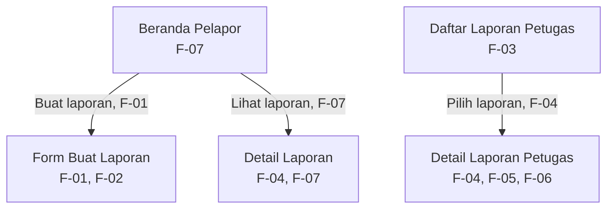

# 1.1 Information Architecture

## 1. Inventaris Layar

| Nama Layar | ID Kebutuhan | Fungsi |
|---|---|---|
| Beranda Pelapor | F-01, F-07 | Menampilkan daftar dan status laporan serta menjadi titik masuk untuk membuat laporan baru. |
| Form Buat Laporan | F-01, F-02 | Memasukkan jenis fasilitas, lokasi, deskripsi, dan lampiran foto atau video opsional. |
| Detail Laporan | F-04, F-07 | Menampilkan informasi lengkap laporan dan status terkininya. |
| Daftar Laporan Petugas | F-03 | Menampilkan laporan kerusakan yang masuk untuk ditinjau petugas. |
| Detail Laporan Petugas | F-04, F-05, F-06 | Menampilkan rincian laporan dan menyediakan fungsi pembaruan status serta bukti perbaikan. |

## 2. Diagram IA

# 1.1 Information Architecture

## 1. Inventaris Layar

| Nama Layar | ID Kebutuhan | Fungsi |
|---|---|---|
| Beranda Pelapor | F-01, F-07 | Menampilkan daftar dan status laporan serta menjadi titik masuk untuk membuat laporan baru. |
| Form Buat Laporan | F-01, F-02 | Memasukkan jenis fasilitas, lokasi, deskripsi, dan lampiran foto atau video opsional. |
| Detail Laporan | F-04, F-07 | Menampilkan informasi lengkap laporan dan status terkininya. |
| Daftar Laporan Petugas | F-03 | Menampilkan laporan kerusakan yang masuk untuk ditinjau petugas. |
| Detail Laporan Petugas | F-04, F-05, F-06 | Menampilkan rincian laporan dan menyediakan fungsi pembaruan status serta bukti perbaikan. |

## 2. Diagram IA

Beranda Pelapor ditetapkan sebagai layar utama bagi mahasiswa dan dosen. Daftar Laporan Petugas merupakan titik masuk bagi petugas sesuai perannya.

## 3. Alasan Pemilihan Layar Utama

Beranda Pelapor dipilih sebagai layar utama karena mendukung F-07 untuk melihat status terbaru laporan, yang termasuk kebutuhan *Must Have*. Tombol untuk membuat laporan juga menjadi titik masuk menuju F-01, sehingga pengguna dapat memulai pelaporan dengan mudah.

Beranda Pelapor ditetapkan sebagai layar utama bagi mahasiswa dan dosen. Daftar Laporan Petugas merupakan titik masuk bagi petugas sesuai perannya.

 