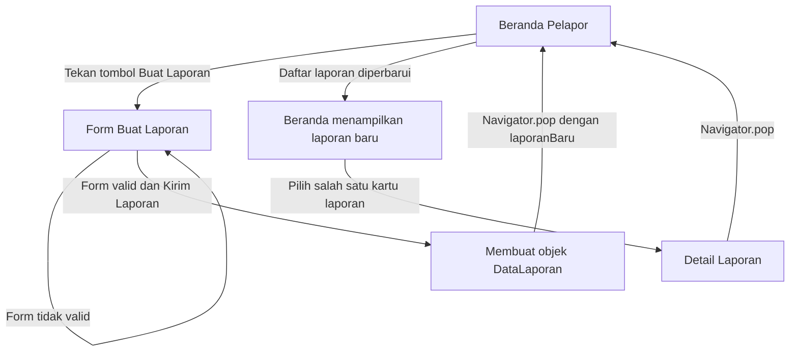

# Navigation Flow – Lapor Fasilitas FTI

## 1. Daftar Route

| Nama Route | Halaman | Requirement ID | Initial Route |
|---|---|---|---|
| `/` | Beranda Pelapor | F-01, F-07 | Ya |
| `/form` | Form Buat Laporan | F-01, F-02 | Tidak |
| `/detail` | Detail Laporan | F-04, F-07 | Tidak |

## 2. Diagram Alur Navigasi

Diagram berikut menggambarkan alur utama pelapor dalam membuat dan melihat laporan kerusakan fasilitas.

## 3. Mekanisme Navigasi dan Transfer Data

### A. Beranda ke Form Buat Laporan

Pelapor menekan tombol Buat Laporan pada halaman Beranda. Aplikasi menjalankan `Navigator.pushNamed()` dengan route `/form` untuk membuka halaman Form Buat Laporan.

### B. Form Buat Laporan ke Beranda

Pelapor mengisi jenis fasilitas, lokasi kerusakan, dan deskripsi kerusakan. Setelah seluruh validasi berhasil, aplikasi membuat objek `DataLaporan`.

Objek laporan dikirim kembali ke halaman Beranda menggunakan `Navigator.pop(context, laporanBaru)`.

Halaman Beranda menerima hasil navigasi dan memperbarui daftar laporan menggunakan `setState()`, sehingga laporan baru langsung ditampilkan.

### C. Beranda ke Detail Laporan

Pelapor memilih salah satu kartu laporan. Aplikasi menjalankan `Navigator.pushNamed()` menuju route `/detail` dengan mengirimkan objek laporan melalui parameter `arguments`.

### D. Detail Laporan ke Beranda

Halaman Detail Laporan mengambil data menggunakan `ModalRoute.of(context)?.settings.arguments`.

Aplikasi memeriksa tipe data menggunakan `is DataLaporan` sebelum menampilkan informasi laporan. Pengguna dapat kembali ke Beranda menggunakan `Navigator.pop(context)`.

## 4. Alasan Pemilihan Initial Route

Route `/` dipilih sebagai initial route karena Beranda Pelapor merupakan halaman utama yang pertama kali digunakan setelah aplikasi dibuka.

Dari halaman Beranda, pelapor dapat melihat daftar laporan, memantau status laporan, membuka detail laporan, dan membuat laporan baru. Penempatan Beranda sebagai halaman awal membantu pengguna memahami fungsi utama aplikasi dan mempermudah akses terhadap fitur pelaporan fasilitas.