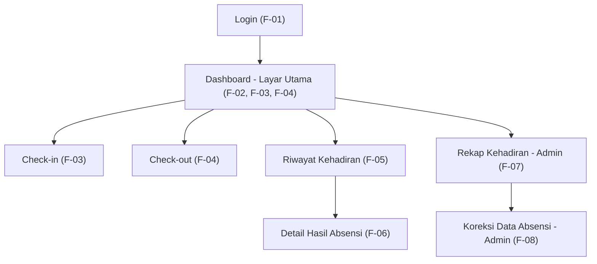

# Information Architecture — Mantra Attendance

## 1. Inventaris Layar

| No | Layar | Kebutuhan yang dipenuhi | Prioritas |
|---|---|---|---|
| 1 | Login | F-01 | Must |
| 2 | Dashboard (layar utama) | F-02, F-03, F-04, F-05 (ringkasan) | Must |
| 3 | Check-in | F-03 | Must |
| 4 | Check-out | F-04 | Must |
| 5 | Riwayat Kehadiran | F-05 | Must |
| 6 | Detail Hasil Absensi | F-06 | Should |
| 7 | Rekap Kehadiran (Admin) | F-07 | Should |
| 8 | Koreksi Data Absensi (Admin) | F-08 | Could |

> Catatan: samakan nama layar dengan kolom "Layar yang Memenuhi" pada tabel pemetaan Tugas 4.

## 2. Diagram IA

## 3. Alasan Layar Utama

Dashboard dipilih sebagai layar utama karena memenuhi kebutuhan Must have yang paling sering dipakai Raka setiap hari kerja: melihat status kehadiran hari ini (F-02) dan melakukan check-in/check-out (F-03, F-04) dari satu titik masuk. Rancangan ini mendukung NF-01 (proses utama maksimal 5 langkah dari halaman utama), karena aksi utama langsung terlihat tanpa menggulir.
