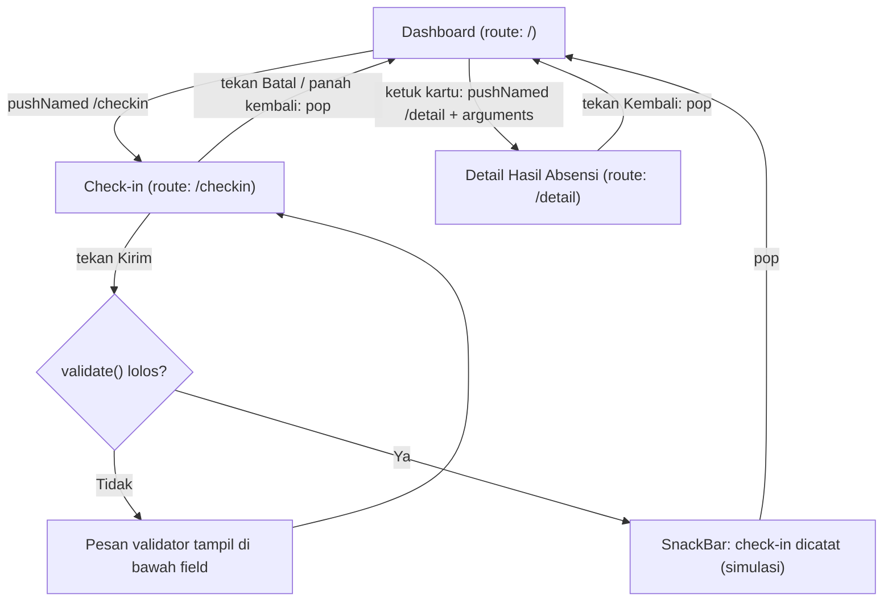

# Navigation Flow — Mantra Attendance

## 1. Daftar Route

| Nama route | Layar (sesuai IA Tugas 5) | Dibuka dari | Data yang dikirim | Kebutuhan |
|---|---|---|---|---|
| `/` (**initialRoute**) | Dashboard | Awal aplikasi | - | F-02, F-05 |
| `/checkin` | Check-in | Tombol FAB "Check-in" (`pushNamed`) | - (form diisi pengguna) | F-03 |
| `/detail` | Detail Hasil Absensi | Ketukan kartu riwayat (`pushNamed` + `arguments`) | Objek `DataKehadiran` (read-only) | F-05, F-06 |

Layar Login (F-01), Check-out (F-04), dan layar Admin (F-07, F-08) belum diberi route pada tugas ini. Alasannya ada di bagian 4.

## 2. Diagram Navigation Flow (tugas Must have: Check-in, F-03)

Dari Dashboard, alur check-in selesai dalam 3 langkah: ketuk Check-in, isi lokasi, tekan Kirim. Ini memenuhi NF-01 (maksimal 5 langkah dari halaman utama).

## 3. Alasan initialRoute

Dashboard (`/`) dipilih sebagai `initialRoute` karena sudah ditetapkan sebagai layar utama pada IA Tugas 5. Layar ini memenuhi kebutuhan Must have F-02 (status kehadiran) dan menjadi titik masuk ke F-03 (check-in).

## 4. Catatan Cakupan

Login (F-01) tidak dijadikan route karena materi Pertemuan 6 hanya membahas `pushNamed` dan `pop`. Perpindahan Login ke Dashboard butuh pola lain dan baru bermakna bila autentikasi sudah ada. Pada prototype ini, pengguna dianggap sudah masuk. Check-out (F-04) akan dibangun setelah penyimpanan data lokal pada Pertemuan 7, karena syaratnya adalah adanya catatan check-in.
