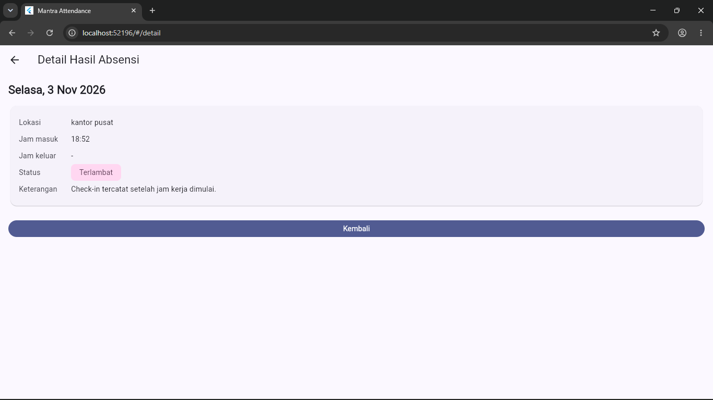
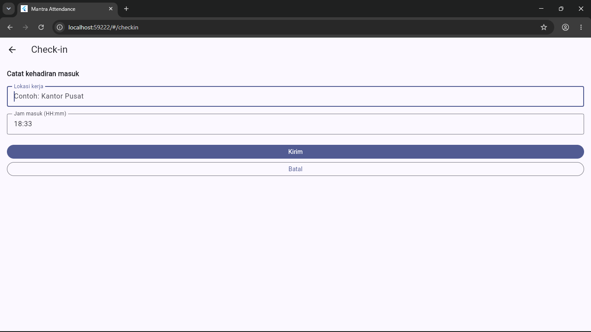
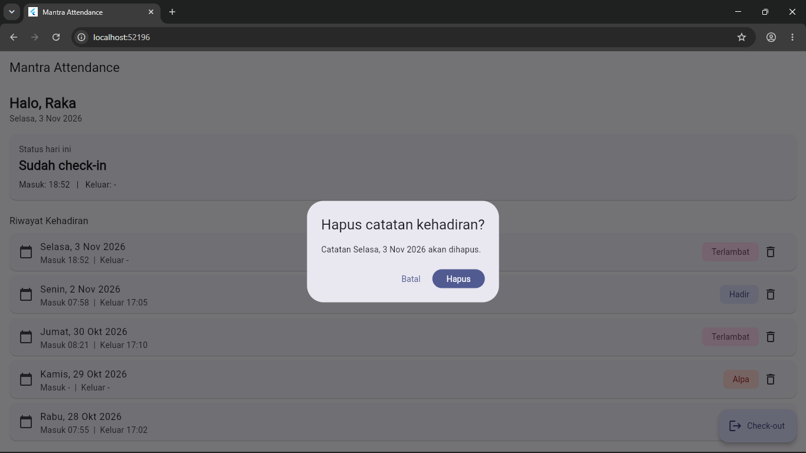

# Laporan Progress Project UTS (Milestone M4)

| | |
|:--|:--|
| **Nama** | Jajang Komara |
| **NIM** | 230660221102 |
| **Kelas** | SI-VIIB |
| **Domain SI** | Sistem Informasi Absensi Karyawan PT Mantra Group |
| **Judul Aplikasi** | Mantra Attendance |
| **Tautan Repository** | https://github.com/PBWFEND/SI-VIIB-Mobile/tree/main/230660221102/tugas-8 |

---

## 1. Ringkasan Eksekutif Project
Mantra Attendance adalah aplikasi mobile untuk membantu karyawan PT Mantra Group mencatat kehadiran harian (check-in dan check-out), melihat status kehadiran hari berjalan, dan memeriksa riwayat absensi. Pengguna utamanya adalah karyawan (persona Raka) dan admin absensi (persona Dina) yang memantau serta memeriksa data kehadiran.

Solusi mobile dipilih karena absensi dilakukan di awal dan akhir jam kerja menggunakan perangkat yang dibawa sehari-hari, tanpa harus membuka komputer. Dengan begitu proses absensi lebih cepat, dan informasi kehadiran bisa diakses langsung oleh karyawan.

## 2. Ketercapaian Milestone (M1 s.d. M3)

| Milestone | Deliverable | Status (Selesai / Sebagian) | Catatan / Bukti |
|:----------|:------------|:----------------------------|:----------------|
| M1: Kebutuhan | Dokumen kebutuhan + User Flow | Selesai | `tugas-4/dokumen-kebutuhan.md`, `user-flow.mmd`, `user-flow.png` (2 persona, 8 kebutuhan fungsional, 3 nonfungsional, MoSCoW) |
| M2: UI/UX | Wireframe + Navigasi | Selesai | `tugas-5/` (IA, wireframe, halaman utama, catatan keputusan UI) dan `tugas_praktikum6/` (navigation flow, 3 route bernama, form dengan validasi, SnackBar) |
| M3: MVP Awal | Model data + CRUD lokal | Selesai | `tugas_praktikum7/crud-lokal.dart`. CRUD berjalan in-memory. Persistensi dan Login belum dibangun. |

## 3. Matriks Kebutuhan ke Implementasi

| ID Kebutuhan | Deskripsi Kebutuhan | Prioritas MoSCoW | Halaman Pemenuh | Operasi Data Terkait |
|:-------------|:-------------------|:----------------:|:----------------|:---------------------|
| F-01 | Karyawan masuk dengan akun terdaftar | Must | Belum dibangun (halaman Login) | - |
| F-02 | Karyawan melihat status kehadiran hari ini | Must | Dashboard (kartu status hari ini) | Read |
| F-03 | Karyawan melakukan check-in bila belum ada catatan hari ini | Must | Form Check-in | Create |
| F-04 | Karyawan melakukan check-out bila sudah check-in | Must | Dashboard (tombol aksi Check-out) | Update |
| F-05 | Karyawan melihat riwayat kehadiran | Must | Dashboard (daftar riwayat) | Read |
| F-06 | Karyawan melihat hasil atau status absensi | Should | Detail Hasil Absensi | Read |
| F-07 | Admin melihat data kehadiran karyawan per periode | Should | Belum dibangun (halaman Rekap, butuh data banyak karyawan) | - |
| F-08 | Admin memeriksa dan memperbarui data absensi | Could | Dashboard (hapus catatan dengan konfirmasi, simulasi koreksi) | Delete |

## 4. Tangkapan Layar Aplikasi Berjalan

| No. | File | Mengisi Bukti |
|:---:|:-----|:--------------|
| 1 | `screenshot-daftar.png` | Dashboard dengan daftar riwayat dan status berwarna |
| 2 | `screenshot-form.png` | Form Check-in dengan pesan validasi pada field |
| 3 | `screenshot-hapus.png` | Dialog konfirmasi hapus catatan |

## 5. Kendala dan Solusi Teknis

| No. | Kendala | Cara Mengatasinya |
|:---:|:--------|:------------------|
| 1 | Kartu status pada Dashboard menyempit mengikuti isi teks sehingga tidak sejajar dengan kartu riwayat yang selebar layar | Membungkus isi kartu dengan `SizedBox(width: double.infinity)` agar lebarnya mengikuti layar |
| 2 | Pull Request ke repository kelas gagal pada pemeriksaan otomatis karena folder tugas diganti nama sehingga berkas lama terbaca terhapus, dan branch tertinggal dari `main` kelas | Mengembalikan nama folder, menggabungkan `main` kelas terbaru ke branch (`git merge upstream/main`), memindahkan berkas Tugas 5 ke folder `tugas-5` sesuai struktur terbaru, lalu push ulang |
| 3 | `flutter run` gagal dengan pesan `No pubspec.yaml file found` | Terminal dijalankan dari folder yang salah. Setelah berpindah ke folder project Flutter, aplikasi berjalan normal |

## 6. Rencana Pengembangan Milestone M5 (REST API)
Data yang saat ini disimpan in-memory akan dipindahkan ke server melalui REST API. Data yang akan diambil dan dikirim adalah akun pengguna untuk login (F-01), catatan kehadiran hari ini (F-02), pengiriman check-in dan check-out (F-03, F-04), riwayat kehadiran per periode (F-05, F-06), serta rekap kehadiran seluruh karyawan untuk admin (F-07, F-08).

Layanan backend yang dibutuhkan adalah endpoint autentikasi, endpoint absensi untuk karyawan (check-in, check-out, riwayat), dan endpoint admin (rekap per periode dan koreksi data), dengan basis data yang menyimpan akun dan catatan absensi. Di sisi aplikasi akan dipakai package `http`, `async/await`, penguraian JSON ke model `DataKehadiran`, serta penanganan loading state dan error.

## 7. Refleksi Pembelajaran Tengah Semester
Selama mengikuti pembelajaran Pemrograman Aplikasi Bergerak, saya mulai memahami bahwa Flutter menggunakan konsep widget tree, yaitu struktur hierarki yang terdiri dari widget-widget untuk membangun tampilan aplikasi. Setiap komponen, seperti MaterialApp, Scaffold, AppBar, Column, dan Text, memiliki peran masing-masing dan saling berhubungan dalam membentuk antarmuka aplikasi. Dari konsep tersebut, saya memahami bahwa membangun tampilan tidak hanya sekadar menyusun komponen, tetapi juga perlu memperhatikan hubungan dan struktur antar-widget agar tampilan dapat berjalan sesuai kebutuhan.

Saya juga memahami bahwa data yang digunakan dalam suatu tampilan perlu dikelola melalui satu sumber State yang jelas agar perubahan data dapat terkontrol dan konsisten. Pada Flutter, setState() digunakan untuk memberi tahu framework bahwa terdapat perubahan pada State sehingga widget perlu dibangun ulang (rebuild) untuk menampilkan kondisi data terbaru. Tanpa mekanisme tersebut, perubahan data mungkin sudah terjadi, tetapi tampilan belum tentu langsung menunjukkan hasil perubahan.

Tantangan yang paling saya rasakan selama membangun aplikasi mobile adalah menerjemahkan kebutuhan pengguna menjadi tampilan dan alur aplikasi yang sesuai, sekaligus memahami bagaimana struktur widget dan pengelolaan data saling berhubungan. Dalam pengembangan proyek Mantra Attendance, saya perlu memikirkan bagaimana pengguna melakukan login, melihat status kehadiran, serta melakukan check-in dan check-out dengan alur yang mudah dipahami. Dari proses tersebut, saya menyadari bahwa membangun aplikasi mobile bukan hanya tentang menulis kode, tetapi juga membutuhkan pemahaman terhadap kebutuhan pengguna, perancangan antarmuka, dan pengelolaan data yang tepat.

Secara keseluruhan, pembelajaran hingga tengah semester memberikan pemahaman bahwa pengembangan aplikasi mobile membutuhkan proses yang bertahap. Saya masih perlu meningkatkan kemampuan dalam memahami struktur Flutter, mengelola State, serta menyelesaikan permasalahan teknis ketika implementasi. Namun, melalui pengerjaan proyek, saya mulai memahami hubungan antara konsep yang dipelajari dengan penerapannya dalam sebuah aplikasi nyata.

## 8. Deklarasi Penggunaan AI
Deklarasi penggunaan AI: Claude — membantu menyusun draf awal dokumen, kode layar, navigasi, dan CRUD lokal pada Tugas 5 sampai 7, merapikan draf laporan ini, serta membantu membaca pesan error Git dan GitHub; perbaikan kode, pengujian, dan penjelasan dilakukan serta diverifikasi oleh penulis. Tes Konsep UTS dikerjakan sendiri tanpa bantuan AI.
