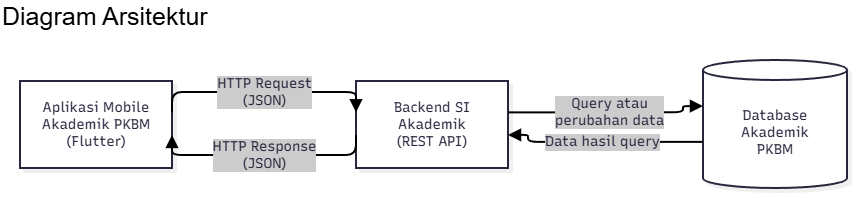

# Tugas 1 — Aplikasi Akademik PKBM Al Qosimmiyah

**Nama:** Talitha Ardelia Ivana  
**NIM:** 230660221114  
**Domain:** Akademik (PKBM Al Qosimmiyah)

## 1. Deskripsi Sistem

Aplikasi Akademik PKBM Al Qosimmiyah merupakan rancangan aplikasi mobile yang bertujuan memudahkan peserta didik dalam mengakses informasi akademik. Informasi yang tersedia meliputi nilai akademik, jadwal pelajaran, dan jadwal ujian.

Permasalahan yang ingin diselesaikan adalah sulitnya memperoleh informasi akademik secara cepat apabila informasi disampaikan melalui media yang berbeda. Hal ini dapat menyebabkan peserta didik terlambat mengetahui jadwal pelajaran, kesulitan memantau nilai, atau melewatkan informasi ujian.

Aplikasi mobile dipilih karena memiliki karakteristik **layar kecil**, sehingga informasi harus ditampilkan secara ringkas dan mudah dibaca; **sesi penggunaan singkat**, karena peserta didik dapat memeriksa nilai dan jadwal dalam waktu singkat; serta **interaksi sentuh**, yang memudahkan pengguna berpindah antarfitur melalui tombol navigasi.

## 2. Diagram Arsitektur

Diagram berikut menggambarkan rancangan hubungan antara pengguna, aplikasi mobile, backend, dan database akademik.

**Sumber diagram:** `diagram.mmd`

flowchart LR
    A[Peserta Didik] --> B[Aplikasi Akademik Mobile]
    B -->|Permintaan Data| C[Backend Sistem Akademik]
    C -->|Query Data| D[(Database Akademik)]
    D -->|Data Akademik| C
    C -->|Respons Data| B
    B --> E[Halaman Nilai Akademik]
    B --> F[Halaman Jadwal Pelajaran]
    B --> G[Halaman Jadwal Ujian]

## 3. Tabel Kebutuhan

| No. | Permintaan | Pengguna | Karakteristik Mobile yang Terkait | Fitur Aplikasi | Materi Pemenuh |
|---|---|---|---|---|---|
| 1 | Mengakses halaman utama akademik | Peserta didik | **Layar kecil** — informasi disusun secara ringkas dan terstruktur | Beranda akademik | Layout dan widget Flutter |
| 2 | Melihat nilai akademik | Peserta didik | **Sesi penggunaan singkat** — nilai dapat diperiksa dengan cepat | Halaman nilai akademik | Widget dan pengelolaan data |
| 3 | Melihat jadwal pelajaran | Peserta didik | **Layar kecil** — jadwal disajikan dalam daftar yang mudah dibaca | Halaman jadwal pelajaran | ListView, Card, dan ListTile |
| 4 | Melihat jadwal ujian | Peserta didik | **Sesi penggunaan singkat** — informasi ujian mudah ditemukan | Halaman jadwal ujian | Widget Flutter dan pengelolaan data |
| 5 | Berpindah antarfitur akademik | Peserta didik | **Interaksi sentuh** — navigasi mudah digunakan melalui tombol | Navigasi beranda, nilai, jadwal pelajaran, dan jadwal ujian | Komponen navigasi Flutter |
| 6 | Memperoleh informasi akademik terbaru | Peserta didik | **Konektivitas terbatas** — pembaruan data dapat dipengaruhi jaringan | Pemuatan dan pembaruan data akademik | Komunikasi data dan penyimpanan lokal jika diterapkan |
| 7 | Mengelola nilai dan jadwal akademik | Admin/pengelola akademik | — | Di luar lingkup prototipe mobile peserta didik | — |

*Catatan: Materi pemenuh dapat disesuaikan dengan nama pertemuan pada modul perkuliahan.*

## 4. Bukti Environment Siap

Bukti persiapan lingkungan pengembangan dan hasil menjalankan aplikasi disertakan dalam folder tugas.

- **Flutter Doctor sebelum perbaikan:** [Lihat gambar](flutter-doctor/sebelum.png)
- **Flutter Doctor sesudah perbaikan:** [Lihat gambar](flutter-doctor/sesudah.png)
- **Tampilan aplikasi akademik:** [Lihat gambar](aplikasi.png)

Gambar harus berupa tangkapan layar asli dari hasil pemeriksaan Flutter dan aplikasi yang dijalankan.

## 5. Refleksi

Karakteristik mobile yang paling relevan untuk aplikasi akademik PKBM Al Qosimmiyah adalah layar kecil dan sesi penggunaan singkat. Kedua karakteristik tersebut menjadi pertimbangan dalam merancang tampilan nilai, jadwal pelajaran, dan jadwal ujian agar ringkas, mudah dibaca, serta dapat diakses melalui beberapa sentuhan. Dengan aplikasi ini, peserta didik diharapkan dapat memperoleh informasi akademik secara lebih praktis melalui satu aplikasi.