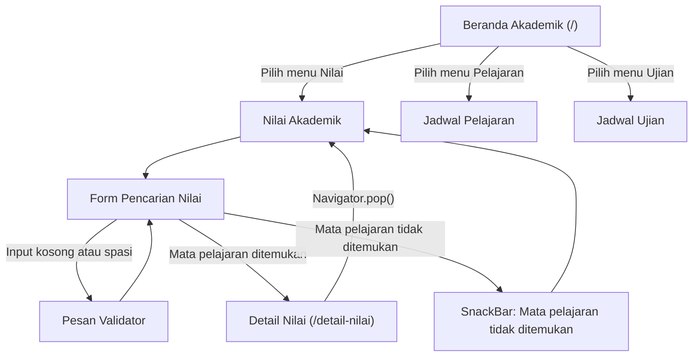

# Navigation Flow
## Aplikasi Akademik PKBM Al Qosimmiyah

### 1. Deskripsi

Navigation Flow merupakan alur perpindahan antarlayar dalam aplikasi Akademik PKBM Al Qosimmiyah. Navigasi dirancang agar siswa atau warga belajar dapat mengakses informasi akademik dengan mudah melalui halaman Beranda, Nilai Akademik, Jadwal Pelajaran, dan Jadwal Ujian.

Alur navigasi juga mencakup halaman Detail Nilai sebagai contoh pengiriman data antarlayar, serta form pencarian mata pelajaran yang dilengkapi validasi dan feedback untuk membantu pengguna memperoleh informasi nilai.

### 2. Daftar Route

| No. | Nama Route | Nama Layar | Kebutuhan |
|---|---|---|---|
| 1 | `/` | Beranda Akademik | F-01 |
| 2 | `/nilai` | Nilai Akademik | F-02 |
| 3 | `/jadwal` | Jadwal Pelajaran | F-03 |
| 4 | `/ujian` | Jadwal Ujian | F-04 |
| 5 | `/detail-nilai` | Detail Nilai | F-02 |

Route tersebut didaftarkan melalui properti `routes` pada `MaterialApp`. Route `/` digunakan sebagai halaman awal aplikasi.

### 3. Initial Route

Initial route aplikasi adalah `/`, yaitu Beranda Akademik.

Halaman ini dipilih karena merupakan halaman utama yang pertama kali diakses oleh siswa atau warga belajar. Dari halaman Beranda, pengguna dapat mengakses tiga layanan utama, yaitu Nilai Akademik, Jadwal Pelajaran, dan Jadwal Ujian melalui menu navigasi bagian bawah aplikasi.

### 4. Diagram Navigation Flow

Diagram berikut menggambarkan alur perpindahan halaman dan interaksi pengguna dalam aplikasi Akademik PKBM Al Qosimmiyah.

### 5. Initial Route dan Navigasi

Navigasi utama aplikasi menggunakan `NavigationBar` dan `IndexedStack` untuk berpindah antara halaman Beranda, Nilai Akademik, Jadwal Pelajaran, dan Jadwal Ujian.

`IndexedStack` digunakan agar halaman yang dipilih dapat ditampilkan berdasarkan indeks navigasi. Perpindahan halaman dilakukan melalui perubahan nilai variabel `halaman` menggunakan `setState()`.

Selain navigasi utama, aplikasi menggunakan named route yang dikelola melalui `MaterialApp`, `initialRoute`, dan `routes`.

Perpindahan menuju halaman Detail Nilai dilakukan menggunakan:

`Navigator.pushNamed(context, '/detail-nilai')`

Data nilai dikirim melalui parameter `arguments`. Untuk kembali ke halaman sebelumnya digunakan:

`Navigator.pop(context)`

### 6. Data Antarlayar

Data dikirim dari halaman Nilai Akademik menuju halaman Detail Nilai menggunakan parameter `arguments` pada `Navigator.pushNamed()`.

Data yang dikirim dibungkus dalam objek `DetailNilaiArgs`.

Contoh data yang dikirim:

| Nama Data | Contoh |
|---|---|
| Mata pelajaran | Matematika |
| Nilai | 88 |
| Kode mata pelajaran | MTK |

Halaman Detail Nilai menerima data tersebut melalui objek `DetailNilaiArgs`, kemudian menampilkannya kepada pengguna.

Data yang diterima digunakan untuk menampilkan informasi mata pelajaran, kode pelajaran, semester, nilai, dan keterangan nilai.

Keterangan nilai ditentukan berdasarkan angka nilai yang diterima, yaitu:
- Nilai 90 ke atas: Sangat Baik.
- Nilai 80–89: Baik.
- Nilai 70–79: Cukup.
- Nilai di bawah 70: Perlu Ditingkatkan.

### 7. Form dan Validasi

Form pencarian mata pelajaran ditempatkan pada halaman Nilai Akademik. Form ini digunakan untuk mencari dan menampilkan detail nilai berdasarkan nama mata pelajaran yang dimasukkan oleh pengguna.

**Field yang digunakan:**

1. Nama mata pelajaran.

Contoh input: `Matematika`.

**Validasi:**

- Field tidak boleh kosong.
- Input yang hanya berisi spasi tidak diperbolehkan.

Form menggunakan `Form` dan `GlobalKey<FormState>` untuk melakukan validasi in put. `TextEditingController` digunakan untuk membaca dan mengelola teks yang dimasukkan pengguna.

Controller dibersihkan melalui metode `dispose()` agar pengelolaan sumber daya aplikasi tetap baik.

**Feedback:**

- Jika input kosong atau hanya berisi spasi, pesan validator ditampilkan pada field dengan tulisan "Nama mata pelajaran wajib diisi."
- Jika mata pelajaran ditemukan, aplikasi membuka halaman Detail Nilai dan menampilkan informasi nilai mata pelajaran tersebut.
- Jika mata pelajaran tidak ditemukan, aplikasi menampilkan `SnackBar` dengan pesan "Mata pelajaran tidak ditemukan."

### 8. Navigasi Kembali

Pengguna dapat kembali ke halaman sebelumnya menggunakan `Navigator.pop(context)`.

Halaman Detail Nilai menyediakan tombol "Kembali ke Nilai Akademik" agar pengguna dapat kembali ke halaman Nilai Akademik setelah melihat detail nilai.

Dengan demikian, pengguna dapat melanjutkan pencarian nilai atau mengakses informasi akademik lainnya dengan mudah.