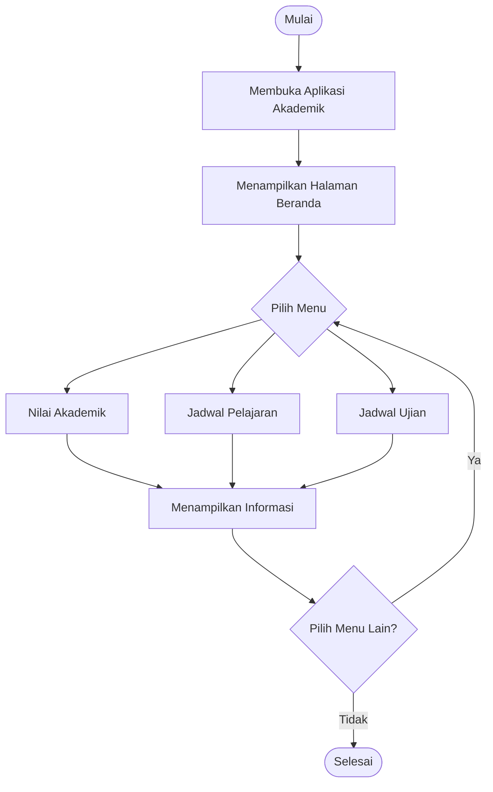
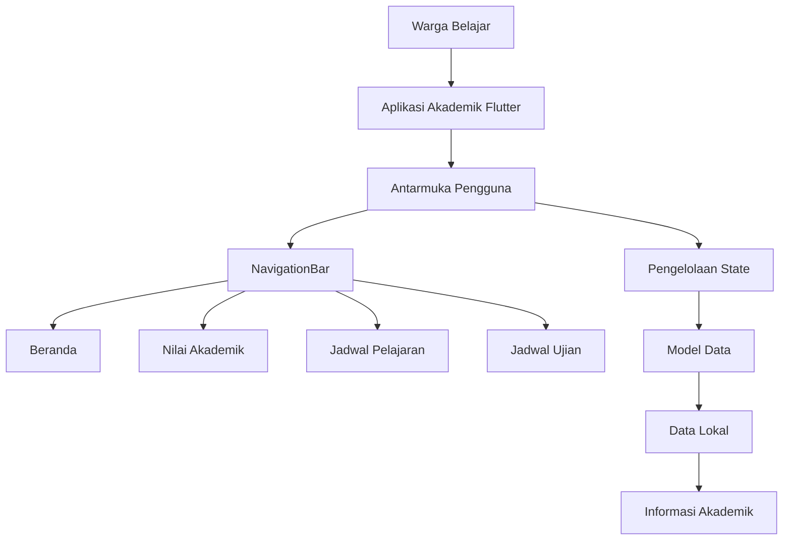

# Tes Konsep UTS — Aplikasi Akademik PKBM Al Qosimmiyah

**Nama:** [Isi nama kamu]  
**NIM:** [Isi NIM kamu]  
**Kelas:** [Isi kelas kamu]  
**Project:** Aplikasi Akademik PKBM Al Qosimmiyah  
**Teknologi:** Flutter dan Dart

---

## Soal 1 — Konsep Aplikasi Bergerak dalam Sistem Informasi

Aplikasi Akademik PKBM Al Qosimmiyah merupakan aplikasi bergerak yang dirancang untuk membantu warga belajar memperoleh informasi akademik melalui smartphone.

Terdapat tiga karakteristik aplikasi bergerak yang mendukung penggunaan aplikasi ini:

1. **Mobilitas dan kemudahan akses**

   Aplikasi mobile memungkinkan warga belajar mengakses informasi akademik tanpa harus datang langsung ke PKBM. Contohnya, warga belajar dapat melihat nilai akademik, jadwal pelajaran, dan jadwal ujian melalui smartphone.

2. **Pemanfaatan perangkat mobile**

   Smartphone dapat memberikan notifikasi kepada pengguna mengenai informasi akademik. Contohnya, warga belajar dapat memperoleh pemberitahuan apabila terdapat perubahan jadwal pelajaran atau informasi ujian.

3. **Antarmuka yang mudah digunakan**

   Aplikasi mobile menggunakan tampilan yang disesuaikan dengan layar smartphone dan interaksi berbasis sentuhan. Contohnya, pengguna dapat memilih menu Nilai Akademik, Jadwal Pelajaran, atau Jadwal Ujian dengan menekan menu yang tersedia.

Dengan karakteristik tersebut, aplikasi Akademik PKBM Al Qosimmiyah dapat mempermudah penyampaian informasi akademik, menghemat waktu, dan membantu warga belajar memperoleh informasi secara lebih praktis.

---

## Soal 2 — Dasar Pemrograman Dart

Dalam pengembangan aplikasi Akademik PKBM Al Qosimmiyah, bahasa Dart digunakan untuk mengatur data dan menjalankan logika aplikasi.

Beberapa konsep dasar Dart yang digunakan antara lain:

1. **Variabel dan tipe data**

   Variabel digunakan untuk menyimpan informasi. Contohnya:

   ```dart
   String namaWarga = 'Rian Rianto';
   int nilaiMatematika = 88;
   ```

   `String` digunakan untuk menyimpan teks, sedangkan `int` digunakan untuk menyimpan bilangan bulat.

2. **List**

   List digunakan untuk menyimpan beberapa data dalam satu variabel. Contohnya:

   ```dart
   List<String> daftarPelajaran = [
     'Matematika',
     'Bahasa Indonesia',
     'IPA',
     'Bahasa Inggris',
   ];
   ```

   Data tersebut dapat ditampilkan sebagai daftar mata pelajaran.

3. **Map**

   Map digunakan untuk menyimpan data dalam bentuk pasangan key dan value. Contohnya:

   ```dart
   Map<String, dynamic> nilai = {
     'mataPelajaran': 'Matematika',
     'nilai': 88,
   };
   ```

   Map tersebut menyimpan nama mata pelajaran dan nilai yang diperoleh warga belajar.

4. **Percabangan if-else**

   Digunakan untuk menentukan tindakan berdasarkan kondisi tertentu. Contohnya:

   ```dart
   if (nilaiMatematika >= 75) {
     print('Lulus');
   } else {
     print('Perlu perbaikan');
   }
   ```

5. **Perulangan for**

   Digunakan untuk membaca data yang terdapat dalam List secara berulang. Contohnya, menampilkan seluruh mata pelajaran yang tersedia.

6. **Fungsi**

   Fungsi digunakan untuk mengelompokkan perintah agar dapat dipanggil kembali sesuai kebutuhan. Contohnya fungsi untuk menambahkan catatan akademik atau menghitung rata-rata nilai.

Dengan konsep dasar Dart tersebut, aplikasi dapat mengelola informasi akademik dan menjalankan fungsi sesuai kebutuhan pengguna.

---

## Soal 3 — Struktur Flutter dan Widget

Flutter menggunakan widget sebagai komponen utama dalam membangun antarmuka aplikasi Akademik PKBM Al Qosimmiyah.

Beberapa widget yang digunakan adalah:

1. **MaterialApp**

   Digunakan sebagai widget utama aplikasi untuk mengatur tema, konfigurasi, dan halaman awal.

2. **Scaffold**

   Digunakan untuk membentuk struktur dasar halaman aplikasi, seperti AppBar, body, dan NavigationBar.

3. **AppBar**

   Digunakan untuk menampilkan judul halaman dan informasi pada bagian atas aplikasi.

4. **Column**

   Digunakan untuk menyusun komponen secara vertikal, misalnya judul layanan akademik, informasi pengguna, dan daftar informasi.

5. **Text**

   Digunakan untuk menampilkan tulisan, seperti judul Nilai Akademik, Jadwal Pelajaran, dan Jadwal Ujian.

6. **ListView.builder**

   Digunakan untuk menampilkan daftar data secara dinamis, misalnya daftar mata pelajaran atau catatan akademik.

7. **NavigationBar**

   Digunakan untuk membantu pengguna berpindah antarmenu, seperti Beranda, Nilai, Pelajaran, dan Ujian.

**Masalah ListView di dalam Column**

Apabila `ListView.builder` diletakkan langsung di dalam `Column` tanpa batas tinggi yang jelas, dapat terjadi masalah layout karena ListView membutuhkan ruang yang terukur.

Solusinya adalah menggunakan `Expanded` agar ListView memperoleh sisa ruang yang tersedia.

Contoh:

```dart
Column(
  children: [
    const Text('Daftar Mata Pelajaran'),
    Expanded(
      child: ListView.builder(
        itemCount: daftarPelajaran.length,
        itemBuilder: (context, index) {
          return ListTile(
            title: Text(daftarPelajaran[index]),
          );
        },
      ),
    ),
  ],
)
```

Widget `Expanded` membuat ListView mengisi ruang yang tersedia sehingga daftar dapat ditampilkan dan digulir dengan baik.

---

## Soal 4 — Analisis Kebutuhan dan User Flow

Analisis kebutuhan dilakukan untuk menentukan fitur yang diperlukan dalam aplikasi Akademik PKBM Al Qosimmiyah.

Kebutuhan fungsional menjelaskan fitur yang dapat dilakukan oleh aplikasi, sedangkan kebutuhan nonfungsional menjelaskan kualitas sistem, seperti keamanan, kinerja, dan kemudahan penggunaan.

### A. Kebutuhan fungsional dan nonfungsional

| No. | Kebutuhan | Jenis | Prioritas | Alasan |
|---|---|---|---|---|
| 1 | Menampilkan nilai akademik warga belajar | Fungsional | Must | Warga belajar perlu mengetahui hasil belajar. |
| 2 | Menampilkan jadwal pelajaran | Fungsional | Must | Membantu warga belajar mengetahui waktu dan mata pelajaran. |
| 3 | Menampilkan jadwal ujian | Fungsional | Must | Membantu warga belajar mempersiapkan ujian. |
| 4 | Tampilan mudah dipahami | Nonfungsional | Must | Memudahkan pengguna menggunakan aplikasi. |
| 5 | Informasi dapat ditampilkan dengan cepat | Nonfungsional | Should | Meningkatkan kenyamanan penggunaan aplikasi. |

### B. User Flow

Alur penggunaan aplikasi Akademik PKBM Al Qosimmiyah:

1. Warga belajar membuka aplikasi.
2. Aplikasi menampilkan halaman Beranda.
3. Pengguna memilih menu akademik yang dibutuhkan.
4. Jika memilih Nilai, aplikasi menampilkan daftar nilai mata pelajaran.
5. Jika memilih Pelajaran, aplikasi menampilkan jadwal pelajaran.
6. Jika memilih Ujian, aplikasi menampilkan jadwal ujian.
7. Pengguna membaca informasi yang ditampilkan.
8. Pengguna dapat kembali ke Beranda atau memilih menu lainnya.

### C. Diagram User Flow



---

## Soal 5 — UI/UX Mobile

UI/UX sangat penting dalam aplikasi Akademik PKBM Al Qosimmiyah karena berpengaruh terhadap kenyamanan warga belajar ketika menggunakan aplikasi.

Tiga prinsip UI/UX yang diterapkan adalah:

1. **Kesederhanaan tampilan**

   Tampilan aplikasi dibuat sederhana agar pengguna mudah memahami fungsi setiap menu. Contohnya, halaman Beranda menampilkan layanan Nilai Akademik, Jadwal Pelajaran, dan Jadwal Ujian.

2. **Konsistensi desain**

   Penggunaan warna, bentuk tombol, ikon, dan susunan komponen dibuat konsisten pada setiap halaman. Aplikasi menggunakan kombinasi warna navy dan biru agar tampilan terlihat rapi dan mudah dikenali.

3. **Kemudahan interaksi**

   Menu navigasi dan tombol dibuat agar mudah ditekan melalui layar smartphone. Contohnya, warga belajar dapat berpindah dari Beranda ke Nilai, Pelajaran, dan Ujian melalui NavigationBar.

Dengan menerapkan prinsip tersebut, aplikasi menjadi lebih mudah dipahami dan membantu warga belajar memperoleh informasi tanpa kesulitan.

---

## Soal 6 — Navigasi dan Interaksi

Navigasi digunakan untuk menghubungkan halaman-halaman dalam aplikasi Akademik PKBM Al Qosimmiyah.

Halaman utama aplikasi terdiri dari:

1. Beranda.
2. Nilai Akademik.
3. Jadwal Pelajaran.
4. Jadwal Ujian.

Beberapa metode navigasi Flutter yang dapat digunakan adalah:

1. **Navigator.push()**

   Digunakan untuk membuka halaman baru di atas halaman sebelumnya. Contohnya, ketika pengguna memilih salah satu catatan akademik untuk melihat detailnya.

2. **Navigator.pushNamed()**

   Digunakan untuk membuka halaman berdasarkan nama route yang telah dikonfigurasi.

3. **Navigator.pop()**

   Digunakan untuk menutup halaman yang sedang dibuka dan kembali ke halaman sebelumnya.

Pada aplikasi Akademik PKBM Al Qosimmiyah, perpindahan menu utama dapat menggunakan `NavigationBar` dengan mengubah indeks halaman yang sedang dipilih.

Contoh:

```dart
int selectedIndex = 0;

final List<Widget> halaman = [
  const BerandaPage(),
  const NilaiPage(),
  const PelajaranPage(),
  const UjianPage(),
];

void pindahHalaman(int index) {
  setState(() {
    selectedIndex = index;
  });
}
```

Ketika pengguna memilih menu lain, nilai `selectedIndex` berubah dan halaman yang sesuai ditampilkan.

**Feedback kepada pengguna**

Aplikasi dapat memberikan feedback menggunakan `SnackBar` ketika pengguna berhasil menyimpan catatan akademik atau melakukan tindakan tertentu. Dengan demikian, pengguna mengetahui bahwa tindakan yang dilakukan telah diproses.

---

## Soal 7 — Model Data dan State

Model data digunakan untuk mengatur struktur informasi yang disimpan dalam aplikasi. Dalam aplikasi Akademik PKBM Al Qosimmiyah, salah satu data yang dapat dikelola adalah Catatan Akademik.

Contoh model:

```dart
class CatatanAkademik {
  final String id;
  final String judul;
  final String isi;
  final String tanggal;

  const CatatanAkademik({
    required this.id,
    required this.judul,
    required this.isi,
    required this.tanggal,
  });
}
```

**Fungsi field final**

`final` digunakan agar nilai field tidak dapat ditetapkan ulang setelah objek dibuat. Hal ini membantu menjaga konsistensi data catatan akademik.

**Pentingnya ID**

ID digunakan sebagai identitas unik setiap catatan. Dengan ID, aplikasi dapat membedakan catatan satu dengan lainnya, termasuk ketika memiliki judul yang sama.

**Perbedaan StatelessWidget dan StatefulWidget**

- `StatelessWidget` digunakan untuk tampilan yang tidak mengelola perubahan state internal.
- `StatefulWidget` digunakan untuk tampilan yang memiliki data atau state yang dapat berubah.

Halaman Catatan Akademik lebih tepat menggunakan `StatefulWidget` karena pengguna dapat menambah, mengubah, dan menghapus catatan.

**Fungsi setState()**

`setState()` digunakan untuk memberi tahu Flutter bahwa terdapat perubahan data sehingga tampilan perlu diperbarui.

Jika data berubah tanpa `setState()`, perubahan tersebut belum tentu langsung terlihat pada tampilan aplikasi.

---

## Soal 8 — CRUD Lokal

CRUD merupakan proses pengelolaan data yang terdiri dari Create, Read, Update, dan Delete.

Pada aplikasi Akademik PKBM Al Qosimmiyah, CRUD dapat diterapkan pada fitur Catatan Akademik.

| Operasi | Fungsi | Penerapan |
|---|---|---|
| Create | Menambahkan data | Menambahkan catatan akademik baru. |
| Read | Membaca data | Menampilkan daftar catatan akademik. |
| Update | Mengubah data | Mengedit judul atau isi catatan. |
| Delete | Menghapus data | Menghapus catatan yang sudah tidak diperlukan. |

**1. Create**

Pengguna mengisi formulir catatan, kemudian aplikasi membuat objek baru dan menambahkannya ke dalam List.

**2. Read**

Data catatan ditampilkan menggunakan `ListView.builder` agar pengguna dapat melihat seluruh catatan yang tersedia.

**3. Update**

Aplikasi mencari data berdasarkan ID, kemudian mengganti data lama dengan data yang telah diperbarui.

**4. Delete**

Aplikasi menghapus data berdasarkan ID agar catatan yang dipilih tidak lagi ditampilkan.

Setiap proses perubahan data sebaiknya menggunakan `setState()` agar tampilan ikut diperbarui.

**Mengapa menggunakan ID daripada index?**

ID lebih tepat digunakan karena merupakan identitas data yang tetap. Index dapat berubah ketika data ditambah, dihapus, atau diurutkan. Dengan ID, proses mengubah dan menghapus catatan menjadi lebih tepat.

---

## Soal 9 — Persistensi Data Lokal

Persistensi data merupakan proses penyimpanan data agar tetap tersedia meskipun aplikasi ditutup atau dijalankan kembali.

Dalam aplikasi Akademik PKBM Al Qosimmiyah, penyimpanan data dapat dibedakan menjadi:

**1. In-memory**

In-memory merupakan penyimpanan data sementara di dalam memori aplikasi. Contohnya, List yang digunakan untuk menampung catatan akademik selama aplikasi berjalan.

Kelebihannya adalah mudah digunakan untuk proses pengujian CRUD. Kekurangannya, data dapat hilang ketika aplikasi dihentikan atau dimulai ulang.

**2. SharedPreferences**

SharedPreferences digunakan untuk menyimpan data sederhana secara lokal pada perangkat. Data dapat tetap tersedia setelah aplikasi ditutup.

Untuk menyimpan data catatan yang berbentuk objek, data perlu dikonversi terlebih dahulu ke format JSON berupa String.

**Mengapa proses penyimpanan menggunakan asynchronous?**

Proses penyimpanan data membutuhkan waktu karena melibatkan akses ke penyimpanan perangkat. Oleh sebab itu, Flutter menggunakan konsep asynchronous.

- `Future` digunakan untuk merepresentasikan hasil proses yang tersedia kemudian.
- `await` digunakan untuk menunggu proses asynchronous selesai.

Jika proses penyimpanan tidak ditunggu ketika hasilnya diperlukan, kode berikutnya dapat berjalan sebelum penyimpanan selesai.

**Penerapan pada aplikasi**

In-memory dapat digunakan ketika aplikasi masih dalam tahap prototype dan pengujian CRUD. Namun, untuk penggunaan sebenarnya, data catatan dan informasi akademik perlu disimpan secara permanen agar tidak hilang ketika aplikasi ditutup.

---

## Soal 10 — Integrasi Konsep Lintas Pertemuan

Aplikasi Akademik PKBM Al Qosimmiyah merupakan aplikasi mobile berbasis Flutter yang membantu warga belajar mengakses informasi akademik, seperti nilai, jadwal pelajaran, jadwal ujian, dan catatan akademik.

### 1. Arsitektur Aplikasi

Aplikasi menggunakan Flutter dan Dart sebagai teknologi frontend. Bagian frontend bertugas menampilkan informasi dan menerima interaksi dari pengguna.

Pengelolaan data dilakukan melalui model dan state. Pada tahap prototype, data dapat disimpan dalam List lokal. Pengembangan berikutnya dapat menggunakan REST API dan database agar informasi dapat dikelola secara terpusat.

Diagram arsitektur:



### 2. Kebutuhan dan User Flow

Kebutuhan utama aplikasi:

1. Warga belajar dapat melihat nilai akademik.
2. Warga belajar dapat melihat jadwal pelajaran.
3. Warga belajar dapat melihat jadwal ujian.
4. Warga belajar dapat membuat dan mengelola catatan akademik.

**User Flow:**

1. Pengguna membuka aplikasi.
2. Aplikasi menampilkan halaman Beranda.
3. Pengguna memilih salah satu menu.
4. Aplikasi menampilkan informasi sesuai menu yang dipilih.
5. Pengguna membaca informasi akademik.
6. Pengguna dapat berpindah ke menu lainnya.
7. Pengguna selesai menggunakan aplikasi.

### 3. Struktur Komponen Flutter

Beberapa widget yang digunakan:

- `MaterialApp` untuk konfigurasi utama aplikasi.
- `Scaffold` untuk struktur halaman.
- `AppBar` untuk menampilkan judul halaman.
- `Column` untuk menyusun komponen secara vertikal.
- `ListView.builder` untuk menampilkan daftar data.
- `Card` untuk membungkus informasi agar lebih terstruktur.
- `Text` untuk menampilkan informasi.
- `TextField` untuk menerima input catatan.
- `ElevatedButton` untuk menjalankan tindakan.
- `NavigationBar` untuk perpindahan menu utama.

Halaman utama aplikasi terdiri dari Beranda, Nilai Akademik, Jadwal Pelajaran, dan Jadwal Ujian.

### 4. Model Data dan State

Model digunakan untuk mengatur struktur data yang ditampilkan dalam aplikasi.

Contoh model Catatan Akademik:

```dart
class CatatanAkademik {
  final String id;
  final String judul;
  final String isi;
  final String tanggal;

  const CatatanAkademik({
    required this.id,
    required this.judul,
    required this.isi,
    required this.tanggal,
  });
}
```

Data catatan dapat disimpan dalam List dan dikelola menggunakan state.

Penerapan CRUD:

- **Create:** menambahkan catatan akademik baru.
- **Read:** menampilkan daftar catatan akademik.
- **Update:** memperbarui judul atau isi catatan.
- **Delete:** menghapus catatan berdasarkan ID.

`setState()` digunakan untuk memperbarui tampilan setelah terjadi perubahan data.

Pada tahap prototype, penyimpanan lokal dapat digunakan untuk menguji pengelolaan data. Untuk pengembangan selanjutnya, aplikasi dapat dihubungkan dengan backend melalui REST API agar data akademik tersimpan secara terpusat dan dapat diperbarui oleh pihak yang berwenang.

### Kesimpulan

Aplikasi Akademik PKBM Al Qosimmiyah menerapkan konsep pengembangan aplikasi mobile menggunakan Flutter dan Dart. Konsep tersebut mencakup struktur widget, navigasi, pengelolaan state, model data, CRUD, dan penyimpanan lokal.

Aplikasi ini diharapkan dapat memudahkan warga belajar dalam memperoleh informasi akademik secara praktis melalui smartphone.