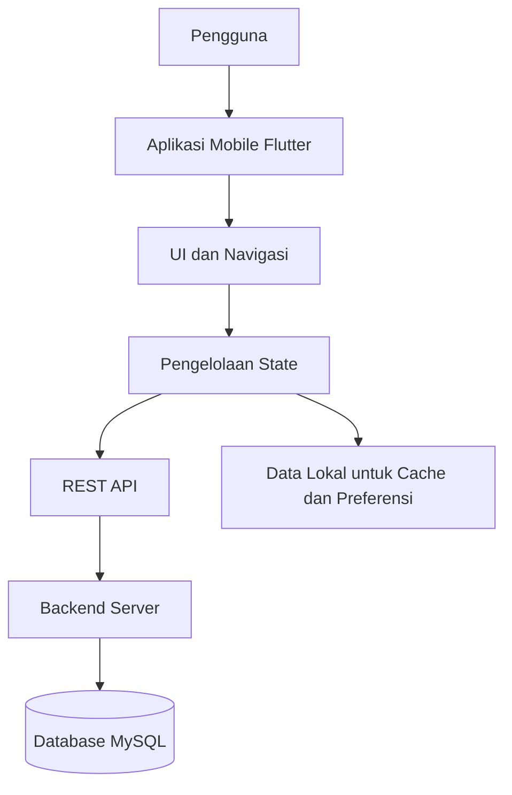
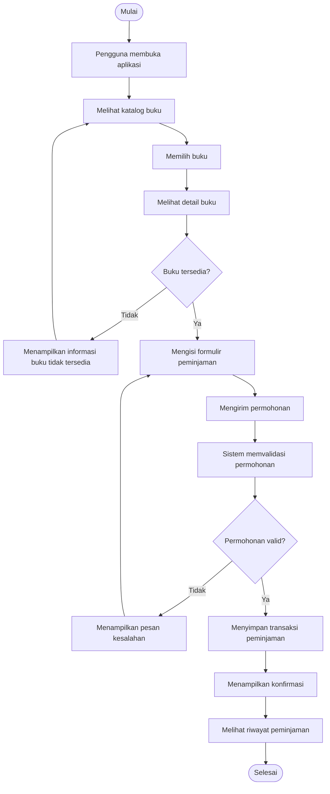

# Tes Konsep UTS — Talitha Ardelia Ivana — 230660221114

## Soal 1 — Konsep Aplikasi Bergerak dalam Sistem Informasi

Tiga karakteristik aplikasi bergerak yang menjadikan solusi mobile lebih tepat untuk layanan pengajuan surat keterangan mahasiswa adalah:

**1. Mobilitas dan Fleksibilitas Akses**

Aplikasi mobile dapat digunakan melalui smartphone kapan saja dan di mana saja tanpa harus datang langsung ke kampus. Mahasiswa dapat mengajukan surat keterangan meskipun sedang berada di luar lingkungan kampus.

Contoh penerapan: Mahasiswa membuka aplikasi melalui HP, memilih jenis surat keterangan yang dibutuhkan, kemudian mengisi formulir pengajuan secara online.

**2. Notifikasi Secara Langsung (Real-Time Notification)**

Aplikasi mobile dapat memberikan pemberitahuan secara langsung kepada pengguna mengenai perkembangan proses pengajuan surat. Dengan demikian, mahasiswa tidak perlu terus-menerus datang ke loket untuk menanyakan status permohonannya.

Contoh penerapan: Setelah mengajukan surat, mahasiswa mendapatkan notifikasi bahwa permohonan sedang diproses, telah disetujui, atau perlu diperbaiki.

**3. Pemanfaatan Fitur Perangkat Mobile**

Aplikasi mobile dapat memanfaatkan fitur bawaan smartphone, seperti kamera, GPS, dan penyimpanan dokumen. Fitur tersebut dapat membantu mahasiswa melengkapi persyaratan pengajuan surat dengan lebih mudah.

Contoh penerapan: Mahasiswa dapat mengambil foto KTP atau mengunggah dokumen persyaratan menggunakan kamera dan penyimpanan HP secara langsung melalui aplikasi.

## Soal 2 — Dasar Pemrograman Dart

Berikut penjelasan fungsi setiap bagian kode Dart:

**1. List<String>**

Digunakan untuk membuat sebuah daftar atau kumpulan data yang hanya dapat menyimpan nilai bertipe teks (String). Pada kode tersebut, daftarSurat digunakan untuk menampung berbagai jenis surat yang diajukan mahasiswa.

**2. Parameter String jenis**

Merupakan parameter yang digunakan untuk menerima masukan berupa teks dari pengguna. Contohnya, pengguna memasukkan jenis surat seperti Surat Keterangan Aktif Kuliah atau Surat Pengantar.

**3. isEmpty**

Digunakan untuk memeriksa apakah teks yang dimasukkan kosong atau tidak. Jika pengguna tidak mengisi jenis surat, program akan menampilkan pesan bahwa jenis surat tidak boleh kosong.

**4. return pada kondisi error**

Berfungsi untuk menghentikan proses di dalam fungsi tambahSurat() ketika ditemukan kesalahan. Dengan demikian, data kosong tidak akan diteruskan ke daftar surat.

**5. daftarSurat.add(jenis)**

Digunakan untuk menambahkan data baru ke dalam List. Pada kode tersebut, daftarSurat.add(jenis) memasukkan jenis surat yang sudah lolos validasi ke dalam daftar.

**6. Perulangan for**

Digunakan untuk mengulang proses berdasarkan jumlah data yang tersimpan dalam daftar. Perulangan ini membantu menampilkan seluruh jenis surat satu per satu dengan nomor urut.

**Kesalahan umum jika validasi isEmpty dihapus:**

Jika validasi isEmpty dihapus, pengguna dapat memasukkan data kosong sehingga data yang tidak memiliki informasi jenis surat tetap tersimpan di dalam daftar. Akibatnya, daftar surat menjadi tidak valid dan dapat membingungkan petugas administrasi ketika memproses pengajuan.

## Soal 3 — Struktur Flutter dan Widget

**1. MaterialApp**

Merupakan widget utama yang digunakan untuk membangun aplikasi dengan desain Material Design. Widget ini mengatur tema, navigasi, dan halaman utama aplikasi.

**2. Scaffold**

Berfungsi sebagai kerangka dasar halaman aplikasi. Scaffold menyediakan struktur seperti AppBar, body, dan bagian lainnya.

**3. AppBar**

Digunakan sebagai bilah bagian atas halaman yang menampilkan judul atau tombol navigasi. Pada kode tersebut, AppBar menampilkan judul "Daftar Surat".

**4. Column**

Berfungsi untuk menyusun beberapa widget secara vertikal atau dari atas ke bawah. Dalam kode tersebut, Column menampilkan teks dan daftar surat secara berurutan.

**5. Text**

Digunakan untuk menampilkan tulisan pada layar. Contohnya, tulisan "Pilih jenis surat" sebagai petunjuk kepada pengguna.

**6. ListView.builder**

Digunakan untuk menampilkan daftar data secara dinamis. Widget ini membuat item daftar sesuai jumlah data yang tersedia sehingga lebih efisien untuk menampilkan banyak jenis surat.

**Masalah jika ListView.builder diletakkan langsung di dalam Column:**

Masalah yang dapat terjadi adalah munculnya error unbounded height atau tinggi ListView tidak memiliki batas yang jelas. Hal ini terjadi karena Column tidak memberikan batas tinggi tertentu kepada ListView sehingga Flutter kesulitan menentukan ukuran area daftar.

Cara memperbaikinya adalah dengan membungkus ListView.builder menggunakan widget Expanded, seperti berikut:

```dart
Column(
  children: [
    Text('Pilih jenis surat'),
    Expanded(
      child: ListView.builder(
        itemCount: daftarSurat.length,
        itemBuilder: (context, index) {
          return ListTile(
            title: Text(daftarSurat[index]),
          );
        },
      ),
    ),
  ],
)
```

Dengan menggunakan Expanded, ListView akan mengisi sisa ruang yang tersedia sehingga daftar surat dapat ditampilkan tanpa menyebabkan error.

## Soal 4 — Analisis Kebutuhan dan User Flow

**Identifikasi Kebutuhan Fungsional dan Nonfungsional**
Berdasarkan permintaan mahasiswa, kebutuhan aplikasi pengajuan surat dapat dibagi menjadi dua jenis:

**1. Kebutuhan Fungsional**

Kebutuhan fungsional merupakan fitur yang dapat dilakukan oleh aplikasi untuk memenuhi kebutuhan pengguna.
1. Mahasiswa dapat mengisi dan mengirim formulir pengajuan surat keterangan aktif kuliah secara online.
2. Mahasiswa dapat melihat status pengajuan surat untuk mengetahui apakah permohonan masih menunggu, sedang diproses, atau sudah selesai.
3. Sistem dapat mengirimkan notifikasi kepada mahasiswa ketika surat sudah selesai dan siap diambil.
2. Kebutuhan Nonfungsional

Kebutuhan nonfungsional merupakan standar kualitas yang harus dimiliki aplikasi agar dapat digunakan dengan baik.
1. Aplikasi mudah digunakan dan memiliki tampilan yang sederhana.
2. Data pribadi dan dokumen mahasiswa harus tersimpan dengan aman.
3. Aplikasi harus memberikan respons yang cepat ketika mahasiswa mengirim pengajuan atau melihat status surat.
4. Notifikasi harus dikirim secara tepat waktu agar mahasiswa tidak terlambat mengetahui informasi surat.

**Penentuan Prioritas MoSCoW**
Kebutuhan	Jenis	Prioritas	Alasan
Pengajuan surat aktif kuliah	Fungsional	Must	Merupakan tujuan utama aplikasi.
Melihat status pengajuan	Fungsional	Must	Mahasiswa perlu mengetahui perkembangan surat tanpa datang ke loket.
Notifikasi surat siap diambil	Fungsional	Should	Membantu memberikan informasi ketika surat selesai diproses.
Tampilan sederhana dan mudah digunakan	Nonfungsional	Must	Agar mahasiswa tidak kesulitan menggunakan aplikasi.
Keamanan data mahasiswa	Nonfungsional	Must	Untuk menjaga kerahasiaan informasi pribadi.
Kecepatan respons aplikasi	Nonfungsional	Should	Supaya proses penggunaan aplikasi lebih nyaman.
Fitur pengingat tambahan	Fungsional	Could	Bisa ditambahkan untuk meningkatkan pelayanan.
Integrasi dengan layanan eksternal kampus	Fungsional	Won't	Belum diperlukan dalam pengembangan aplikasi tahap awal.

Penjelasan MoSCoW:
- Must: Kebutuhan wajib yang harus tersedia agar aplikasi dapat digunakan sesuai tujuan.
- Should: Kebutuhan penting, tetapi masih bisa ditunda pada pengembangan awal.
- Could: Fitur tambahan yang dapat dikembangkan jika masih ada waktu.
- Won't: Fitur yang belum akan diterapkan pada versi aplikasi saat ini.

**User Flow untuk Kebutuhan Must**
Berikut alur penggunaan aplikasi untuk proses pengajuan surat keterangan aktif kuliah:
1. Mahasiswa membuka aplikasi melalui smartphone.
2. Mahasiswa melakukan login menggunakan akun yang telah terdaftar.
3. Sistem menampilkan halaman beranda.
4. Mahasiswa memilih menu pengajuan surat.
5. Sistem menampilkan beberapa pilihan jenis surat.
6. Mahasiswa memilih surat keterangan aktif kuliah.
7. Mahasiswa mengisi formulir sesuai data yang diminta.
8. Mahasiswa menekan tombol kirim pengajuan.
9. Sistem memeriksa kelengkapan data.
10. Jika data lengkap, sistem menyimpan pengajuan ke database.
11. Sistem menampilkan pemberitahuan bahwa pengajuan berhasil dikirim.
12. Mahasiswa membuka menu status pengajuan untuk melihat perkembangan surat.

## Soal 5 — UI/UX Mobile

**1. Kesederhanaan Tampilan (Simplicity)**

Keputusan desain: Saya akan membuat tampilan daftar surat menggunakan bentuk card yang tersusun secara vertikal. Setiap card menampilkan nama surat, status pengajuan, dan tombol ajukan. Saya juga akan menyediakan fitur pencarian agar mahasiswa lebih mudah menemukan jenis surat yang dibutuhkan.

Alasan: Ukuran layar smartphone terbatas sehingga informasi harus disusun secara sederhana dan tidak terlalu banyak elemen dalam satu halaman. Dengan adanya pencarian, mahasiswa tidak perlu menggulir seluruh 20 jenis surat.

**2. Kemudahan Interaksi Sentuh (Touch-Friendly Design)**

Keputusan desain: Saya akan membuat tombol Ajukan dengan ukuran yang cukup besar, mudah ditekan, dan memiliki jarak antar tombol. Warna tombol dibuat kontras agar mudah dibedakan dari informasi lainnya.

Alasan: Pengguna smartphone berinteraksi menggunakan jari, bukan mouse. Tombol yang terlalu kecil atau berdekatan dapat menyebabkan kesalahan saat ditekan. Oleh karena itu, tombol harus mudah dijangkau dan digunakan.

**3. Efisiensi Penggunaan (Efficiency)**

Keputusan desain: Saya akan menampilkan nama surat dan status secara langsung pada setiap card, serta menggunakan warna berbeda untuk membedakan status, misalnya hijau untuk disetujui, kuning untuk diproses, dan merah untuk ditolak. Proses pengajuan dibuat singkat dengan formulir yang sederhana.

Alasan: Mahasiswa biasanya menggunakan aplikasi dalam waktu singkat. Dengan informasi yang langsung terlihat dan proses yang tidak berbelit-belit, mahasiswa dapat menemukan surat serta melakukan pengajuan dengan lebih cepat.

## Soal 6 — Navigasi dan Interaksi

**A. Implementasi Navigasi Antarhalaman**
Terdapat tiga metode navigasi yang dapat digunakan:

**1. Navigator.push()**

Digunakan untuk membuka halaman baru dari halaman yang sedang ditampilkan.

Contoh penerapan: Ketika mahasiswa memilih salah satu jenis surat pada halaman daftar, aplikasi akan membuka halaman form pengajuan.
Navigator.push(
  context,
  MaterialPageRoute(
    builder: (context) => FormPengajuanPage(),
  ),
);


**2. Navigator.pushNamed()**

Digunakan untuk berpindah halaman berdasarkan nama atau route yang sudah didaftarkan sebelumnya.

Contoh penerapan: Ketika mahasiswa selesai mengisi form, aplikasi dapat membuka halaman detail status melalui route /detail-status.
Navigator.pushNamed(
  context,
  '/detail-status',
  arguments: jenisSurat,
);


**3. Navigator.pop()**

Digunakan untuk kembali ke halaman sebelumnya dengan menutup halaman yang sedang dibuka.

Contoh penerapan: Ketika mahasiswa membatalkan pengajuan atau ingin kembali ke daftar surat dari halaman form.
Navigator.pop(context);

**B. Pengiriman Data Jenis Surat**
Data jenis surat dikirim dari halaman daftar ke halaman form menggunakan parameter pada constructor.

Contohnya, ketika mahasiswa memilih Surat Keterangan Aktif Kuliah, data tersebut diteruskan ke halaman form.
Navigator.push(
  context,
  MaterialPageRoute(
    builder: (context) => FormPengajuanPage(
      jenisSurat: 'Surat Keterangan Aktif Kuliah',
    ),
  ),
);


Kemudian, pada halaman form, data diterima melalui constructor:
class FormPengajuanPage extends StatelessWidget {
  final String jenisSurat;

  const FormPengajuanPage({
    super.key,
    required this.jenisSurat,
  });

  @override
  Widget build(BuildContext context) {
    return Scaffold(
      appBar: AppBar(title: const Text('Form Pengajuan')),
      body: Center(
        child: Text('Jenis Surat: $jenisSurat'),
      ),
    );
  }
}


Dengan cara tersebut, halaman form dapat langsung menampilkan jenis surat yang dipilih mahasiswa tanpa harus memilih ulang.

**C. Feedback Setelah Form Dikirim**
Setelah mahasiswa menekan tombol kirim, aplikasi perlu memberikan feedback agar pengguna mengetahui apakah pengajuan berhasil atau gagal.

Contoh penerapan menggunakan SnackBar:
ScaffoldMessenger.of(context).showSnackBar(
  const SnackBar(
    content: Text('Pengajuan surat berhasil dikirim!'),
    backgroundColor: Colors.green,
  ),
);


Jika pengajuan berhasil, aplikasi dapat melanjutkan ke halaman detail status untuk menampilkan informasi bahwa surat sedang menunggu proses pemeriksaan.

Jika pengajuan gagal, aplikasi menampilkan pesan kesalahan agar mahasiswa dapat memperbaiki data yang belum sesuai.

## Soal 7 — Model Data dan State

**A. Alasan Setiap Field Menggunakan final**
Pada model data PengajuanSurat, setiap field menggunakan final karena nilainya hanya dapat diisi satu kali ketika objek dibuat dan tidak dapat diubah setelahnya.

Fungsi masing-masing field adalah:
1. id: Sebagai identitas unik untuk membedakan satu pengajuan surat dengan pengajuan lainnya.
2. jenis: Menyimpan nama atau kategori surat yang diajukan mahasiswa.
3. tanggal: Menyimpan tanggal ketika mahasiswa mengajukan surat.
4. status: Menyimpan kondisi pengajuan, seperti menunggu, diproses, disetujui, atau ditolak.
Penggunaan final membantu menjaga data agar tidak berubah secara tidak sengaja sehingga informasi pengajuan lebih konsisten.

**Mengapa id wajib ada?**

id wajib ada karena setiap pengajuan harus memiliki identitas yang berbeda. Misalnya, seorang mahasiswa mengajukan dua surat dengan jenis yang sama, sistem tetap dapat membedakan kedua pengajuan tersebut berdasarkan ID. ID juga memudahkan proses pencarian, pembaruan status, dan penghapusan data tertentu.

**B. Perbedaan StatelessWidget dan StatefulWidget**
StatelessWidget	StatefulWidget
Tidak memiliki state yang dapat berubah selama widget digunakan.	Memiliki state yang dapat berubah selama widget digunakan.
Cocok untuk menampilkan informasi tetap.	Cocok untuk halaman yang datanya dapat berubah.
Tidak menggunakan setState untuk memperbarui tampilan.	Dapat menggunakan setState untuk memperbarui tampilan.

**Widget yang saya pilih: StatefulWidget.**

Alasannya, halaman daftar pengajuan surat membutuhkan data yang dapat berubah. Contohnya, ketika mahasiswa menambahkan pengajuan baru, daftar harus langsung menampilkan data tersebut tanpa perlu membuka ulang aplikasi.

**C. Fungsi setState**
setState() merupakan fungsi dalam Flutter yang digunakan untuk memberi tahu sistem bahwa terdapat perubahan data pada state sehingga tampilan widget perlu diperbarui.

## Soal 8 — CRUD Lokal

CRUD merupakan singkatan dari Create, Read, Update, dan Delete. Keempat operasi ini digunakan untuk mengelola data pengajuan surat yang tersimpan di dalam aplikasi.

**A. Empat Operasi CRUD dan Method List**
**1. Create (Menambahkan Data)**

Create merupakan proses untuk menambahkan data pengajuan surat baru ke dalam daftar.

Method List yang digunakan adalah add().

Contoh:
daftarSurat.add(
  PengajuanSurat(
    id: '001',
    jenis: 'Surat Keterangan Aktif Kuliah',
    tanggal: '09-11-2026',
    status: 'Menunggu',
  ),
);

**2. Read (Membaca Data)**

Read merupakan proses untuk mengambil dan menampilkan data pengajuan surat yang sudah tersimpan.

Method List yang dapat digunakan adalah forEach(), map(), atau mengakses data berdasarkan posisi menggunakan index.

Contoh:
for (var surat in daftarSurat) {
  print(surat.jenis);
  print(surat.status);
}

**3. Update (Mengubah Data)**

Update merupakan proses untuk memperbarui informasi pengajuan surat, misalnya mengubah status dari Menunggu menjadi Disetujui.

Method List yang digunakan adalah indexWhere() untuk mencari posisi data dan kemudian mengganti elemen menggunakan index.

Contoh:
int index = daftarSurat.indexWhere(
  (surat) => surat.id == '001',
);

if (index != -1) {
  daftarSurat[index] = PengajuanSurat(
    id: daftarSurat[index].id,
    jenis: daftarSurat[index].jenis,
    tanggal: daftarSurat[index].tanggal,
    status: 'Disetujui',
  );
}

**4. Delete (Menghapus Data)**

Delete merupakan proses untuk menghapus pengajuan surat tertentu dari daftar.

Method List yang digunakan adalah removeWhere().

Contoh:
daftarSurat.removeWhere(
  (surat) => surat.id == '001',
);


**B. Mengapa ID Digunakan sebagai Kunci Update dan Delete?**
ID digunakan sebagai kunci karena setiap pengajuan surat memiliki identitas unik yang tidak berubah meskipun posisi data dalam daftar berubah.

Contohnya, mahasiswa memiliki tiga pengajuan surat dengan ID 001, 002, dan 003. Jika pengajuan dengan ID 001 dihapus, data lainnya tetap memiliki identitas masing-masing.

## Soal 9 — Persistensi Data Lokal

**A. Perbedaan In-Memory dan Persistensi Data**
1. Penyimpanan In-Memory

In-memory merupakan penyimpanan data sementara di dalam memori aplikasi menggunakan variabel atau List. Data hanya tersedia selama aplikasi masih berjalan. Jika aplikasi ditutup atau dimulai ulang, data yang tersimpan dapat hilang.

Contoh:
List<PengajuanSurat> daftarSurat = [];


Pada aplikasi pengajuan surat, in-memory dapat digunakan untuk menampung data pengajuan sementara selama pengguna menggunakan aplikasi.

2. Persistensi Menggunakan SharedPreferences

Persistensi merupakan proses menyimpan data agar tetap tersedia meskipun aplikasi ditutup atau perangkat dimulai ulang.

Pada Flutter, package shared_preferences dapat digunakan untuk menyimpan data sederhana secara lokal, seperti teks, angka, boolean, atau data JSON dalam bentuk String.

Contoh:
final prefs = await SharedPreferences.getInstance();

await prefs.setString('nama', 'Mahasiswa');


Dengan penyimpanan tersebut, data nama mahasiswa tetap tersedia ketika aplikasi dibuka kembali.

**B. Mengapa SharedPreferences Bersifat Asinkron (Future)?**
Operasi shared_preferences bersifat asinkron karena proses membaca dan menyimpan data membutuhkan komunikasi dengan penyimpanan perangkat.

Flutter menggunakan Future agar proses tersebut dapat berjalan tanpa harus menghentikan seluruh aktivitas aplikasi. Dengan demikian, tampilan aplikasi tetap dapat merespons interaksi pengguna selama proses penyimpanan berlangsung.

**Apa yang terjadi jika await diabaikan?**

Jika await tidak digunakan, program tidak menunggu proses penyimpanan selesai sebelum menjalankan perintah berikutnya. Akibatnya, data mungkin belum selesai tersimpan ketika aplikasi melanjutkan proses lainnya.

Contoh penggunaan yang benar:
Future<void> simpanData() async {
  final prefs = await SharedPreferences.getInstance();

  await prefs.setString('status', 'Disetujui');
}


Pada contoh tersebut, await memastikan proses penyimpanan ditunggu hingga selesai sebelum fungsi melanjutkan ke perintah berikutnya.

**C. Contoh Situasi Penggunaan**
1. In-Memory Sudah Cukup

Contohnya, ketika mahasiswa sedang mengisi formulir pengajuan surat dan data hanya digunakan sementara untuk menampilkan pratinjau sebelum dikirim. Data tidak harus disimpan secara permanen karena masih dalam tahap pengisian.

2. Persistensi Mutlak Diperlukan

Contohnya, ketika mahasiswa sudah mengirim pengajuan surat dan ingin melihat kembali statusnya setelah aplikasi ditutup. Data pengajuan harus tetap tersimpan agar tidak hilang ketika aplikasi dibuka kembali.

## Soal 10 — Perancangan Aplikasi Bergerak (CPMK-2)

Aplikasi peminjaman buku perpustakaan dapat dikembangkan menggunakan Flutter sebagai aplikasi mobile, API sebagai penghubung antara aplikasi dan server, serta MySQL sebagai tempat penyimpanan data utama.

**A. Arsitektur aplikasi**

Komponen yang digunakan dalam aplikasi adalah:

| Komponen | Fungsi |
|---|---|
| Flutter | Membuat tampilan dan interaksi aplikasi mobile. |
| UI dan navigasi | Mengatur halaman katalog, detail buku, dan riwayat peminjaman. |
| Pengelolaan state | Memperbarui tampilan ketika data berubah. |
| REST API | Menghubungkan aplikasi mobile dengan server. |
| Backend | Memproses permintaan peminjaman dan pengelolaan buku. |
| MySQL | Menyimpan data buku dan transaksi peminjaman. |
| Penyimpanan lokal | Menyimpan preferensi atau data sementara yang diperlukan. |



**B. Dua kebutuhan utama aplikasi**

1. **Melihat katalog dan ketersediaan buku**

   Pengguna dapat mencari buku berdasarkan judul, penulis, atau kategori. Aplikasi juga menampilkan informasi apakah buku masih tersedia untuk dipinjam.

2. **Mengajukan peminjaman dan melihat riwayat**

   Pengguna dapat memilih buku, mengirim permohonan peminjaman, serta melihat daftar transaksi yang pernah dilakukan.

**C. User Flow peminjaman buku**



**D. Widget Flutter yang digunakan**

| Widget | Fungsi |
|---|---|
| `MaterialApp` | Mengatur aplikasi secara keseluruhan. |
| `Scaffold` | Menyusun struktur setiap halaman. |
| `AppBar` | Menampilkan judul halaman. |
| `TextField` | Memasukkan kata kunci pencarian buku. |
| `ListView.builder` | Menampilkan katalog buku. |
| `Card` | Menyajikan informasi buku dalam bentuk kartu. |
| `ElevatedButton` | Menjalankan tindakan peminjaman. |
| `Navigator` | Mengatur perpindahan halaman. |

**E. Model data buku**

Model `Buku` digunakan untuk menggambarkan informasi setiap buku yang tersedia di perpustakaan.

```dart
class Buku {
  final String id;
  final String judul;
  final String penulis;
  final String kategori;
  final bool tersedia;

  Buku({
    required this.id,
    required this.judul,
    required this.penulis,
    required this.kategori,
    required this.tersedia,
  });
}
```

**Penjelasan atribut:**

- `id`: kode unik untuk membedakan setiap buku.
- `judul`: nama atau judul buku.
- `penulis`: nama penulis buku.
- `kategori`: kelompok atau jenis buku.
- `tersedia`: menunjukkan apakah buku dapat dipinjam.

Untuk mencatat transaksi peminjaman, aplikasi juga dapat menggunakan model terpisah seperti berikut:

```dart
class Peminjaman {
  final String id;
  final String bukuId;
  final String judulBuku;
  final String tanggalPinjam;
  final String status;

  Peminjaman({
    required this.id,
    required this.bukuId,
    required this.judulBuku,
    required this.tanggalPinjam,
    required this.status,
  });
}
```

**F. Penerapan Create dan Read**

**Create (menambahkan transaksi peminjaman)**

Ketika pengguna mengajukan peminjaman, sistem membuat data transaksi baru. Pada contoh sederhana, data dapat dimasukkan ke dalam list menggunakan `setState()`.

```dart
List<Peminjaman> daftarPeminjaman = [];

void tambahPeminjaman(Buku buku) {
  if (!buku.tersedia) {
    return;
  }

  setState(() {
    daftarPeminjaman.add(
      Peminjaman(
        id: 'PINJAM001',
        bukuId: buku.id,
        judulBuku: buku.judul,
        tanggalPinjam: '09 November 2026',
        status: 'Menunggu Persetujuan',
      ),
    );
  });
}
```

**Read (menampilkan data peminjaman)**

Data transaksi yang telah tersimpan dapat ditampilkan menggunakan `ListView.builder`.

```dart
ListView.builder(
  itemCount: daftarPeminjaman.length,
  itemBuilder: (context, index) {
    final data = daftarPeminjaman[index];

    return ListTile(
      title: Text(data.judulBuku),
      subtitle: Text(
        'Tanggal: ${data.tanggalPinjam}\n'
        'Status: ${data.status}',
      ),
    );
  },
);
```

Contoh tersebut menggambarkan pengelolaan data pada sisi aplikasi. Untuk penggunaan nyata, validasi ketersediaan buku dan penyimpanan transaksi harus dilakukan melalui backend dan database agar data peminjaman tetap konsisten serta dapat diakses oleh petugas perpustakaan.
