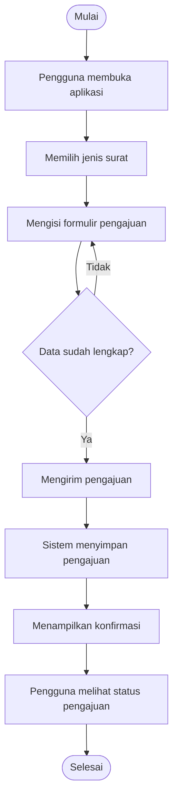
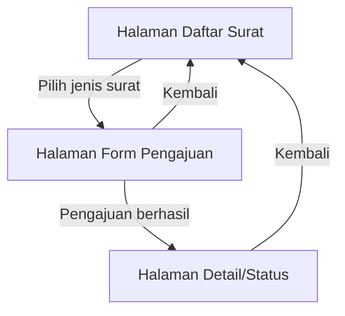
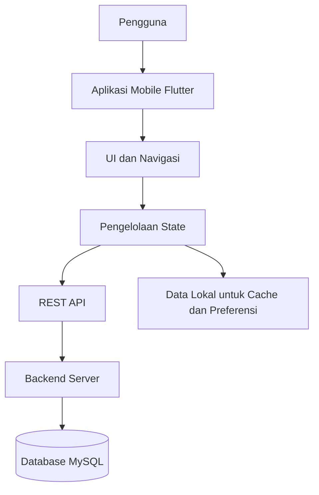
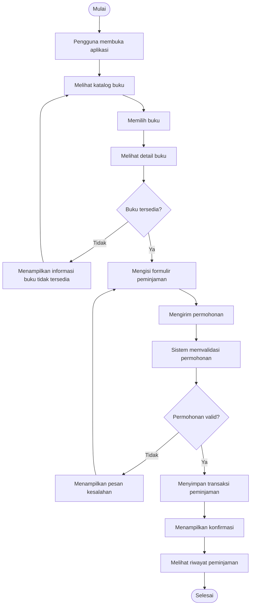

# Tes Konsep UTS — [Nama] — [NIM]

## Soal 1 — Konsep Aplikasi Bergerak dalam SI (CPMK-1)

Aplikasi mobile lebih tepat digunakan untuk layanan pengajuan surat keterangan mahasiswa karena memiliki beberapa karakteristik yang mendukung kebutuhan pengguna.

**1. Mobilitas dan fleksibilitas akses**

Aplikasi mobile dapat dibuka melalui smartphone tanpa mengharuskan mahasiswa datang ke loket administrasi atau menggunakan komputer. Mahasiswa bisa mengajukan surat dari rumah, kampus, maupun tempat lain selama memiliki akses internet.

Contoh penerapan: mahasiswa dapat membuka aplikasi, memilih jenis surat keterangan aktif kuliah, mengisi formulir, dan mengirim pengajuan melalui ponsel.

**2. Pemanfaatan fitur perangkat**

Aplikasi mobile dapat memanfaatkan fitur yang tersedia pada smartphone, seperti kamera, penyimpanan, dan notifikasi. Fitur tersebut dapat membantu proses pengajuan menjadi lebih praktis.

Contoh penerapan: mahasiswa dapat mengambil foto dokumen persyaratan menggunakan kamera ponsel dan mengunggahnya langsung ke aplikasi.

**3. Antarmuka yang praktis dan mudah digunakan**

Aplikasi mobile dirancang dengan tampilan yang menyesuaikan ukuran layar dan penggunaan sentuhan. Tombol, formulir, dan menu dapat dibuat sederhana sehingga mahasiswa lebih mudah memahami alur pengajuan.

Contoh penerapan: aplikasi menyediakan tombol "Ajukan Surat", kolom pengisian data, dan menu untuk memeriksa status permohonan.

Dengan ketiga karakteristik tersebut, aplikasi mobile dapat mengurangi ketergantungan pada layanan loket, mempersingkat proses administrasi, serta memberikan kemudahan bagi mahasiswa.

---

## Soal 2 — Dasar Pemrograman Dart (CPMK-1)

Dalam Dart, `List<String>` dapat digunakan untuk menyimpan kumpulan data berupa teks. Berikut contoh program sederhana untuk mengelola daftar jenis surat.

```dart
void main() {
  List<String> jenisSurat = [
    'Surat Keterangan Aktif Kuliah',
    'Surat Pengantar Penelitian',
    'Surat Keterangan Lulus'
  ];

  String jenis = 'Surat Keterangan Aktif Kuliah';

  if (jenisSurat.isEmpty) {
    print('Belum ada jenis surat yang tersedia.');
  } else {
    print('Daftar Jenis Surat:');

    for (var surat in jenisSurat) {
      print(surat);
    }
  }

  jenisSurat.add('Surat Rekomendasi');

  print('Jumlah jenis surat: ${jenisSurat.length}');
}
```

**Penjelasan kode:**

1. `List<String>` digunakan untuk membuat daftar yang berisi beberapa nama surat dalam bentuk teks.
2. Variabel `jenis` menyimpan salah satu jenis surat yang dipilih.
3. `isEmpty` digunakan untuk memeriksa apakah daftar surat masih kosong.
4. `for` digunakan untuk menampilkan setiap jenis surat yang tersimpan.
5. `add()` digunakan untuk memasukkan jenis surat baru ke dalam daftar.
6. `length` digunakan untuk mengetahui jumlah data dalam list.

**Dampak jika pengecekan `isEmpty` dihilangkan:**

Program tetap dapat menampilkan isi list menggunakan perulangan. Namun, program tidak lagi memberikan penanganan khusus ketika daftar surat kosong. Akibatnya, pengguna bisa saja hanya melihat hasil kosong tanpa memperoleh informasi bahwa belum ada jenis surat yang tersedia.

---

## Soal 3 — Pengenalan Widget Flutter (CPMK-2)

Flutter menggunakan widget sebagai komponen utama untuk membangun tampilan aplikasi. Setiap widget memiliki fungsi yang berbeda dalam menyusun antarmuka.

**Contoh susunan widget untuk halaman daftar pengajuan surat:**

| Widget | Fungsi |
|---|---|
| `MaterialApp` | Menjadi konfigurasi utama aplikasi Flutter. |
| `Scaffold` | Menyediakan struktur dasar halaman. |
| `AppBar` | Menampilkan judul halaman pada bagian atas. |
| `Column` | Menyusun beberapa widget secara vertikal. |
| `Text` | Menampilkan tulisan atau informasi. |
| `ListView.builder` | Menampilkan daftar pengajuan secara dinamis. |
| `Expanded` | Memberikan ruang fleksibel kepada widget di dalam `Column`. |

**Contoh kode:**

```dart
import 'package:flutter/material.dart';

void main() {
  runApp(const MaterialApp(
    home: HalamanSurat(),
    debugShowCheckedModeBanner: false,
  ));
}

class HalamanSurat extends StatelessWidget {
  const HalamanSurat({super.key});

  final List<String> daftarSurat = const [
    'Surat Keterangan Aktif Kuliah',
    'Surat Pengantar Penelitian',
    'Surat Keterangan Lulus',
  ];

  @override
  Widget build(BuildContext context) {
    return Scaffold(
      appBar: AppBar(
        title: const Text('Daftar Pengajuan Surat'),
      ),
      body: Column(
        children: [
          const Padding(
            padding: EdgeInsets.all(16),
            child: Text(
              'Pilih jenis surat yang ingin diajukan',
            ),
          ),
          Expanded(
            child: ListView.builder(
              itemCount: daftarSurat.length,
              itemBuilder: (context, index) {
                return ListTile(
                  leading: const Icon(Icons.description),
                  title: Text(daftarSurat[index]),
                  trailing: const Icon(Icons.arrow_forward_ios),
                );
              },
            ),
          ),
        ],
      ),
    );
  }
}
```

**Penyebab error jika `Expanded` tidak digunakan:**

`Column` tidak otomatis memberikan batas tinggi tertentu kepada anak widget yang membutuhkan ruang vertikal. Akibatnya, `ListView` dapat menerima batas tinggi yang tidak terbatas dan menimbulkan error seperti *Vertical viewport was given unbounded height*.

`Expanded` membantu membatasi ruang `ListView` berdasarkan sisa tinggi yang tersedia pada halaman.

---

## Soal 4 — Analisis Kebutuhan Aplikasi Bergerak (CPMK-2)

Aplikasi pengajuan surat mahasiswa membutuhkan kebutuhan fungsional dan nonfungsional agar dapat digunakan dengan baik.

**A. Kebutuhan fungsional**

Kebutuhan fungsional menjelaskan tindakan yang dapat dilakukan oleh pengguna melalui aplikasi.

| No. | Kebutuhan | Penjelasan |
|---|---|---|
| 1 | Pengajuan surat | Mahasiswa dapat memilih jenis surat dan mengirim formulir permohonan. |
| 2 | Pemeriksaan status | Mahasiswa dapat melihat perkembangan proses pengajuan surat. |
| 3 | Notifikasi | Sistem memberikan pemberitahuan ketika terdapat perubahan status pengajuan. |

**B. Kebutuhan nonfungsional**

Kebutuhan nonfungsional berkaitan dengan kualitas dan cara kerja aplikasi.

| No. | Kebutuhan | Penjelasan |
|---|---|---|
| 1 | Kemudahan penggunaan | Tampilan aplikasi harus mudah dipahami oleh mahasiswa. |
| 2 | Keamanan data | Informasi mahasiswa harus dilindungi dan tidak dapat diakses sembarang pengguna. |
| 3 | Responsivitas | Aplikasi harus memberikan tanggapan yang baik ketika pengguna memilih menu atau mengirim formulir. |
| 4 | Keandalan | Data pengajuan harus tersimpan dengan benar dan dapat diperiksa kembali. |

**C. Prioritas kebutuhan menggunakan MoSCoW**

| Prioritas | Kebutuhan | Alasan |
|---|---|---|
| Must Have | Pengajuan surat | Merupakan fungsi utama aplikasi. |
| Must Have | Melihat status pengajuan | Mahasiswa perlu mengetahui perkembangan permohonannya. |
| Must Have | Keamanan data | Informasi pribadi mahasiswa harus dilindungi. |
| Should Have | Notifikasi perubahan status | Membantu mahasiswa mengetahui informasi terbaru tanpa harus membuka aplikasi berulang kali. |
| Should Have | Tampilan responsif | Mempermudah penggunaan pada berbagai ukuran layar. |
| Could Have | Pengingat pengajuan yang belum selesai | Dapat menjadi fitur tambahan untuk meningkatkan kenyamanan. |
| Won't Have pada MVP | Integrasi dengan layanan eksternal yang belum dibutuhkan | Tidak menjadi bagian dari pengembangan versi awal karena bukan kebutuhan utama yang disebutkan. |

**D. User Flow kebutuhan utama**



Alur tersebut menunjukkan proses utama yang harus tersedia pada versi awal aplikasi, mulai dari pemilihan jenis surat hingga pengguna dapat melihat status permohonan.

---

## Soal 5 — Prinsip UI/UX Aplikasi Bergerak (CPMK-2)

Desain UI/UX berpengaruh terhadap kenyamanan pengguna ketika mengoperasikan aplikasi. Pada aplikasi pengajuan surat mahasiswa, terdapat beberapa prinsip yang perlu diperhatikan.

**1. Kesederhanaan tampilan**

Tampilan sebaiknya tidak dipenuhi elemen yang tidak diperlukan. Menu utama dapat berisi pilihan jenis surat, pengajuan baru, dan riwayat pengajuan.

**2. Kemudahan membaca informasi**

Ukuran tulisan, warna, dan jarak antarbagian perlu diatur agar informasi dapat dibaca dengan jelas. Status pengajuan juga sebaiknya memiliki penanda yang mudah dikenali, misalnya "Menunggu", "Diproses", dan "Selesai".

**3. Kemudahan interaksi**

Tombol harus memiliki ukuran yang nyaman untuk disentuh. Formulir juga sebaiknya menggunakan label yang jelas agar mahasiswa mengetahui data apa saja yang harus diisi.

**4. Konsistensi desain**

Warna, bentuk tombol, ikon, dan susunan menu perlu dibuat seragam pada setiap halaman agar pengguna tidak kebingungan ketika berpindah halaman.

**Contoh penerapan desain:**

- Halaman beranda menampilkan tombol pengajuan surat.
- Halaman formulir menampilkan kolom data mahasiswa dan pilihan jenis surat.
- Halaman riwayat menampilkan daftar pengajuan beserta statusnya.
- Halaman detail menampilkan informasi lengkap mengenai permohonan yang dipilih.

Dengan menerapkan prinsip tersebut, aplikasi dapat menjadi lebih mudah dipahami, mengurangi kesalahan pengisian, dan mempercepat aktivitas mahasiswa.

---

## Soal 6 — Navigasi Antarhalaman pada Flutter (CPMK-2)

Navigasi merupakan mekanisme untuk berpindah dari satu halaman ke halaman lain dalam aplikasi Flutter.

Beberapa fungsi navigasi yang dapat digunakan adalah:

**1. `Navigator.push()`**

Digunakan untuk membuka halaman baru di atas halaman yang sedang aktif.

Contoh:

```dart
Navigator.push(
  context,
  MaterialPageRoute(
    builder: (context) => const FormPengajuanPage(),
  ),
);
```

**2. `Navigator.pushNamed()`**

Digunakan untuk berpindah halaman berdasarkan nama route yang sudah didaftarkan pada aplikasi.

Contoh:

```dart
Navigator.pushNamed(
  context,
  '/detail',
  arguments: 'SURAT001',
);
```

**3. `Navigator.pop()`**

Digunakan untuk kembali ke halaman sebelumnya.

Contoh:

```dart
Navigator.pop(context);
```

**Contoh alur navigasi aplikasi:**



**Cara mengirim data antarhalaman:**

Data dapat dikirim melalui parameter konstruktor ketika menggunakan `MaterialPageRoute`.

Contoh:

```dart
Navigator.push(
  context,
  MaterialPageRoute(
    builder: (context) => DetailSuratPage(
      jenisSurat: 'Surat Keterangan Aktif Kuliah',
    ),
  ),
);
```

**Cara memberikan umpan balik kepada pengguna:**

Aplikasi dapat menggunakan `SnackBar` untuk memberikan informasi setelah pengguna melakukan tindakan.

```dart
ScaffoldMessenger.of(context).showSnackBar(
  const SnackBar(
    content: Text('Pengajuan surat berhasil dikirim'),
  ),
);
```

Dengan navigasi tersebut, pengguna dapat berpindah halaman secara terarah dan memperoleh informasi setelah melakukan suatu tindakan.

---

## Soal 7 — Model Data dan State Management Sederhana (CPMK-2)

Model data digunakan untuk mengatur struktur informasi yang akan disimpan dan diolah oleh aplikasi.

**A. Contoh model data `PengajuanSurat`**

```dart
class PengajuanSurat {
  final String id;
  final String namaMahasiswa;
  final String jenisSurat;
  final String tanggalPengajuan;
  final String status;

  PengajuanSurat({
    required this.id,
    required this.namaMahasiswa,
    required this.jenisSurat,
    required this.tanggalPengajuan,
    required this.status,
  });
}
```

**Penjelasan atribut:**

| Atribut | Kegunaan |
|---|---|
| `id` | Identitas unik untuk setiap pengajuan. |
| `namaMahasiswa` | Menyimpan nama mahasiswa yang mengajukan surat. |
| `jenisSurat` | Menunjukkan jenis surat yang diminta. |
| `tanggalPengajuan` | Menyimpan tanggal permohonan dibuat. |
| `status` | Menunjukkan perkembangan pengajuan surat. |

**B. Perbedaan `StatelessWidget` dan `StatefulWidget`**

- `StatelessWidget` digunakan untuk tampilan yang tidak membutuhkan perubahan state internal selama widget digunakan.
- `StatefulWidget` digunakan ketika tampilan perlu diperbarui berdasarkan perubahan data atau interaksi pengguna.

Pada halaman daftar pengajuan yang datanya dapat ditambahkan, diubah, atau dihapus, `StatefulWidget` lebih sesuai karena membutuhkan pengelolaan perubahan state.

**C. Fungsi `setState()`**

`setState()` digunakan untuk memberi tahu Flutter bahwa terdapat perubahan pada state sehingga tampilan perlu dibangun ulang (*rebuild*).

Contoh:

```dart
setState(() {
  daftarPengajuan.add(pengajuanBaru);
});
```

Ketika kode tersebut dijalankan, data baru dimasukkan ke dalam list dan Flutter memperbarui tampilan yang menggunakan data tersebut.

**D. Dampak jika `setState()` tidak digunakan**

Data pada variabel mungkin tetap berubah, tetapi Flutter belum tentu mengetahui bahwa tampilan harus diperbarui. Akibatnya, isi daftar pada layar dapat terlihat belum berubah sampai terjadi proses rebuild karena sebab lain.

---

## Soal 8 — Operasi CRUD pada Aplikasi Flutter (CPMK-2)

CRUD merupakan empat operasi utama dalam pengelolaan data, yaitu Create, Read, Update, dan Delete.

Misalnya aplikasi menggunakan list untuk menyimpan data pengajuan surat sementara.

```dart
List<PengajuanSurat> daftarPengajuan = [];
```

**1. Create — Menambahkan data**

Operasi Create digunakan untuk memasukkan data pengajuan baru.

```dart
setState(() {
  daftarPengajuan.add(
    PengajuanSurat(
      id: 'SURAT001',
      namaMahasiswa: 'Andi',
      jenisSurat: 'Surat Keterangan Aktif Kuliah',
      tanggalPengajuan: '09 November 2026',
      status: 'Menunggu',
    ),
  );
});
```

**2. Read — Menampilkan data**

Data dapat dibaca menggunakan perulangan atau `ListView.builder`.

```dart
ListView.builder(
  itemCount: daftarPengajuan.length,
  itemBuilder: (context, index) {
    final data = daftarPengajuan[index];

    return ListTile(
      title: Text(data.jenisSurat),
      subtitle: Text(data.status),
    );
  },
);
```

**3. Update — Mengubah data**

Operasi Update digunakan untuk memperbarui informasi pengajuan berdasarkan identitasnya.

```dart
final index = daftarPengajuan.indexWhere(
  (item) => item.id == 'SURAT001',
);

if (index != -1) {
  setState(() {
    daftarPengajuan[index] = PengajuanSurat(
      id: daftarPengajuan[index].id,
      namaMahasiswa: daftarPengajuan[index].namaMahasiswa,
      jenisSurat: daftarPengajuan[index].jenisSurat,
      tanggalPengajuan: daftarPengajuan[index].tanggalPengajuan,
      status: 'Diproses',
    );
  });
}
```

**4. Delete — Menghapus data**

Operasi Delete digunakan untuk menghapus data berdasarkan identitas tertentu.

```dart
setState(() {
  daftarPengajuan.removeWhere(
    (item) => item.id == 'SURAT001',
  );
});
```

**Mengapa menggunakan ID lebih tepat daripada index?**

ID memiliki nilai identitas yang membedakan satu data dengan data lainnya. Sementara itu, index menunjukkan posisi data dalam list dan dapat berubah ketika terdapat penambahan atau penghapusan.

Karena itu, penggunaan ID lebih aman untuk menentukan data yang akan diperbarui atau dihapus.

---

## Soal 9 — Penyimpanan Data pada Aplikasi Bergerak (CPMK-2)

Penyimpanan data dibutuhkan agar informasi yang dimasukkan pengguna dapat digunakan kembali.

**A. Perbedaan penyimpanan in-memory dan SharedPreferences**

| Aspek | In-memory | SharedPreferences |
|---|---|---|
| Lokasi penyimpanan | Memori aplikasi | Penyimpanan lokal perangkat |
| Ketahanan data | Hilang ketika aplikasi dihentikan atau dimulai ulang | Dapat tetap tersedia setelah aplikasi ditutup |
| Penggunaan | Data sementara | Preferensi dan data sederhana |
| Contoh | List sementara selama aplikasi berjalan | Pengaturan tema atau status login sederhana |

**B. Mengapa data in-memory dapat hilang?**

Data in-memory hanya disimpan selama aplikasi berjalan. Ketika aplikasi ditutup atau prosesnya dihentikan, data tersebut tidak otomatis disimpan ke penyimpanan permanen. Oleh karena itu, data perlu disimpan menggunakan mekanisme penyimpanan yang sesuai apabila ingin digunakan kembali.

**C. Mengapa SharedPreferences menggunakan proses asynchronous?**

Operasi penyimpanan dapat membutuhkan waktu karena melibatkan proses input dan output. Flutter menggunakan proses asynchronous agar aplikasi tidak harus menunggu secara langsung hingga proses penyimpanan selesai.

Contoh:

```dart
final prefs = await SharedPreferences.getInstance();

await prefs.setString('namaMahasiswa', 'Andi');
```

Kata kunci `await` membuat proses berikutnya menunggu sampai operasi asynchronous tersebut selesai. Dengan demikian, urutan proses program lebih mudah dikendalikan.

**D. Contoh penggunaan SharedPreferences**

```dart
import 'package:shared_preferences/shared_preferences.dart';

Future<void> simpanNama() async {
  final prefs = await SharedPreferences.getInstance();

  await prefs.setString('nama', 'Andi');
}

Future<String> ambilNama() async {
  final prefs = await SharedPreferences.getInstance();

  return prefs.getString('nama') ?? 'Nama belum tersedia';
}
```

**E. Pemilihan penyimpanan untuk aplikasi pengajuan surat**

- In-memory cocok untuk menampung data sementara ketika pengguna sedang mengisi formulir.
- SharedPreferences cocok untuk menyimpan preferensi sederhana, misalnya tema aplikasi.
- Database server lebih tepat untuk menyimpan data pengajuan surat yang harus dapat diakses mahasiswa dan petugas secara terpusat.

SharedPreferences tidak sebaiknya digunakan sebagai penyimpanan utama untuk seluruh transaksi administrasi karena kapasitas dan fungsinya ditujukan untuk data sederhana, bukan pengelolaan data transaksi yang kompleks.

---

## Soal 10 — Perancangan Aplikasi Bergerak (CPMK-2)

Aplikasi peminjaman buku perpustakaan dapat dikembangkan menggunakan Flutter sebagai aplikasi mobile, API sebagai penghubung antara aplikasi dan server, serta MySQL sebagai tempat penyimpanan data utama.

**A. Arsitektur aplikasi**

Komponen yang digunakan dalam aplikasi adalah:

| Komponen | Fungsi |
|---|---|
| Flutter | Membuat tampilan dan interaksi aplikasi mobile. |
| UI dan navigasi | Mengatur halaman katalog, detail buku, dan riwayat peminjaman. |
| Pengelolaan state | Memperbarui tampilan ketika data berubah. |
| REST API | Menghubungkan aplikasi mobile dengan server. |
| Backend | Memproses permintaan peminjaman dan pengelolaan buku. |
| MySQL | Menyimpan data buku dan transaksi peminjaman. |
| Penyimpanan lokal | Menyimpan preferensi atau data sementara yang diperlukan. |



**B. Dua kebutuhan utama aplikasi**

1. **Melihat katalog dan ketersediaan buku**

   Pengguna dapat mencari buku berdasarkan judul, penulis, atau kategori. Aplikasi juga menampilkan informasi apakah buku masih tersedia untuk dipinjam.

2. **Mengajukan peminjaman dan melihat riwayat**

   Pengguna dapat memilih buku, mengirim permohonan peminjaman, serta melihat daftar transaksi yang pernah dilakukan.

**C. User Flow peminjaman buku**



**D. Widget Flutter yang digunakan**

| Widget | Fungsi |
|---|---|
| `MaterialApp` | Mengatur aplikasi secara keseluruhan. |
| `Scaffold` | Menyusun struktur setiap halaman. |
| `AppBar` | Menampilkan judul halaman. |
| `TextField` | Memasukkan kata kunci pencarian buku. |
| `ListView.builder` | Menampilkan katalog buku. |
| `Card` | Menyajikan informasi buku dalam bentuk kartu. |
| `ElevatedButton` | Menjalankan tindakan peminjaman. |
| `Navigator` | Mengatur perpindahan halaman. |

**E. Model data buku**

Model `Buku` digunakan untuk menggambarkan informasi setiap buku yang tersedia di perpustakaan.

```dart
class Buku {
  final String id;
  final String judul;
  final String penulis;
  final String kategori;
  final bool tersedia;

  Buku({
    required this.id,
    required this.judul,
    required this.penulis,
    required this.kategori,
    required this.tersedia,
  });
}
```

**Penjelasan atribut:**

- `id`: kode unik untuk membedakan setiap buku.
- `judul`: nama atau judul buku.
- `penulis`: nama penulis buku.
- `kategori`: kelompok atau jenis buku.
- `tersedia`: menunjukkan apakah buku dapat dipinjam.

Untuk mencatat transaksi peminjaman, aplikasi juga dapat menggunakan model terpisah seperti berikut:

```dart
class Peminjaman {
  final String id;
  final String bukuId;
  final String judulBuku;
  final String tanggalPinjam;
  final String status;

  Peminjaman({
    required this.id,
    required this.bukuId,
    required this.judulBuku,
    required this.tanggalPinjam,
    required this.status,
  });
}
```

**F. Penerapan Create dan Read**

**Create (menambahkan transaksi peminjaman)**

Ketika pengguna mengajukan peminjaman, sistem membuat data transaksi baru. Pada contoh sederhana, data dapat dimasukkan ke dalam list menggunakan `setState()`.

```dart
List<Peminjaman> daftarPeminjaman = [];

void tambahPeminjaman(Buku buku) {
  if (!buku.tersedia) {
    return;
  }

  setState(() {
    daftarPeminjaman.add(
      Peminjaman(
        id: 'PINJAM001',
        bukuId: buku.id,
        judulBuku: buku.judul,
        tanggalPinjam: '09 November 2026',
        status: 'Menunggu Persetujuan',
      ),
    );
  });
}
```

**Read (menampilkan data peminjaman)**

Data transaksi yang telah tersimpan dapat ditampilkan menggunakan `ListView.builder`.

```dart
ListView.builder(
  itemCount: daftarPeminjaman.length,
  itemBuilder: (context, index) {
    final data = daftarPeminjaman[index];

    return ListTile(
      title: Text(data.judulBuku),
      subtitle: Text(
        'Tanggal: ${data.tanggalPinjam}\n'
        'Status: ${data.status}',
      ),
    );
  },
);
```

Contoh tersebut menggambarkan pengelolaan data pada sisi aplikasi. Untuk penggunaan nyata, validasi ketersediaan buku dan penyimpanan transaksi harus dilakukan melalui backend dan database agar data peminjaman tetap konsisten serta dapat diakses oleh petugas perpustakaan.

